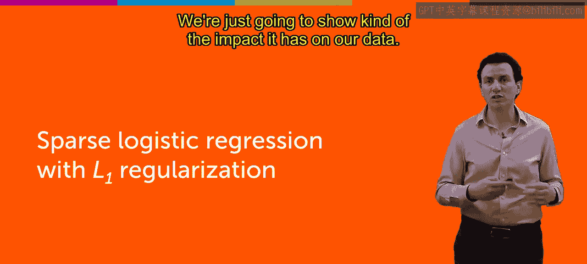
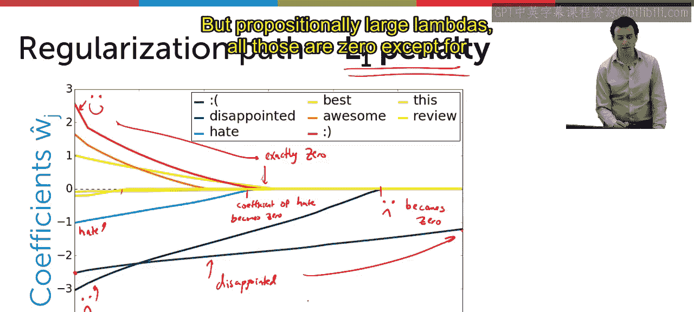

# 机器学习（分类，聚类和检索）：第3-4课：L1正则化的稀疏Logistic回归

在本节课中，我们将要学习L1正则化的Logistic回归。我们将探讨它如何通过引入稀疏性来改进模型，并比较其与L2正则化的效果差异。

## 概述

之前我们讨论了L2正则化的Logistic回归，并简要提及了L1正则化Logistic回归。本节我们将更详细地探讨L1正则化，特别是它如何产生稀疏模型，以及这种稀疏性对模型效率和可解释性的影响。

## 稀疏性的概念

首先，我们来回顾稀疏性的概念。一个稀疏模型意味着其许多权重系数 `Wj` 等于零。这有助于提升模型的效率和可解释性。

例如，假设我们拥有大量数据和特征，权重系数 `W` 的数量可能达到1000亿。这在许多实际场景中都会出现，例如某些垃圾邮件过滤器就学习了数百亿个参数。

这带来了两个问题：
1.  进行预测的成本可能很高，因为需要遍历1000亿个值。
2.  然而，如果我能得到一个稀疏解，即许多 `Wj` 实际上等于0，那么在预测时，我只需要关注非零系数 `Wj`。其他所有系数都可以忽略。如果1000亿个系数中只有10万个是非零的，那么进行预测的速度将快得多，这在实践中差异巨大。

稀疏性的另一个影响是，它可以帮助你解释那些非零系数。你可以观察少量非零系数，并尝试理解预测是如何做出的。这种解释在实践中非常有用。

## L1正则化Logistic回归

那么，如何学习一个具有稀疏性的Logistic回归分类器呢？答案是使用L1正则化惩罚项。

我们采用相同的对数似然函数 `l(W)`，但额外添加一个L1惩罚项，即所有权重系数绝对值的和：`|W0| + |W1| + ... + |WD|`。

通过将平方和（L2）改为绝对值之和（L1），我们就得到了所谓的**L1正则化Logistic回归**，它能产生稀疏解。这是一个微小的改动，却能带来稀疏解。

与L2正则化类似，这里我们也有一个参数 `λ`，用于控制引入的正则化强度，即惩罚的力度。目标函数变为数据的对数似然减去 `λ` 乘以这个L1惩罚项。

*   当 `λ = 0` 时，没有正则化，我们得到标准的极大似然解。
*   当 `λ = ∞` 时，只有惩罚项，这将导致所有权重系数 `W` 都为0。
*   我们真正关心的是 `λ` 介于0和无穷大之间的情况，这会产生稀疏解，其中一些 `Wj` 不为零，但希望许多其他 `Wj` 恰好为零。

## 系数路径对比

现在，让我们重新审视系数路径。下图展示了使用L2惩罚时的系数路径。可以看到，当 `λ` 参数较小时，学习到的系数较大；当 `λ` 参数增大时，系数变小。它们从大变小，但永远不会恰好等于零。

然而，如果你观察使用L1正则化时的系数路径，会得到更有趣的结果。例如，开始时，“笑脸”符号的系数是一个较大的正值，但最终会恰好变为0。同样，“皱眉脸”符号的系数是一个较大的负值，但最终也会变为0。你可以看到许多其他词的系数也遵循这个规律。

（注：此处课程中提到的例子是基于产品评论的情感分析，试图判断评论是正面还是负面。）

一个快速的提醒：我们可以观察哪个系数在最长的时间内保持非零。在上图中，有一条线从未触及零或保持为零，这就是单词“disappointed”（失望）的系数。你可能会失望地发现，“皱眉脸”符号并不是那个保持最久的系数。开始时，它的系数并不像“皱眉脸”那么大，因此不那么显著，但它是保持负值时间最长的系数。所以，“皱眉脸”符号可能不是最重要的，“笑脸”符号也不如“disappointed”重要。这可能是因为“disappointed”在更多评论中出现，并且当你说“失望”时，通常意味着这是一条负面评论。

你可以看到这些转变：像“used”（使用过）这样的小数字系数很早就变为零；“笑脸”符号持续了一段时间，然后变为零；“皱眉脸”符号持续了更长时间，然后也恰好变为零。但对于足够大的 `λ`，除了“disappointed”的系数外，所有这些都变为零。

## 总结

本节课中，我们一起学习了L1正则化的Logistic回归。我们了解到，通过在目标函数中添加所有权重系数绝对值的和作为惩罚项，可以促使模型产生稀疏解，即许多系数恰好为零。这种稀疏性显著提高了模型预测的效率，并增强了模型的可解释性，使我们能够聚焦于少数关键特征。通过对比L1和L2正则化的系数路径，我们直观地看到了L1正则化在诱导稀疏性方面的独特优势。