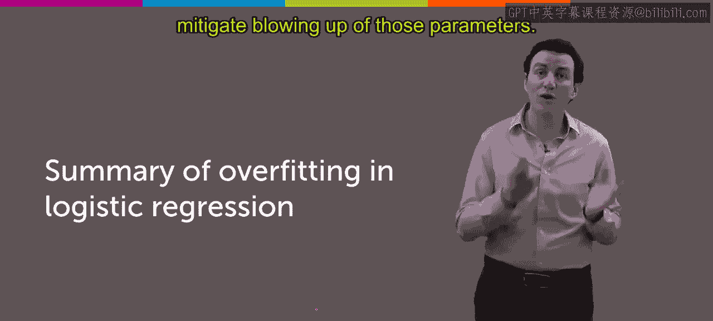

# 华盛顿大学《机器学习（分类，聚类和检索，第3-4课⧸共4课）｜Machine Learning》中英字幕 p57 56_Logistic回归中过拟合和正则化的回顾.zh_en -BV1Sr421F7N7_p57-

。

Great， we've now seen a notion of overfitting in classificationification。

 especially logistic regression， we've seen how the serum boundaries get really complicated as we start overfitting how those parameter values tend to increase。

 how we get overconfident about our predictions， and we introduce a notion of regularization to try to mitigate those blowing up of those parameters。

😊。

And so by doing so， we've seen how we can take theide of logistic regression which werere so far kind the more the theoretical side into being ready for real practical work and you should be able to take those ideas and implement them in practice using L2 regularization and we've also seen how L1 regularization can make sense。

 we haven't described how to implement that， but it's similar to what you did for the lastso problem before。

😊。