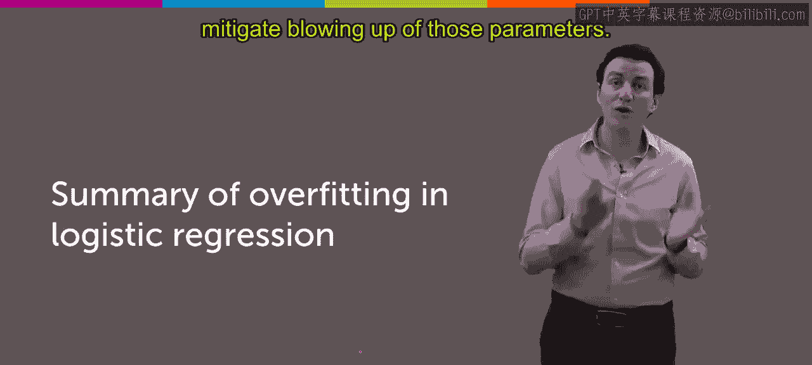

# 机器学习（分类，聚类和检索）：第3-4课：Logistic回归中过拟合和正则化的回顾

在本节课中，我们将回顾分类问题，特别是Logistic回归中的过拟合现象，并学习如何使用正则化技术来缓解这一问题。我们将探讨过拟合如何导致决策边界复杂化、参数值增大以及预测过度自信，并介绍L2和L1正则化的基本概念。

## 过拟合现象回顾

上一节我们介绍了分类模型的基本概念。本节中，我们来看看Logistic回归中的过拟合问题。

过拟合是指模型在训练数据上表现很好，但在新数据上泛化能力差的现象。在Logistic回归中，过拟合通常表现为决策边界变得异常复杂，参数值显著增大，并且模型对预测结果表现出过度自信。

以下是过拟合在Logistic回归中的几个主要表现：

*   决策边界变得非常复杂和扭曲，以“完美”拟合训练数据中的每个点，包括噪声。
*   模型参数（权重）的绝对值倾向于变得非常大。
*   模型输出的概率值会非常接近0或1，表现出对预测的过度自信。

## 正则化引入

为了解决过拟合问题，我们引入了正则化技术。正则化的核心思想是在优化目标（如损失函数）中添加一个惩罚项，以限制模型参数的大小，从而鼓励更简单、更平滑的模型。

在Logistic回归中，我们通常将原始的损失函数（如负对数似然损失）与一个正则化项相加，形成新的优化目标。

**公式表示如下：**
`新的目标函数 = 原始损失函数 + λ * 正则化项`

其中，**λ** 是一个超参数，用于控制正则化的强度。λ 值越大，对模型复杂度的惩罚越重。

## L2正则化

我们首先详细探讨最常用的L2正则化。L2正则化也称为岭回归（Ridge Regression）或权重衰减，它在目标函数中添加了所有权重参数的平方和作为惩罚项。

**L2正则化的目标函数公式为：**
`J(w) = 原始损失函数 + (λ/2) * ||w||²`

这里的 `||w||²` 表示权重向量 **w** 的L2范数的平方，即所有 `w_j²` 的和。添加这项惩罚后，优化过程会倾向于让权重值整体变小，但通常不会将任何权重精确地压缩到零。

使用L2正则化的Logistic回归模型能够有效防止参数值“爆炸式”增长，从而得到更平滑的决策边界和更好的泛化性能。你现在应该能够理解这个思想，并在实践中使用L2正则化来实现它。

## L1正则化简介

除了L2正则化，L1正则化也是常用的技术。L1正则化在目标函数中添加的是权重参数的绝对值之和作为惩罚项。

**L1正则化的目标函数公式为：**
`J(w) = 原始损失函数 + λ * ||w||₁`

这里的 `||w||₁` 表示权重向量 **w** 的L1范数，即所有 `|w_j|` 的和。L1正则化倾向于产生稀疏的权重向量，即它会将一部分不重要的特征的权重直接压缩为零，从而实现特征选择的效果。

虽然我们在这里没有详细描述L1正则化的具体实现方法，但其思路与你之前在线性回归问题中接触过的Lasso回归是相似的。

## 总结

本节课中，我们一起学习了Logistic回归中的过拟合问题及其解决方案。我们回顾了过拟合如何导致复杂的决策边界和增大的参数值，并引入了正则化作为关键的缓解手段。我们重点介绍了L2正则化的原理与公式，它能有效控制参数大小，提升模型泛化能力。此外，我们也简要了解了L1正则化及其可能带来的特征选择优势。通过这些方法，我们可以将Logistic回归从理论层面推进到实际应用阶段，为处理现实世界的数据做好准备。