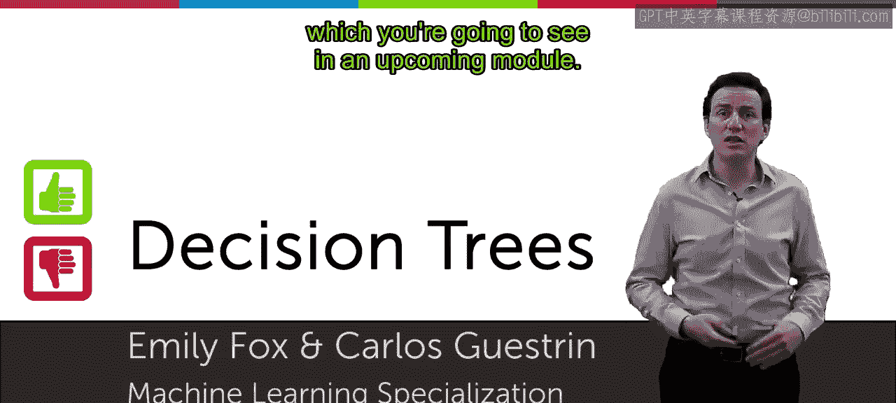
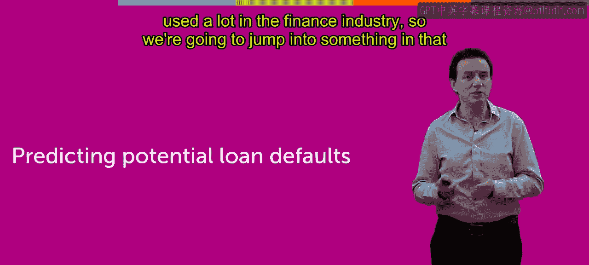
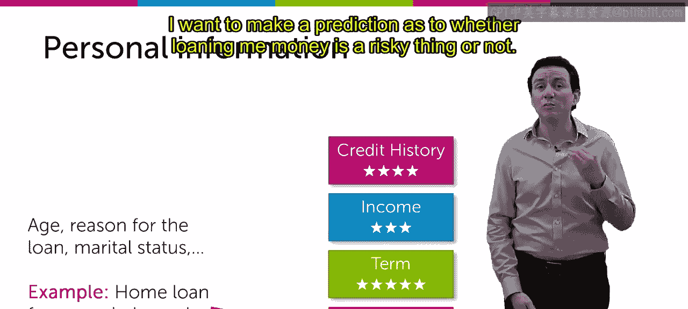
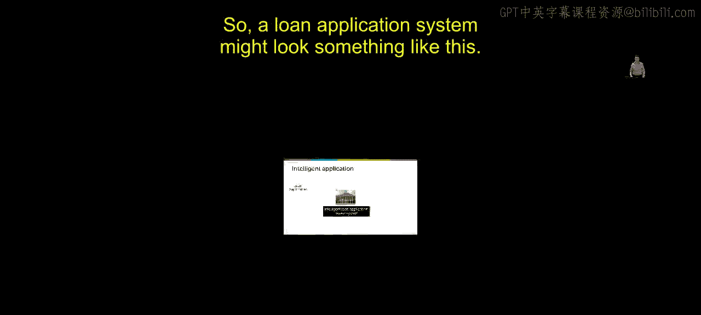
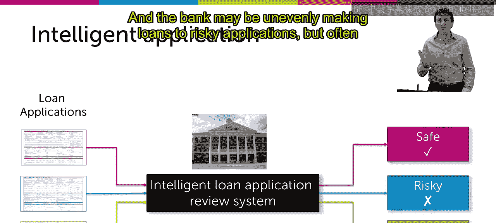
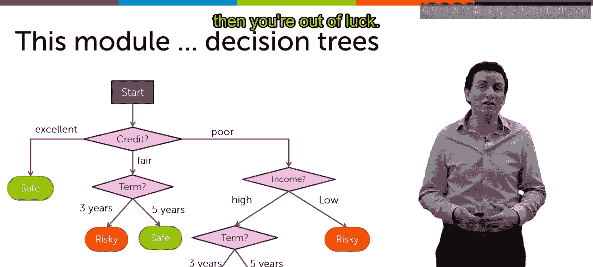

# 华盛顿大学《机器学习（分类，聚类和检索，第3-4课⧸共4课）｜Machine Learning》中英字幕 p58 57_使用决策树预测贷款违约.zh_en -BV1Sr421F7N7_p58-

。

Now that we've taken a deep dive into a linear classifier， namely logistic regression。

 let's jump into a different kind of classifier， one called a decision tree。

 which is extremely useful in practice， especially when combined with something called boosting。

 which we want to see in an upcoming module。😊。

In this module we're going to jump into another really interesting real world example which falls more into the financial data modeling part。

 it turns out that decision trees are extremely useful and used a lot in the finance industry。

 so we want to jump into something in that domain to give you a little bit more experience into that kind of data。

😊。

In particular， when I look at evaluating loan applications， so let's say I want to buy a house。

 I'm excited I want to buy this particular house and to buy it， I don't have all the money。

 I need to take a loan from the bank So the bank is going to look at some properties of my history。

 like my credit， what has it been like in the past， how much money I make， how long my loan is。

 how much time I'm willing to spend for I pay it off and other personal information about me。

 like my gender age and so on。 and it's going to take that information and try to make a prediction as to whether loaning me money is a risky thing or not。

So let me give you a little bit more details on the kinds of things that people measure when they try to make loan application decisions。

So typically you look at credit history， which looks at all the other loans I've taken in the past in my credit cards and all that。

 and have I paid those off on time。Then we look at my income， how much money do I make today？

And you might also look at what's called the term of the loan， which maybe it's three years。

 five years， 15 years， 30 years， which is the period of time I'm going to take to pay back that loan。

 so let's take a three loan means I pay back within three years。And finally。

 I look at information about a particular individual like my age of whether married and so on。

 so given this information， I want to make a prediction as whether loaning me money is a risky thing or not。

So a loan application system might look something like this。 you get as input。

 all that loan information they fill up a bunch of forms， it goes through a system。

 maybe a machine learning system or maybe a minor created one。

 hopefully a machine learning system which can make a prediction whether this loan is safe it's okay to make that loan or whether it's risky So some applications is going to be classified as safe while others will come in and be classified as risky and the bank may be unusually making loans to risky applications but often to save ones。

😊。

And we can view this loan application process as a classification problem。

 I'm given this input information from my form， and let's call that X all information about me and my loan。

 I push it through the classified model which is going to make a decision say y plus one。

 y hat equal plus one if it's a safe loan and y hat equal equal minus1 if it's a risky loan。😊。

In this module， we're going to use what's called Decion  three classifier。

 might look a little bit like this。You start with the application and you look at some particular feature of the particular input。

 let's say what is my credit been like If my credit has been excellent。

 I just make the loan without looking at any other information about me but if my credit has been only fair。

 I look at the term of the loan if the loan is short， maybe it's too risky but if the loan is long。

 maybe I'll take enough time to pay it off。Now if my credit is poor， I don't stop there。

 I'll look further at what my income is， even if my credit isn't possibly be poor but I make a bunch of money。

 maybe I'm willing to make a longterm loan to somebody with poor credit that makes a bunch of money。

 but if you don't make that much money and your credit is poor， then you're out of luck。

 no loans for you。

