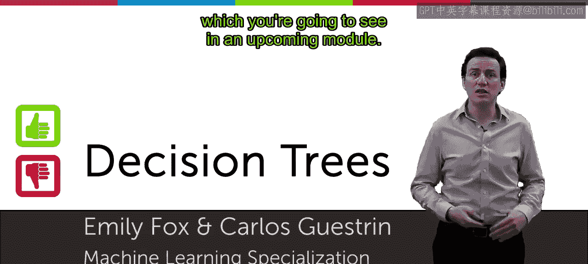
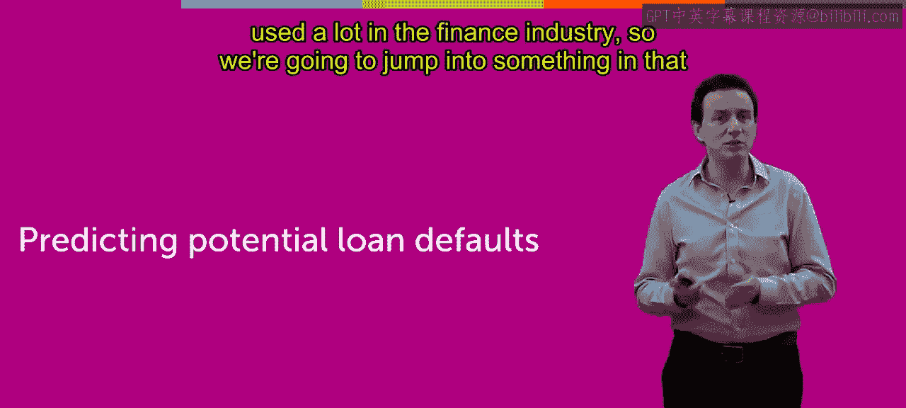
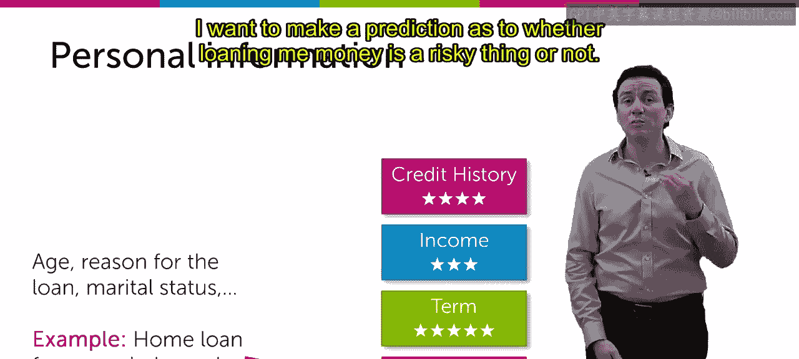
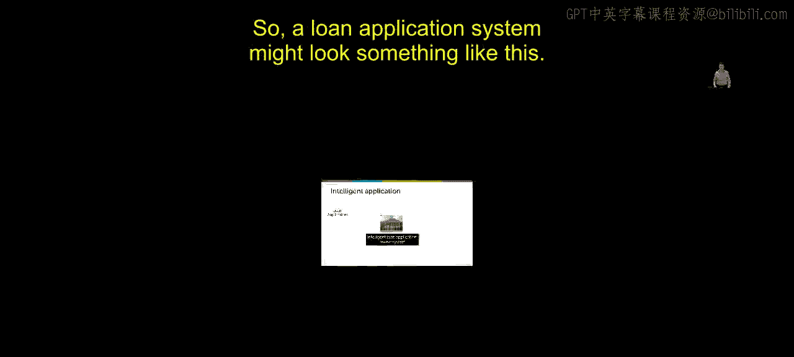
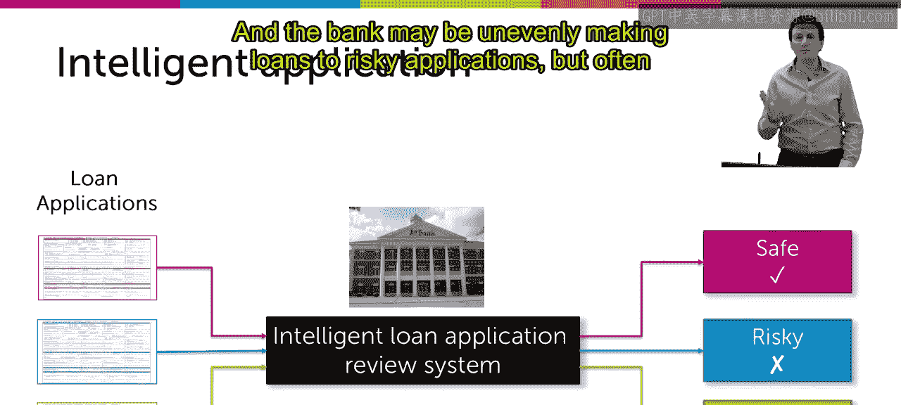
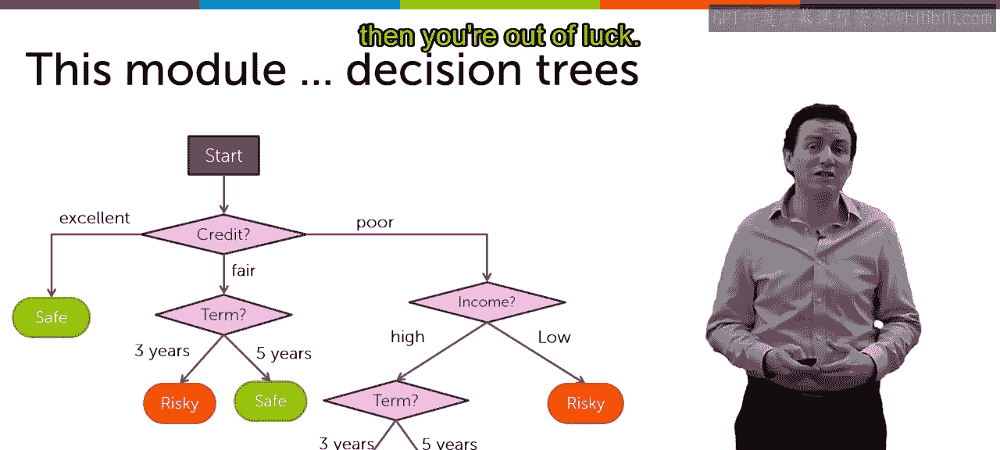

# 机器学习（分类，聚类和检索）：第3-4课：使用决策树预测贷款违约 💳

在本节课中，我们将要学习一种新的分类器——决策树。我们将深入探讨其在金融领域，特别是贷款违约预测中的应用。决策树在实践中非常有用，尤其是在与后续模块中将要介绍的“提升”方法结合时。

---

## 概述

上一节我们深入探讨了线性分类器，即逻辑回归。本节中，我们来看看另一种分类器：决策树。决策树在实践中极其有用，尤其是在金融数据建模领域。我们将通过一个贷款申请评估的真实案例来学习它。

---

## 贷款申请评估问题

假设我想买一套房子，但资金不足，需要向银行申请贷款。银行会审查我的历史记录，例如信用状况、收入水平、贷款期限（如3年、5年、30年）以及其他个人信息（如年龄、婚姻状况）。银行将利用这些信息来预测贷款给我是否存在风险。

以下是贷款决策中通常考量的因素：
*   **信用历史**：审查过往贷款和信用卡的还款记录。
*   **收入**：评估当前的收入水平。
*   **贷款期限**：考虑偿还贷款的时间长度。
*   **个人信息**：如年龄、婚姻状况等。

基于这些信息，目标是预测贷款是否安全。

---

## 作为分类问题的贷款审批

我们可以将贷款审批过程视为一个分类问题。输入信息（来自申请表格的所有数据）记为 **X**。分类模型会处理这些信息并做出决策：预测结果 **ŷ = +1** 表示安全贷款，**ŷ = -1** 表示风险贷款。

---

## 决策树分类器简介

在本模块中，我们将使用决策树分类器。它的工作方式可能如下所示：

决策树从一个申请开始，首先检查输入的某个特定特征，例如“信用状况”。如果信用“优秀”，则直接批准贷款，无需查看其他信息。如果信用“一般”，则进一步查看“贷款期限”：短期贷款可能被视为风险较高，而长期贷款则可能被接受。如果信用“差”，则不会停止，而是继续查看“收入”水平：即使信用差，但如果收入很高，银行可能愿意提供长期贷款；但如果收入也不高，那么申请很可能被拒绝。

---

## 总结

本节课中我们一起学习了决策树分类器，并了解了它如何应用于预测贷款违约这一金融领域的实际问题。我们看到了决策树如何通过一系列基于特征（如信用、收入、期限）的规则性判断来做出分类决策。下一模块，我们将探讨如何通过“提升”技术来进一步增强决策树的性能。