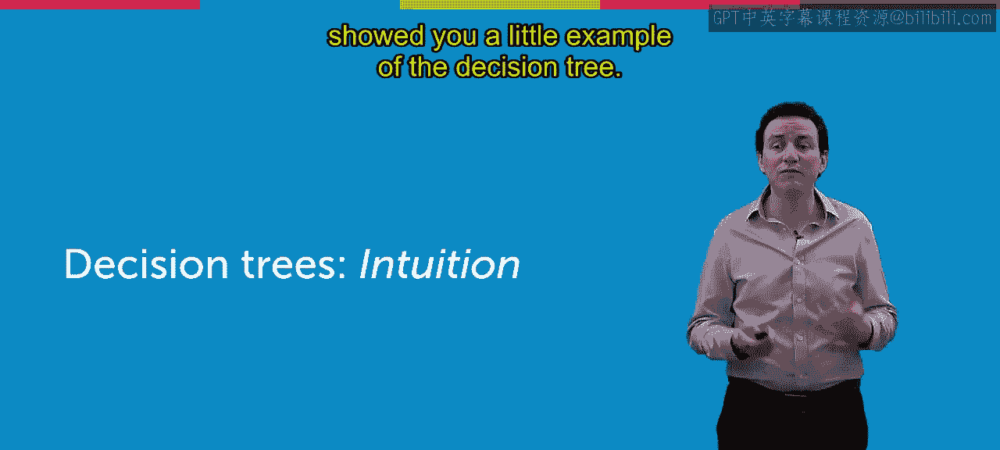
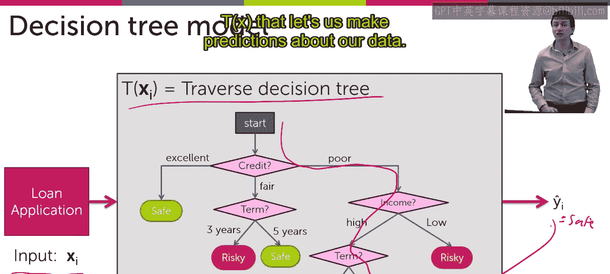

# 华盛顿大学《机器学习（分类，聚类和检索，第3-4课⧸共4课）｜Machine Learning》中英字幕 p59 58_决策树的直观理解.zh_en -BV1Sr421F7N7_p59-

。

We've discussed a little bit of this loan application domain and showed you a little example for a decision tree。

 let's dive in and explore the decision tree a little bit further。😊。

So I start from my loan application and I could go down one branch or one path of this decision tree and say。

 if this application is somebody with a credit that's fair and is a short termm loan。

 let's say three a loan， then this is considered a risky application。

If I take another path of the decision tree， let's say I look at somebody who's credit the poor。

 but the income as high， but it's a short term loan again。

 I might say that that's a risky application。In general。

 I'm going to be given an input X sign in this case。

 that has assignments to each one of those input features that say credit poor income high and term five years or longer term loan。

 and then I traversed the path down the tree to make a prediction which in this case why had I will be safe So this is the model predicts to be a safe loan to make。

So just in general， the task that we're looking at is given some input X I。

 I'm going to traverse that decision tree down the particular branches of that input。

 which in the example that we just did was a traverseo that looks like this。

 and then I'm going to make a prediction why hat I， which might be that this loan is safe。

And so our goal is to learn that tree。T of x that lets us make predictions about our data。

