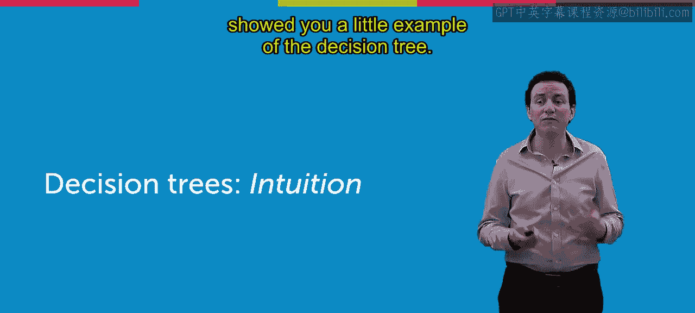
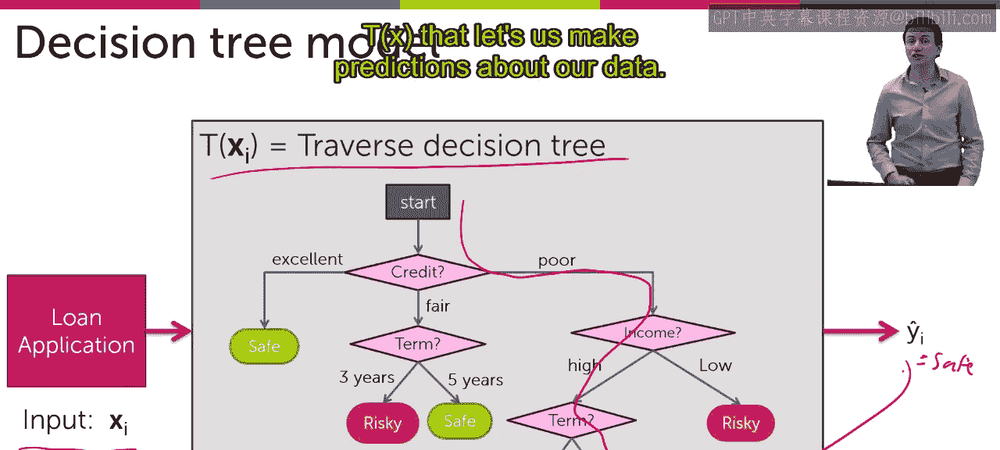

# 机器学习（分类，聚类和检索）：第3-4课：决策树的直观理解


在本节课中，我们将深入探讨决策树模型。我们将从直观理解开始，学习决策树如何根据输入特征进行预测，并明确我们的目标是学习一个能够对数据做出预测的树结构模型。

## 决策树的基本概念



上一节我们简要介绍了贷款申请领域的决策树示例。本节中，我们来看看决策树是如何运作的。

我们从一份贷款申请开始。我可以沿着决策树的某一条分支路径进行判断。例如，如果申请人的信用评级为“一般”，且贷款期限为短期（例如3年），那么这份申请将被视为高风险。

如果我选择另一条路径，例如查看一个信用评级为“差”，但收入“高”，且同样是短期贷款的申请人，我可能也会判定其为高风险申请。

通常，我们会得到一个输入 **X**，它包含了对每个输入特征的赋值。例如，信用=差，收入=高，期限=5年或更长的贷款。然后，我沿着树向下遍历相应的路径，以做出预测 **ŷ**。在这个例子中，模型预测这是一笔安全的贷款。

总而言之，我们面对的任务是：给定某个输入 **Xᵢ**，我将沿着该输入对应的特定分支遍历决策树，然后做出预测 **ŷᵢ**（例如，这笔贷款是安全的）。

因此，我们的目标是学习那棵能让我们对数据进行预测的树 **T(x)**。

## 决策树的构建与遍历

以下是决策树构建和预测过程的核心步骤：

1.  **从根节点开始**：决策树从顶部（根节点）的一个问题或条件开始。
2.  **根据特征值选择分支**：根据输入数据在该节点特征上的取值，选择向左或向右的分支。
3.  **递归遍历**：重复步骤2，沿着树向下移动，直到到达一个叶节点。
4.  **在叶节点获得预测**：叶节点不包含判断条件，而是直接提供一个预测结果（例如，“安全”或“风险”）。

用伪代码描述这一预测过程如下：
```python
def predict(tree, input_x):
    node = tree.root
    while node is not leaf:
        if input_x[node.feature] <= node.threshold:
            node = node.left_child
        else:
            node = node.right_child
    return node.prediction
```

## 学习决策树的目标

我们的核心目标是**从数据中自动学习**出决策树的结构。这意味着算法需要自行决定：
*   在每个节点上应该使用哪个特征进行划分。
*   该特征的划分阈值是多少。
*   何时停止划分并创建叶节点。

学习过程通常涉及衡量划分“好坏”的指标（如信息增益、基尼不纯度），并通过递归分割数据来构建树，直到满足停止条件（如达到最大深度、节点内样本数过少等）。




本节课中我们一起学习了决策树的直观工作原理。我们明白了决策树如何通过一系列基于特征的判断来对输入样本进行分类或回归预测，并且明确了机器学习的目标是自动从数据中构建出这棵有效的决策树。在接下来的课程中，我们将深入探讨用于构建决策树的具体算法。