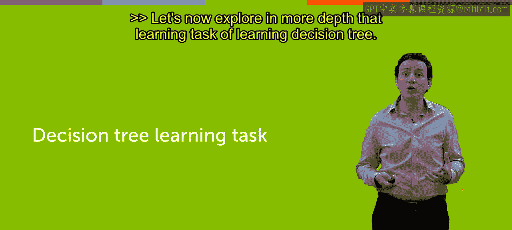
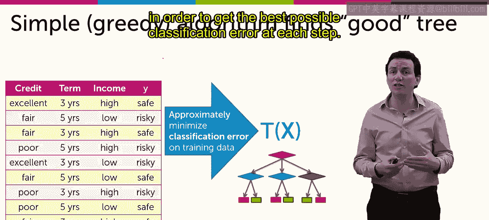

# 华盛顿大学《机器学习（分类，聚类和检索，第3-4课⧸共4课）｜Machine Learning》中英字幕 p60 59_从数据学习决策树的任务.zh_en -BV1Sr421F7N7_p60-

。

Let's now explore in more depth that learning task of a learning decision tree So just like before we're giving a set of training data and we start some features from that and then we're going to take this decision tree model T of x and use it to predict why hot so let's explore the T of x in a little bit more detail and discuss what the learning process might look like here。

In particular， we're given a data set here， which is a table where each row corresponds to a data point and we have our features here。

 H1 of x， H2 of x， H3 of x， so credit term income so in this example is's only going to be three features and I'm going to try to predict what we call loan status。

Whi is this variable Y， which is whether the loan is risky or safe。

 and our goal is to learn a decision tree that can help us make that prediction given one or more of these input features。

More generally， we're going to be given n observations from our data of the form X，Yi。

 where YI is the true label， and we're trying to optimize some kind of quality metric that tries to fit a tree that is as good as possible with respect to that metric。

And in the case of decision trees， the metrics we're going to use is just straight up classification error。

 There are other metrics you may use for decision trees。 but just for this module。

 we just want to focus straight up on classification error and classification error measures the fraction of mistakes that we make when we try to make prediction of the training data。

 So that's the number of incorrect predictions divided by the total number of examples just like we saw in the logistic regression case。

 the best possible value here is0， no mistakes and the worst possible value here is one。

 I made as many data states as there are data points。

 So hopefully don have error1 hopefully we have error closer to0。😊。

So now that way we've seen an no classification error。

 we can state more clearly where a learning goal is given a data set。

 find a tree that minimizes the classification error The question is how hard is this problem。

 how hard is this learning task and it turns out that this is an extremely hard learning task there's exponentially many combinations of decision trees out there even if you consider just one branch of decision tree selecting what features to come next in an order can be a really hard problem and lead to exponentially many combinations and in fact for those familiar with this。

 this is an example what's called an NP hard problem。😊。

So it's a really hard problem and there are no approximation algorithms for this problem with guarantees。

 but there is some simple ideas of heuristics that tend to perform extremely well in practice and we're going to talk about one such idea today。

 which is called the greedy simple greedity algorithm basically。

 and we're going to incrementally build a tree， one layer at a time in order to get the best possible classification error at each step。

😊。

