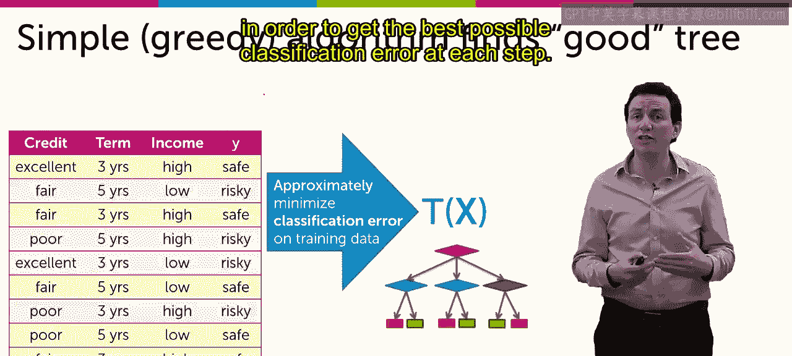

# 机器学习（分类，聚类和检索）：第3-4课：从数据中学习决策树的任务


在本节课中，我们将深入探讨如何从数据中学习决策树模型。我们将了解学习任务的定义、评估模型质量的指标，以及为什么寻找最优决策树是一个计算难题。最后，我们将介绍一种在实践中非常有效的启发式方法。


---

上一节我们介绍了决策树的基本概念。本节中，我们来看看如何从给定的数据集中学习一个决策树模型。

我们被给予一个训练数据集。这个数据集是一个表格，其中每一行对应一个数据点，每一列对应一个特征。例如，在这个例子中，我们有三个特征：**信用期限**、**收入**，以及我们试图预测的目标变量**贷款状态**（Y），即贷款是“高风险”还是“低风险”。

我们的目标是学习一个决策树模型 **T(x)**，它能够根据一个或多个输入特征来预测 Y 的取值。

更一般地说，我们被给予 n 个形式为 **(Xi, Yi)** 的观测数据，其中 **Yi** 是真实标签。我们的任务是优化某个质量指标，以拟合一个在该指标下尽可能好的树。

对于决策树，我们将使用的指标是**分类错误率**。决策树也可以使用其他指标，但本模块我们专注于分类错误率。分类错误率衡量的是我们在训练数据上做出预测时犯错的**比例**。

其计算公式如下：
```
分类错误率 = 错误预测的数量 / 总样本数量
```
与逻辑回归的情况类似，最佳可能值是 **0**（没有错误），最差可能值是 **1**（每个预测都错了）。我们希望错误率尽可能接近 0。

---

既然我们已经明确了分类错误率，就可以更清晰地陈述学习目标：**给定一个数据集，找到一个能最小化分类错误率的决策树**。

接下来的问题是：这个学习任务有多难？事实证明，这是一个**极其困难**的学习任务。即使只考虑决策树的一个分支，选择下一个要使用的特征及其顺序也会导致**指数级**的组合数量。

事实上，对于熟悉计算复杂性理论的读者来说，这是一个**NP难问题**的典型例子。这是一个非常困难的问题，目前没有能提供性能保证的近似算法。

---

然而，存在一些简单的启发式思想，在实践中往往表现极佳。今天我们将讨论其中一种思想，称为**简单的贪心算法**。

其基本思路是：我们**逐步地、一层一层地**构建决策树，在每一步都力求获得当前可能的最佳分类错误率。

---



本节课中，我们一起学习了决策树的学习任务。我们明确了目标是最小化分类错误率，并认识到寻找全局最优决策树是一个NP难问题。最后，我们引入了贪心算法作为构建决策树的一种有效且实用的启发式方法。在接下来的课程中，我们将详细探讨这种贪心算法的具体步骤。