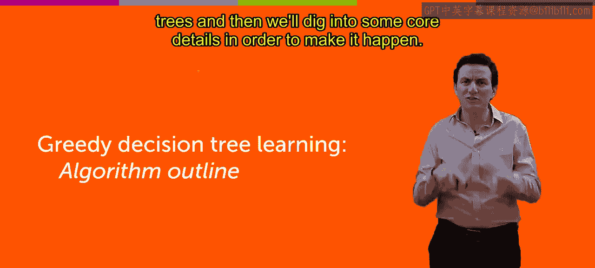
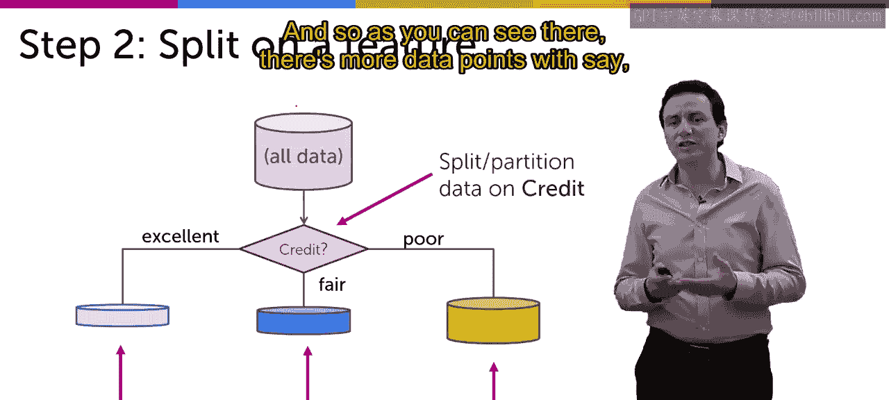
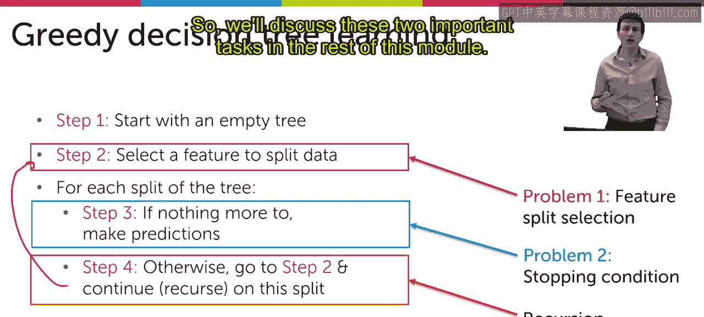

# 华盛顿大学《机器学习（分类，聚类和检索，第3-4课⧸共4课）｜Machine Learning》中英字幕 p61 60_递归贪心算法.zh_en -BV1Sr421F7N7_p61-

。

We'll start with a high level outline of the learning algorithm for decision three。

 and then we'll dig into some core details in order to make it happen。

So typically we start to empty tree where you have some data。

 some loans labeled as say labeled as risky， and this node in the tree， which's called the root node。

 contains the whole data set。And what I'm showing here is a histogram of the number of values that have safe or risky loans。

 so this can be viewed as all of the data。 So I'm going to pick a feature to split on， split a tree。

 So for example here I'm splitting the tree on credit and credit can take three possible values so I can take the subset of the data that corresponds to Xon credit and just feed it here at the left side of that tree。

😊，I can take the subsetcellular of data that corresponds to fair credit value。

 which corresponds to middle side of the tree， and then poor is the subsetcellularr data to the right side of the tree。

And so as you can see there， there's more data points with say。

 poor credit than there are those of excellent credit。

Now that we've assigned subsets of data to which one of these subsequent nodes。

 we can visualize that data using histograms again。

 so the top histogram here corresponds to all the data。

 but the histogram on the branch here on the left corresponds to the data points where credit was excellent。

The ones in the middle corresponds to the data points where credit was fair and the ones in the right corresponds to data points where credit was poor as we can see the。

Set where credit was excellent， has a lot of safe loans。

 where the one of credit was poor has more risky loans than it has safe loans。

And next we'll continue splitting each one of these branches， each one of the data sets。 however。

 if you consider this first node， the node where the credit was excellent。

 you see that all of the examples in this node are labeled as safe， these are all safe loans。

 so there's no point in keeping on splitting we just predict that everything that has excellenton credit is a safe loan。

Now， for the other two， we need to keep on going。 So for example。

 for the loans where we have a credit rating of far。

 we're going to build a next tree going down from there and for those data points where the credit rating was poor we again well keep on building trees from there。

So that's the recursive greedy algorithm that we're going to discuss and build today。

We can now discuss at a high level degree greedD algorithm for learning a decision three and it's a very simple algorithm。

 I'll start see with an empty tree and I pick a feature to split on in our case to split on credit so we decided to say take my data and split on which data points have X credit。

 which ones have fair credit and which ones have poor credit。😊。

And then for each subset of data excellent， fair poor。

 I continue thinking about what to do next so I decide in the case of X credit。

 there's nothing else to do so I stop， but in the other two cases there was more to do and what I do is what's called the recursion I go back to step two but only look at a subset of the data that has credit far and then only look at a subset of data that has credit poor。

Now， if you look at this algorithm so far， it sounds a little abstract。

 but there's a few points that we need to make more concrete。

 We have to decide how to pick the feature to split on We split on credit in our example。

 but it could have split on something else like the term of the loan or my income。

And then since we have a recursion here at the end， we had figured out when to stop recursion。

 when to not go and expand another node in the tree。

 So we'll discuss these two important tasks in the rest of this module。

。