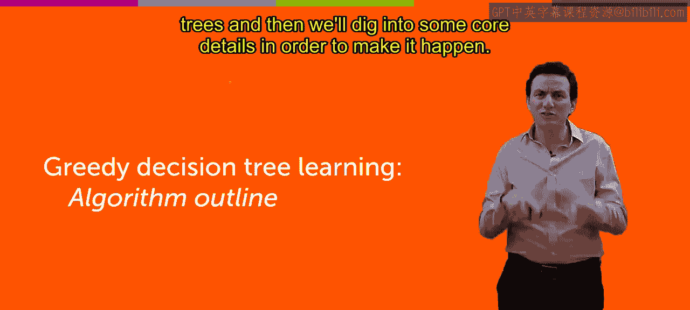
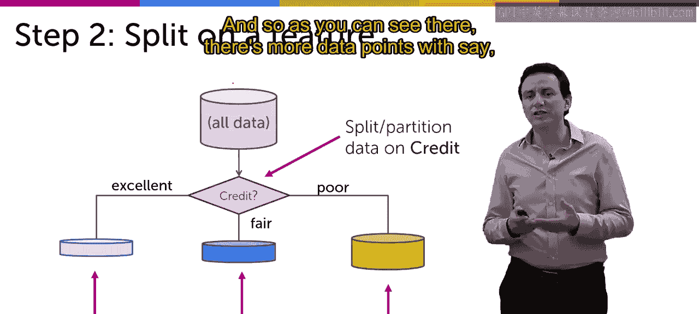
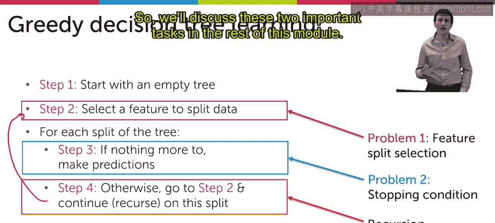

# 机器学习（分类，聚类和检索）：3-4：递归贪心算法

在本节课中，我们将学习决策树的核心构建算法——递归贪心算法。我们将从算法的高层概述开始，然后深入探讨实现该算法所需的关键细节。

## 算法概述

决策树学习算法通常从一个空树开始，该树包含所有数据。我们的目标是构建一棵树，通过一系列基于特征的判断（即“分裂”），将数据逐步分类。

上一节我们介绍了决策树的基本概念，本节中我们来看看如何通过递归贪心算法来构建它。

## 算法步骤详解

以下是递归贪心算法的高层描述，它是一个非常简单的过程。

1.  **从空树开始**：初始时，我们有一个根节点，它包含整个数据集。例如，在贷款数据中，根节点包含所有被标记为“安全”或“风险”的贷款记录。
2.  **选择分裂特征**：从所有可用特征（如信用评级、贷款期限、收入等）中选择一个特征来分裂当前节点。在我们的例子中，我们选择了“信用评级”作为分裂特征。
3.  **创建分支**：根据所选特征的可能取值，将当前节点的数据划分到不同的子节点中。例如，信用评级有“优秀”、“良好”、“差”三个值，因此会创建三个分支。
4.  **递归处理子节点**：对于每个新创建的子节点（即每个数据子集），重复步骤2和步骤3。但是，如果某个子节点中的数据已经全部属于同一类别（例如，所有贷款都是“安全”的），则停止在该节点上的分裂，并将其标记为叶节点。

这个算法听起来有些抽象，但有两个关键点需要具体化：**如何选择最佳的分裂特征**，以及**何时停止递归分裂**。我们将在本模块的剩余部分讨论这两个重要任务。

## 核心概念与示例

让我们通过一个具体的例子来理解算法的执行过程。

*   **初始状态**：我们从包含所有数据的根节点开始。可以用一个柱状图来可视化数据中“安全”与“风险”贷款的数量分布。
*   **第一次分裂**：我们选择“信用评级”作为分裂特征。这会将数据分成三个子集：
    *   信用评级 = “优秀”的数据子集（左分支）
    *   信用评级 = “良好”的数据子集（中分支）
    *   信用评级 = “差”的数据子集（右分支）
*   **检查子节点**：分裂后，我们再次用柱状图检查每个子节点中的数据。
    *   在“优秀”信用分支中，几乎所有贷款都是“安全”的。由于该节点数据已经“纯净”（属于同一类别），我们停止在此分支上的进一步分裂，并预测所有信用优秀的人都会获得安全贷款。
    *   在“良好”和“差”信用分支中，数据类别仍然混合（既有安全贷款也有风险贷款）。因此，我们需要对这些节点**递归地**应用相同的算法，继续选择特征进行分裂。

## 算法要点总结

本节课中我们一起学习了决策树的递归贪心构建算法。我们了解到，该算法从一个包含全部数据的根节点开始，通过**贪婪地选择当前最佳分裂特征**来构建树，并在每个子节点上**递归地**重复这一过程，直到满足停止条件（如节点数据纯净或达到深度限制）。理解如何选择分裂特征和何时停止递归，是掌握该算法的关键。在接下来的课程中，我们将深入探讨这两个核心问题。