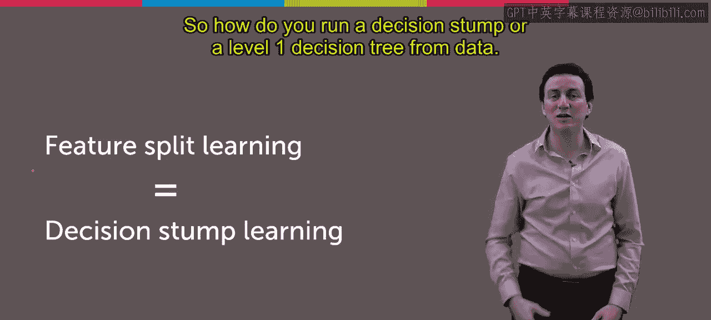
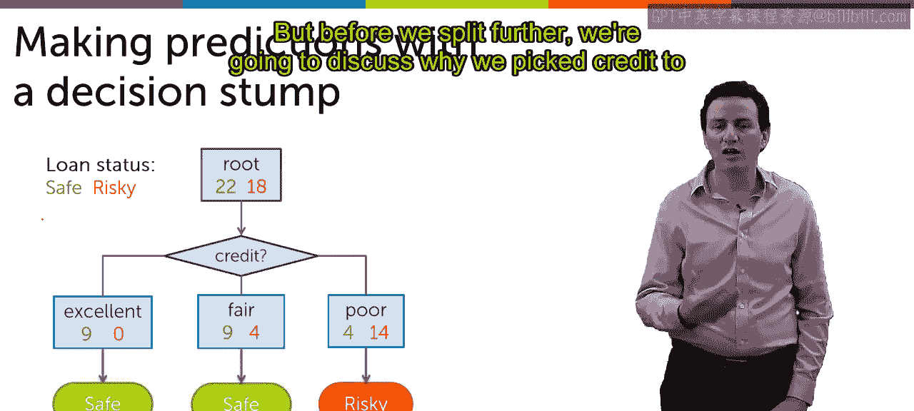
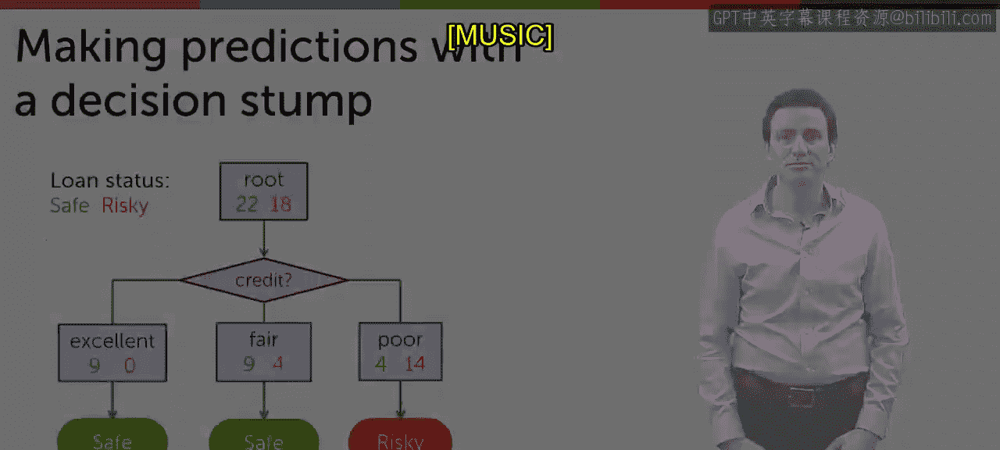

# 华盛顿大学《机器学习（分类，聚类和检索，第3-4课⧸共4课）｜Machine Learning》中英字幕 p62 61_学习决策树桩.zh_en -BV1Sr421F7N7_p62-

。

We've now outlined the greedy algorithm for learning a decision tree。

 The first thing that we can explore this idea of picking what feature to split on next we split in our example on credit first and we could split some of different feature how do we decide what to do and it turns out that this feature selection problem this feature are splitting learning problem can be viewed as the problem of learning what's called a decision stump which is that one level decision tree for those un' familiar with it a tree its going this really big thing。

 but if you cut it， you're only left a little bit at the bottom and that thing is called a stump。

 So it's a really really really short piece of a tree。

 So how do you learn decision stump or level one decision tree from data So we're given a data set like this just like we had before and our goal here is learn onele decision tree So we're given the top node or the root node all of the data some of the data points are save some of the data points are risky there's 40 examples in our case and it turns。

Out that 22 of those are safe loans and 18 are risky loans。 That's what our data looks like。

Now I have a histogram， but as we're building these figures， they can get really big。Complicated。

 so we're going to compress it a little bit instead of showing the histogram and the numbers 32 and 18。

 I'm just going to show you the numbers 22 and 18 to simplify the visualization。

So now when you see that root node， you should interpret it as we have 40 data points， 22 green。

 which is safe loans， 18 orange， which are risky load。And starting from there。

 how do we go and build that decision stop？So in our case we had all the data。

 we split on credit and we decided that some had data had XM credit， some had fair and some had poor。

 so we assigned each one of those subsets to the subsequent node in our new kind of visualization notation we have the original root node。

 we followed the data 22 risky and  sorry  fair 22 safe and 18 risky。For X and credit。

 we have subset data where nine of them were safe and zero were risky， so9 in green。

 zero and orange for fair credit， we have nine safe for risky and for poor credit。

 we have four safe and 14 risky。So that's what later looks like at the next level after we've done the splits。

These nodes here in the middle， we call intermediate nodes。Now， for each intermediate node。

 we can try to make a prediction of decision stump。 So for example， for poor credit。

 we see the majority of the data in there has risky associated with it。

 so we say that that's a risky we predict that to be a risky loan。For fair credit。

 we see that the majority nine versus four have or safe loan。

 so we predict that to be a safe loan and for X credit。

 we predict that to be a safe loan because9 versus zero So nine safe loans in there So for each node we look at the majority value to make a prediction and you now learn your first decision stamp it's a pretty simple one。

 but to get better predictions or more accuracy， we're going to explore that more and split further。

 but before we split further， we're going to discuss why we picked credit to do the first split as opposed to say。

 for example， the term of the loan or income。

