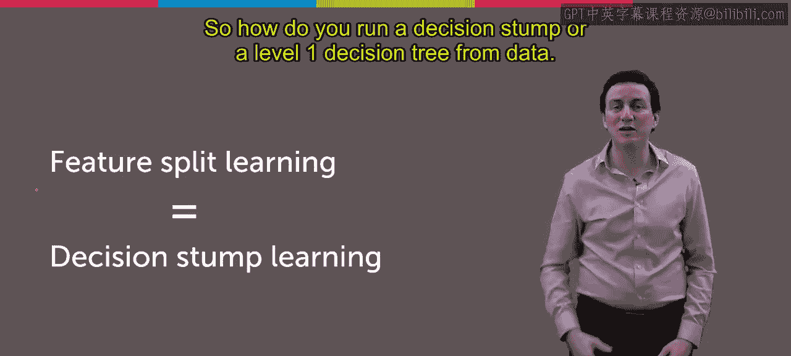
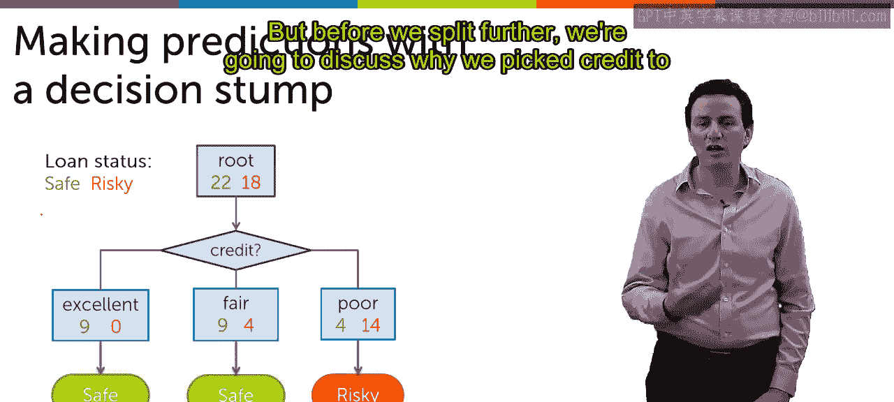
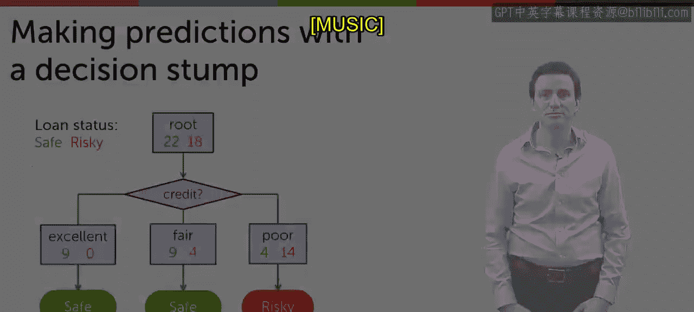

# 机器学习（分类，聚类和检索）：第3-4课：学习决策树桩 🌳

在本节课中，我们将要学习决策树构建中的一个核心概念——决策树桩。我们将探讨在构建决策树时，如何选择第一个特征进行划分，并理解这一过程如何简化为学习一个单层决策树，即决策树桩。

## 概述

上一节我们介绍了构建决策树的贪心算法。本节中，我们来看看这个算法的第一步：如何选择下一个要划分的特征。在我们的例子中，我们首先根据“信用”特征进行了划分，但我们也可以选择其他特征。如何决定呢？事实证明，这个特征选择问题，或者说特征划分学习问题，可以被看作是学习一个被称为“决策树桩”的单层决策树。

对于那些不熟悉树桩概念的人，可以想象一棵大树。如果你把它砍断，只留下底部的一小段，那个东西就被称为树桩。所以，决策树桩就是一棵非常非常短的树。

## 学习决策树桩

那么，如何从数据中学习一个决策树桩，或者说一个单层的决策树呢？我们被给予一个像之前一样的数据集，我们的目标是学习一个单层决策树。

我们拥有根节点，它包含了所有的数据。其中一些数据点是安全的贷款，一些是风险贷款。在我们的案例中，总共有40个例子。具体来说，其中22个是安全贷款，18个是风险贷款。这就是我们数据的样子。

为了简化可视化，我们将用数字22和18来代表这些类别，而不是显示完整的直方图。

所以，当你看到这个根节点时，你应该将其解释为：我们有40个数据点，22个绿色（安全贷款），18个橙色（风险贷款）。

从那里开始，我们如何构建那个决策树桩呢？

在我们的案例中，我们拥有所有数据，我们根据“信用”进行了划分，并决定一些数据有“优秀”信用，一些是“良好”，一些是“差”。我们将这些子集分别分配给了后续的节点。

用我们新的可视化符号表示：原始的根节点有22个安全和18个风险。对于“优秀”信用，我们有一个子集数据，其中9个是安全的，0个是风险的。对于“良好”信用，我们有9个安全，4个风险。对于“差”信用，我们有4个安全，14个风险。这就是我们在完成划分后，下一层节点的样子。

这些中间的节点，我们称之为中间节点。

现在，对于每个中间节点，我们可以尝试做出一个决策树桩的预测。

例如，对于“差”信用，我们看到其中的数据大多数与风险相关，所以我们预测那是一个风险贷款。对于“良好”信用，我们看到多数（9对4）是安全贷款，所以我们预测那是一个安全贷款。对于“优秀”信用，我们预测那是一个安全贷款，因为里面有9个安全贷款，0个风险。

对于每个节点，我们查看多数值来进行预测。这样，你就学会了你的第一个决策树桩。这是一个相当简单的模型，但为了获得更好的预测或更高的准确性，我们将进一步探索并进行更深的划分。

然而，在我们进一步划分之前，我们将讨论为什么我们选择“信用”作为第一个划分特征，而不是例如贷款期限或收入。

## 总结

本节课中，我们一起学习了决策树桩的概念。我们了解到，在构建决策树的贪心算法中，第一步的特征选择可以简化为学习一个单层的决策树，即决策树桩。我们通过查看每个划分后子节点中数据的多数类别来进行预测。理解这个简单的模型是后续学习更复杂决策树的基础。下一节，我们将深入探讨如何量化并选择最佳的划分特征。