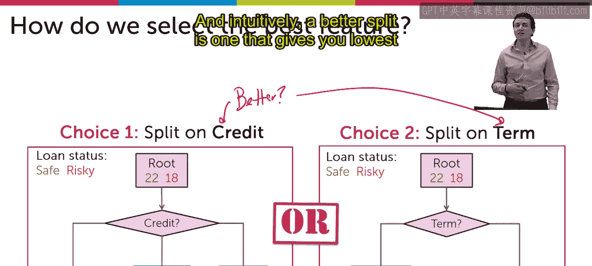
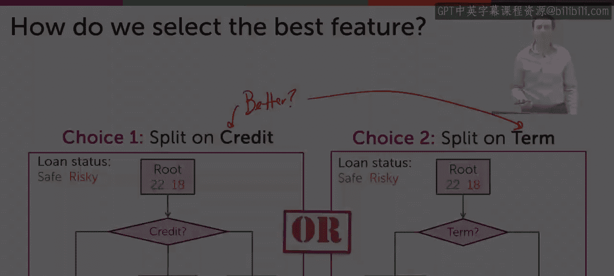
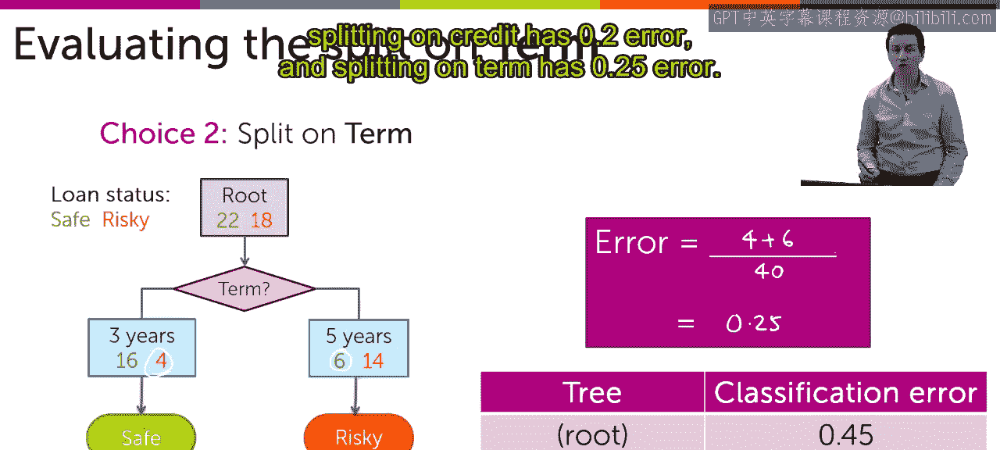
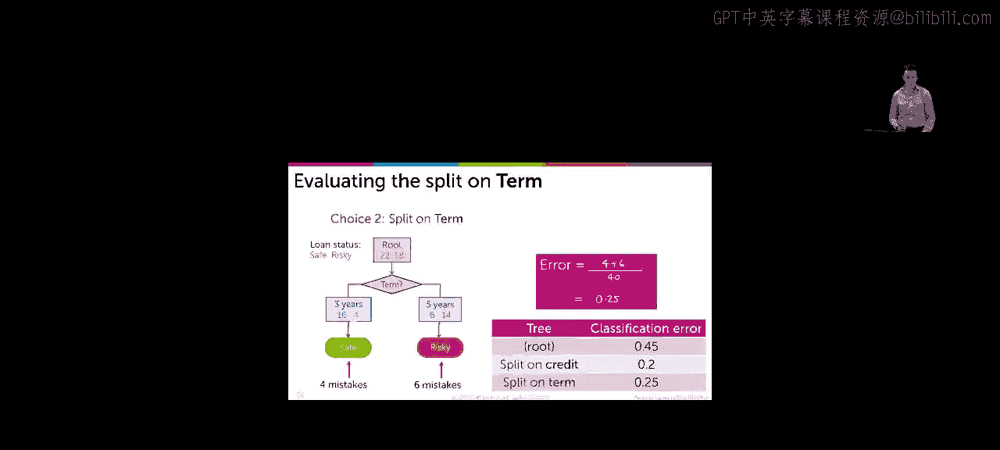
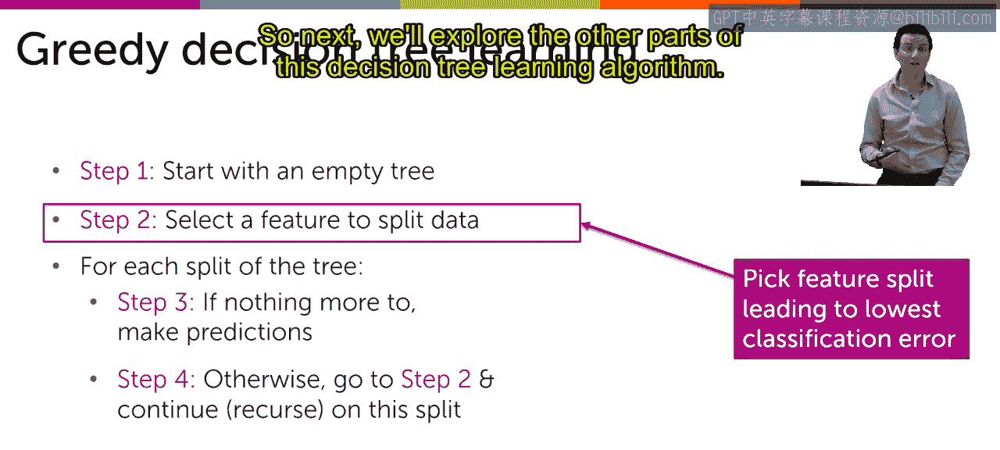

# 华盛顿大学《机器学习（分类，聚类和检索，第3-4课⧸共4课）｜Machine Learning》中英字幕 p63 62_选择最佳特征进行分割.zh_en -BV1Sr421F7N7_p63-

。

So now we've discussed the idea of building a decision St from data and a little bit of what that data set looks like。

 let's discuss now how do we pick the right feature to split on when we're building a decision Stump。

😊，So trying to learn a decision stem from data and he was split on credit。 But the question is。

 what is the best feature to split on and how do we measure that。So in our example。

 we split on credit， but we could have split on something else。

 let's say we could have split on in terms of the loan， is a three year loan or five year loan。

And the question is what is better between the two， what is a better split？

And that's what we're gonna to。Ask next。And intuitively。

 a better split is one that gives you lowest classification error。

 and that's exactly what we'll explore in the algorithm。

We'd like to figure out whether it's better to split on credit or split on term and we're going to do that is by measuring the number of mistakes each one of the decision stamps makes and pick the one that makes the least number of mistakes or has lowest error and just remember the error is just a number of mistakes classifier makes divided by the total number of data points so let's start with the root node and this is the。

😊，This is if we made no split in a decision stamp and may measure the error that we get in that example。

 So as a reminder， we're going to predict why hat to be the majority class associated with a particular。

Notode so in our case here the class that has most values for the root is going to be the safe class and when I compute the classification error of making that prediction so here what is classification error we're just saying that all the data points are safe。

So we can go ahead and say that there are 22 correct things， 22 were safe and 80 mistakes。

 So the classification error here is going to be。😊，I'm going to change colors is going to be。

18 divided by 22 plus 18， which is 40， so 18 over 40， which is 0。45。

 It's a binary classification problem。 You only get 0。45。 It mean you get 0。45 error。

 which is really bad。And so not splitting on anything gives you a pretty bad result。

So the question here is how good is the decision stamp that splits on credit and how does it compare to not spliting on anything which had a classification error of 0。

45。 Is this one better So let's look at the decision stamp for。😊，Data points that have exon credit。

 We're going predict that they're safe for those who have fair credit。

 we're going to predict that they're safe。 and that have poor credit。

 We're going to predict them to be risky And so this is our prediction。

 and this is again the majority value of the data in each one of these nodes。

 And if we look at how many mistakes we make。 you see that for the data that had excellenton credit。

 we make zero mistakes because everything was safe there for data had fair credit。

 we're going to make four mistakes。 there were four risky loans with fair credit。

 And for the data that had poor credit we see this four mistakes again because there were four safe loans when when we had poor credit。

 So let's compute our overall error I're going to write over here。 I'm just going change my colors。

 And we'll see that we make four plus 4 mistakes。 So that's8 out of 40 data points。

 So that's an error0。200。2 which is lower。Then we had 0。45。 So we've gone down now from 0。45 to 0。2。

 So speed on credit seems like a pretty good idea。Now， let's see what happens when we split on。

Term of the loan。 Well still on term of the loan。 If the term is three years。

 maybe there is 16 safe loans and and four risky ones。 So in this case， we're making four mistakes。

 and for five years， we predicted risky， but there were six safe loans。

 So now we're making six mistakes。And so if you look at our overall error here。

 it's 4 plus 6 divided by 40， so that's 10 by 40， which is 0。25。So overall， if we look at our data。

 not splitting anything， the root node has 0。45 error， splitting on credit has 0。

2 error and splitting on term has 0。25 error。

So we can go back and ask what is the best choice should we split on credit or should put it on term。

 the answer now becomes obvious， splitting on credit gives you lower classification error。

 so this is what our greedy algorithm will do first this is a first feature to split on。😊。

And that will be the winner of our selection process。So in general。

 the decision tree splitting process will say given the subset of data at node M。

 which is what we're looking at the root node so far。We try out every feature X I。

 which in our case here was。Credit。Term。An income。And I consider splitting the data according to possible values of each one of these features。

 and I compute the classification error of the resulting split， just like we did manually over here。

 and then I picked the feature which in our case was credit。😊。

Which had the lowest classification error。So if we go back to our decision tree learning algorithm。

 that first challenge that we had figuring out what features to split on。

 we can now do that using this feature split selection algorithm that minimizes the classification error。

So next we'll explore the other parts of this decision tree learning algorithm。

