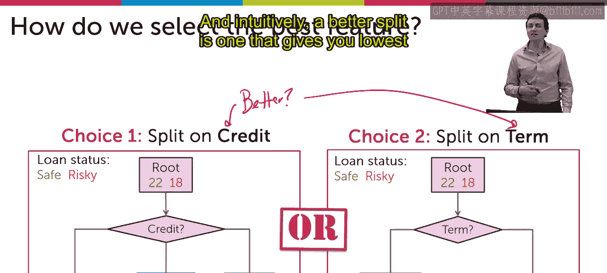
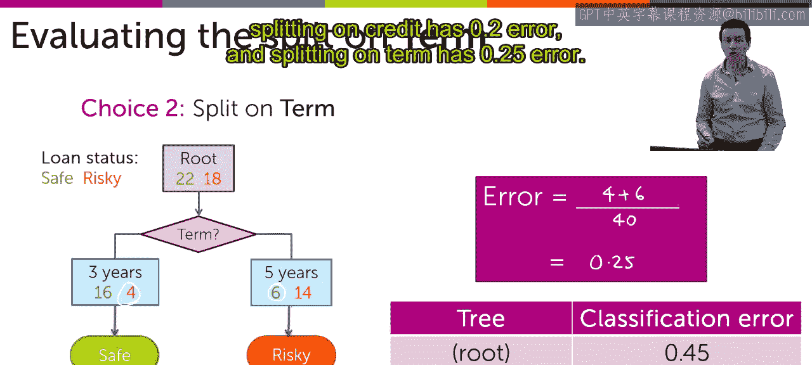
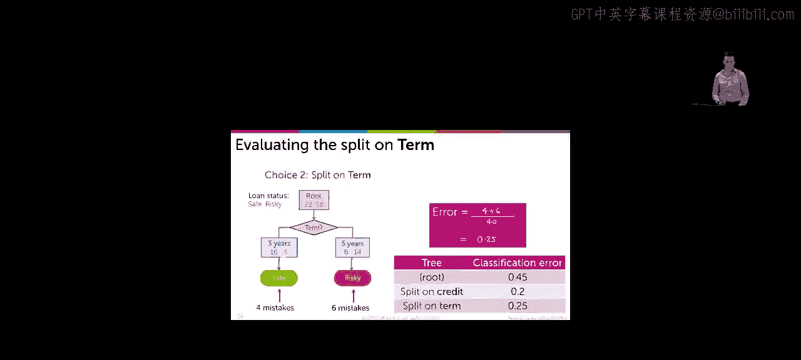
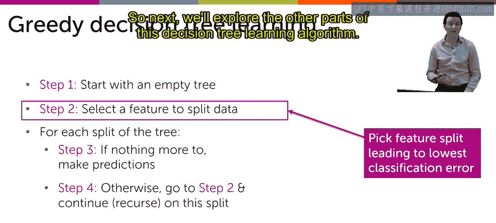

# 机器学习（分类，聚类和检索）：第3课：选择最佳特征进行分割

## 概述
在本节课中，我们将要学习如何在构建决策树时，选择最佳的特征进行数据分割。我们将通过比较不同特征分割后的分类错误率，来理解如何做出最优选择。

## 从数据构建决策树
上一节我们讨论了从数据构建决策树的基本概念，以及数据集的大致样貌。本节中我们来看看，在构建决策树时，如何选择正确的特征进行分割。

我们尝试从数据中学习一个决策树桩，并基于“信用”特征进行了分割。但问题是，什么是最佳的分割特征？我们如何衡量它？

在我们的例子中，我们根据“信用”进行了分割，但我们也可以根据其他特征进行分割，例如贷款期限是三年还是五年。问题是，这两种分割方式哪个更好？什么是更好的分割？这就是我们接下来要探讨的问题。

直观地说，一个更好的分割是能带来最低分类错误率的分割。这正是我们将在算法中探索的核心。

## 衡量分割质量：分类错误率
我们希望弄清楚，根据“信用”分割和根据“期限”分割哪个更好。我们将通过衡量每个决策树桩所犯的错误数量来实现这一点，并选择犯错最少或错误率最低的那个。

请记住，错误率就是分类器犯错的次数除以数据点的总数。

让我们从根节点开始。这是我们在决策树桩中不做任何分割的情况，我们来衡量在这种情况下得到的错误率。

提醒一下，我们将预测 $\hat{y}$ 为与特定节点相关联的多数类。在我们的例子中，根节点中拥有最多值的类别是“安全”类。当我们计算做出该预测的分类错误时，我们实际上是在说所有数据点都是安全的。

因此，我们可以说有22个正确的预测（22个是安全的），以及18个错误。所以这里的分类错误率将是 18 除以 (22 + 18)，即 40，所以是 18/40 = 0.45。

这是一个二分类问题，得到0.45的错误率意味着结果非常糟糕。因此，不做任何分割会得到一个相当差的结果。

现在的问题是，基于“信用”分割的决策树桩效果如何？与不做任何分割（错误率为0.45）相比，它是否更好？

## 比较不同分割方式的错误率
让我们看看基于“信用”分割的决策树桩。

*   对于信用“优秀”的数据点，我们预测为“安全”。
*   对于信用“良好”的数据点，我们预测为“安全”。
*   对于信用“差”的数据点，我们预测为“风险”。

这是我们的预测，同样，这是每个节点中数据的多数值。

如果我们查看我们犯了多少错误：
*   对于信用“优秀”的数据，我们犯了0个错误，因为那里所有贷款都是安全的。
*   对于信用“良好”的数据，我们将犯4个错误，因为有4笔风险贷款信用良好。
*   对于信用“差”的数据，我们再次看到4个错误，因为当我们信用差时，有4笔安全贷款。

让我们计算总体错误率。我们犯了 4 + 4 = 8 个错误，总共有40个数据点。所以错误率是 8/40 = 0.2。这比之前的0.45要低。因此，我们从0.45下降到了0.2。基于“信用”分割似乎是个好主意。

现在，让我们看看根据“贷款期限”分割会发生什么。

如果期限是三年，也许有16笔安全贷款和4笔风险贷款。在这种情况下，我们犯了4个错误。
对于五年期贷款，我们预测为“风险”，但有6笔安全贷款。所以现在我们犯了6个错误。

因此，我们这里的总体错误率是 (4 + 6) / 40 = 10/40 = 0.25。

## 选择最佳特征
综上所述，如果我们查看数据：
*   不做任何分割（根节点）的错误率为 0.45。
*   基于“信用”分割的错误率为 0.2。
*   基于“期限”分割的错误率为 0.25。

现在我们可以回过头来问：最佳选择是什么？我们应该根据“信用”分割还是根据“期限”分割？答案现在变得很明显：基于“信用”分割能带来更低的分类错误率。

因此，这就是我们的贪心算法首先要做的事情，这将是我们在选择过程中的获胜特征。

## 决策树分割的一般过程
一般来说，决策树分割过程会这样进行：给定节点 M 处的数据子集（到目前为止我们看的是根节点），我们尝试每一个特征 $X_i$（在我们的例子中是信用、期限和收入）。

我们考虑根据每个特征的可能值来分割数据，并计算分割后的分类错误率，就像我们刚才手动计算的那样。然后，我们选择具有最低分类错误率的特征（在我们的例子中是“信用”）。

如果我们回到决策树学习算法，我们面临的第一个挑战是弄清楚用什么特征进行分割。现在，我们可以使用这个最小化分类错误率的特征分割选择算法来解决它。

接下来，我们将探索决策树学习算法的其他部分。

## 总结
本节课中，我们一起学习了如何为决策树选择最佳分割特征。我们通过计算和比较不同特征分割后的分类错误率来实现这一目标。我们发现，选择能最小化分类错误率的特征（如例子中的“信用”特征）是构建有效决策树的关键第一步。这为后续深入学习决策树算法奠定了基础。