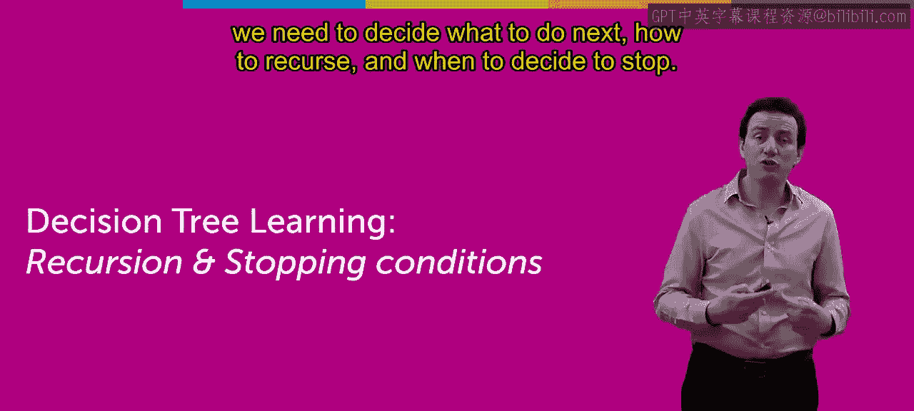
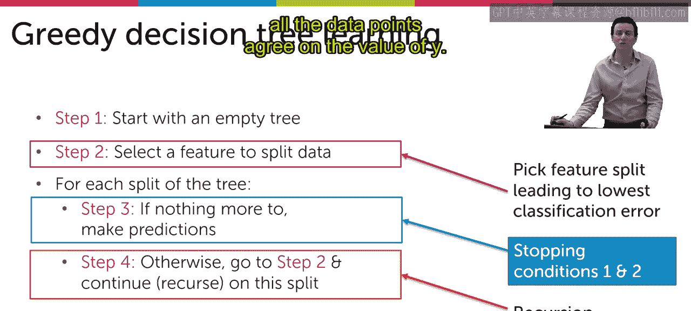
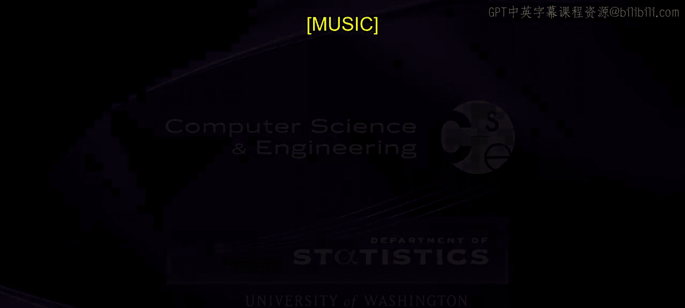

# 华盛顿大学《机器学习（分类，聚类和检索，第3-4课⧸共4课）｜Machine Learning》中英字幕 p64 63_何时停止递归.zh_en -BV1Sr421F7N7_p64-

。

Now that we're able to pick a feature to split on， we need to decide what to do next， how to recurse。

 and when to decide to stop。

So our goal now has gone beyond just learning a decision stamp or just that first level decision tree or picking that first feature to split on and learning a whole decision tree from data。

So if you look at our decision stamp that we learn splitting on credit。

 if you look at that first split where credit was excellent。

 we see that every single data point in there was a safe loan， so there's nothing else to do。

 there's no reason to recurse or trying more， we just make that what's called a leaf node because all other splits will also be predicted as safe。

But for the other two， for the cases where credit was fair， or the cr credit was poor。

 we need to look at a subset of the data that has fair credit and the subset of data that has poor credit and build the next decision stamp from each one of these。

 and then from there build the next decision stamps and so on。So in our example。

 if we were to keep going， build the next decision stamp for the data that is fair。

 where credit was fair， you will see that the results would be something like this I would split on term next that would be the next best thing to do and then if we look at the data that has poor credit we'll figure out the next best thing there is to split on income and for the points with low income everything was risky so we stopped splitting from there so credit poor income low。

 everything' is risky， no need to build a decision stamp。

 but for the other case where the credit was poor the income was high we see there's some risky points。

 some save points we build another decision stamp from there and then if you were to do that we learn something like this which completes our entire data。

I study decision three， so we see now that we have branches that take us two leaves in every possible split。

So we described here is what's called a recursive algorithm it starts with a process where we pick the best feature split on。

 then we split our data into decision stamp with this selected feature and then for each leaf of the decision stamp or each node associated with it we go back and learn a new decision stamp and the question is we keep iterating like this forever or do we stop somewhere。

So one are the criteria to stop recursing is the question here。And the criteria are extremely simple。

😊，So the first criteria we've already seen。For the nodes I've selected here。

 including that first node where credit was excellent。

 every single node is associated with data points of just one category or one class， same output。

 so for excellent there， everything was safe and for the case where the credit was fair but the term was three years。

 everything was risky。So， as we can see。For those there is no point to keep on splitting。

 so the first stopping condition is stop splitting when all the data agrees on the value of y there's nothing to do there。

And there's a second criteria。😊，Whi is only happened over here where we stopped splitting and we still have some data points with safe and risky loans inside that node。

 However we had used up all of the features in our data， we only have three features here credit。

 income and term and on that branch of decision to you， we used all of them up。

 there's nothing else to split on。We get the same things if we kept splitting on forever。

 and so the two stopping criteria actually simple， stop if every data point agrees or stop if you run out of features。

So if we go back now to our radio algorithmgon of for learning decision trees， we see that step two。

 you just pick the feature that minimizes the classification error as we discussed。

 and then we have the two stopping conditions here that we just described two extremely simple ones and then we just recurse and keep going until those stopping conditions are reached either we use all the features use the mop up or all the data points agree on the value of y。

。

