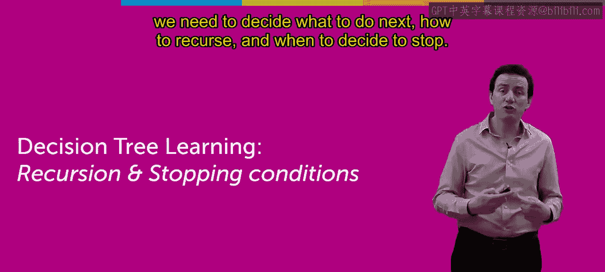
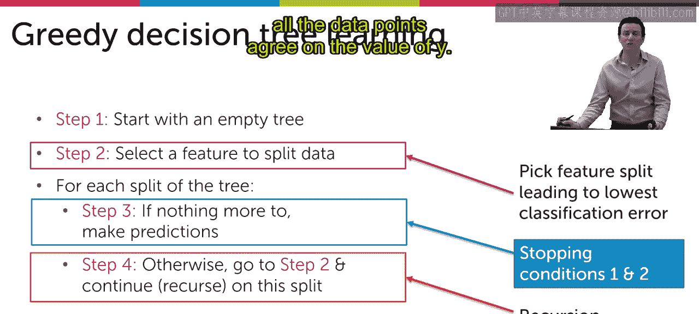

# 机器学习（分类，聚类和检索）：第3-4课：何时停止递归

在本节课中，我们将学习如何构建完整的决策树，而不仅仅是决策桩。我们将重点讨论决策树学习算法中的递归过程，以及决定何时停止递归的关键条件。

上一节我们介绍了如何选择最佳特征进行分割。本节中我们来看看如何基于这个分割进行递归，并最终决定何时停止递归。

## 递归构建决策树

我们的目标已经从学习一个决策桩，扩展为从数据中学习一整棵决策树。

以我们之前基于“信用”特征学习的决策桩为例。在“信用=优秀”的分支中，所有数据点都是安全贷款。因此，无需进一步操作，我们可以直接将其标记为**叶节点**，因为任何进一步分割的预测结果都将是“安全”。

然而，对于“信用=一般”和“信用=差”的另外两个分支，我们需要分别查看对应这些条件的数据子集，并为每个子集构建下一个决策桩，如此递归下去。

在我们的例子中，如果继续构建：
*   对于“信用=一般”的数据子集，下一个最佳分割特征是“期限”。
*   对于“信用=差”的数据子集，下一个最佳分割特征是“收入”。
    *   在“收入=低”的分支中，所有贷款都是高风险，因此可以停止分割。
    *   在“收入=高”的分支中，数据点混合了高风险和安全贷款，因此需要继续构建下一个决策桩。

通过这样的递归过程，我们最终可以学习到一棵覆盖所有数据的完整决策树，每个可能的分支路径都通向一个叶节点。

## 停止递归的条件

我们描述的是一个**递归算法**：首先选择最佳特征进行分割，然后根据该特征将数据分成决策桩，接着针对决策桩的每个叶节点（或与之关联的数据子集），返回去学习一个新的决策桩。

关键问题是：我们需要一直这样迭代下去吗？还是应该在某个点停止？

以下是决定何时停止递归的两个核心条件。

### 条件一：数据纯度达到100%

第一个条件我们已经见过。当某个节点关联的所有数据点都属于同一个类别（即输出值 `y` 完全一致）时，继续分割没有意义。

例如：
*   “信用=优秀”的节点中，所有贷款都是“安全”。
*   “信用=一般，期限=3年”的节点中，所有贷款都是“高风险”。

对于这些节点，应该停止分割。

### 条件二：特征已用完

第二个条件发生在另一种情况：我们停止了分割，但该节点内的数据点仍然混合了不同类别的贷款（例如既有安全贷款也有高风险贷款）。然而，我们已经用完了数据集中所有可用的特征。

在我们的例子中，只有三个特征：信用、收入和期限。在决策树的某个分支上，如果这三个特征都已用于分割，那么就没有其他特征可以继续分割了。即使继续分割，结果也不会改变。

## 算法总结

回顾我们学习决策树的递归算法，其步骤可以概括如下：

1.  **选择特征**：选取能最小化分类错误的特征进行分割，如之前所讨论。
2.  **检查停止条件**：应用我们刚刚描述的两个简单条件：
    *   停止，如果该节点所有数据点的 `y` 值一致。
    *   停止，如果所有可用特征都已用完。
3.  **递归**：如果以上条件均不满足，则对当前分割产生的每个数据子集（节点）重复步骤1和2，直到满足停止条件为止。

本节课中我们一起学习了决策树构建过程中的递归逻辑以及何时停止递归的两个关键条件：**数据完全纯净**或**特征全部用完**。理解这些条件是掌握决策树如何从数据中自动学习并形成完整树形结构的基础。