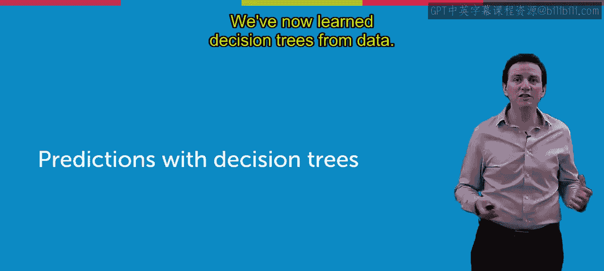
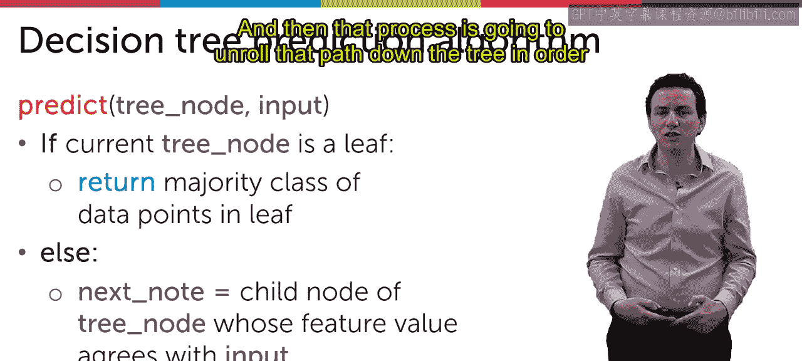

# 华盛顿大学《机器学习（分类，聚类和检索，第3-4课⧸共4课）｜Machine Learning》中英字幕 p65 64_使用决策树进行预测.zh_en -BV1Sr421F7N7_p65-

。

We've now learned a decision tree from data。 Let's look at how we can make predictions from it。

 So given the model that we learn from the data， we want to predict why hat。

 And as we discuss in the beginning of the module， it's a pretty simple process of traversing down the tree in order to make that prediction。

 So given a particular input X I。 So going back to the first example。

 where credit was poor income was high and the thermomost five years。

 we go down the branch of the decision tree that is associated with those particular input and we make a prediction prediction that why hat I is safe。

😊。

So just to be， even that prediction algorithm is what's called a recursive algorithm。

 so I'm trying to predict for a particular decision tree I start with the top node and my input set and then I say if the current node is a leaf。

 return， predict whatever is on that leaf and if it's not a leaf then pick the child that agrees with the input and then recurs on that child so return the prediction that child makes and then the process to un that path down the tree in order to make the prediction。

