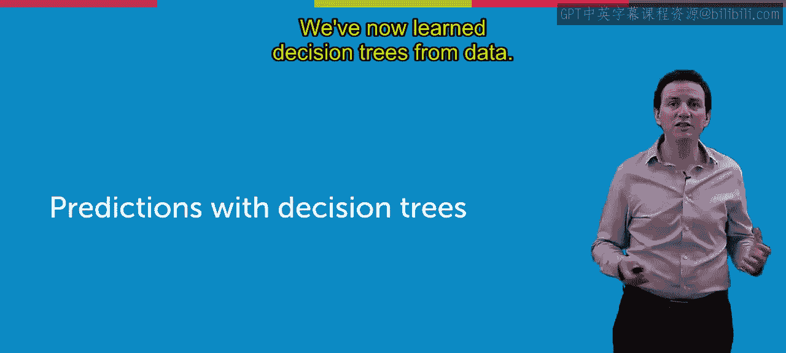
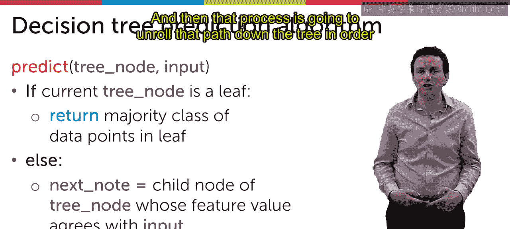

# 机器学习：3-4：使用决策树进行预测


在本节课中，我们将学习如何利用已训练好的决策树模型来对新数据进行预测。我们将详细介绍预测的流程，并通过一个具体的例子来演示整个过程。

---

## 预测流程概述

上一节我们介绍了如何从数据中学习一个决策树模型。本节中，我们来看看如何使用这个模型进行预测。

正如在本模块开始时讨论的，使用决策树进行预测是一个相当简单的过程，本质上是沿着树的结构向下遍历，直到到达一个叶节点。

## 预测算法详解

以下是使用决策树进行预测的递归算法步骤：

1.  **从根节点开始**：给定一个输入数据点 `X_i` 和决策树的根节点。
2.  **检查当前节点**：
    *   如果当前节点是**叶节点**，则直接返回该叶节点上存储的预测值（例如，“安全”或“有风险”）。
    *   如果当前节点是**内部节点**（即决策节点），则根据输入数据 `X_i` 在该节点特征上的取值，选择对应的分支（子节点）。
3.  **递归调用**：在选定的子节点上，重复步骤2，直到到达一个叶节点并返回预测结果。

这个算法可以形式化地表示为以下伪代码：



```python
def predict(tree_node, input_x):
    if tree_node.is_leaf_node:
        return tree_node.prediction
    else:
        # 根据 input_x 在 tree_node.feature 上的值选择分支
        child_node = select_child_based_on_feature(tree_node, input_x)
        return predict(child_node, input_x)
```

## 实例演示

让我们回到最初的贷款审批例子。假设我们有一个新的申请者，其特征为：
*   信用记录：差 (`credit = poor`)
*   收入：高 (`income = high`)
*   工作年限：5年 (`employment = 5 years`)

我们使用训练好的决策树对这个申请者进行预测：

1.  从根节点（“信用记录”）开始。
2.  由于信用记录为“差”，我们沿着“差”分支向下走到下一个节点（“收入”）。
3.  在“收入”节点，由于收入为“高”，我们沿着“高”分支向下走。
4.  到达一个叶节点，该节点的预测是“安全”。

因此，模型预测该申请者的贷款风险为 **安全** (`y_hat_i = safe`)。

---

## 总结



本节课中我们一起学习了如何使用决策树模型进行预测。我们了解到，预测过程就是根据输入数据的特征值，从根节点开始，沿着决策树的分支向下遍历，直到到达一个叶节点，该叶节点的值就是最终的预测结果。这个过程可以通过一个简洁的递归算法来实现，易于理解和执行。