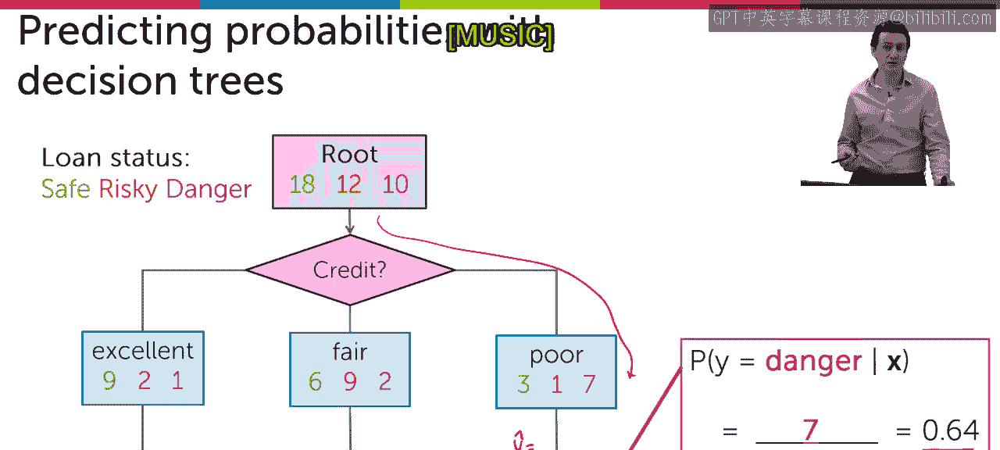

# 华盛顿大学《机器学习（分类，聚类和检索，第3-4课⧸共4课）｜Machine Learning》中英字幕 p66 65_决策树的多类分类.zh_en -BV1Sr421F7N7_p66-

。

Now decision trees can be used for binary classification。

 They can also be used for multiclass classification。 with basically no modifications。

 So for example， let's say that in the same setting， you give an input as a loan application。

 we have a classifier that starts to predict an output。

 but it's not just whether the loans are safe or risky， but some loans I just。

Don't even think about it， danger， danger， danger， don't touch them。So the question is。

 how do we make a decision whether a loan is safe， risky or danger？

Let's see an example of three class classification here and we'll see a decision stamp but the same thing applies to a bigger decision tree。

 so as input we're given a data set， for example we might have only one feature credit and the credit can have those three values X and fair and poor and then the output here can be safe。

 risky or danger。😊，If you look at the root here， you'll see that there's now three possible categories。

 safe loans， risky loans and danger loans， and if you split on credit。

 we'll see prenaturally that some of these loans fall on the exxon bin。

 some fall on the fair bins have fall on the poor bin and the ones who fall in the exon bin you see that the majority here are safe。

 so we predict safe for the fair bin， we see that the majority is risky， so we predict risky。

 but for the poor credit bin， the majority is dangerous so we don't even touch those。

We discussed that we can make predictions based on the majority class for each one of these splits here。

 but it turns out that if with decision trees， if you not predict the probability of a class。

 iss actually very simple as well。 So all you have to do is look at the fraction of the data that is associated with a particular label or value for each one of these leaves。

 So for example， for this case here， where credit was poor， where we predicted the Y hat was danger。

 we can actually ask for the probability of danger， given the input X。

 and in our case here would say that if your input takes you down this branch， then7 out of。

What is this 11 of the data points for danger， so we say that the probability of danger is 0。

64 well say the probability of safe loan is 3 out of 11 so there's a way for us predict both probabilities and the actual value of the outcome and both are very useful in practice。

