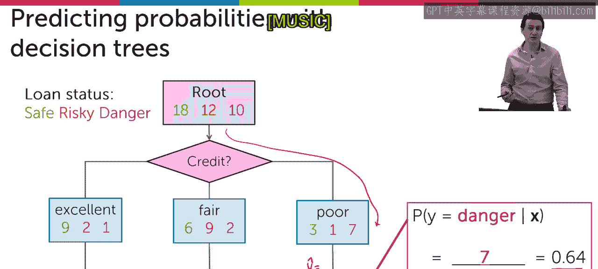

# 机器学习：3-4：决策树的多类分类 🌳

在本节课中，我们将学习决策树如何应用于多类分类问题。我们将看到，决策树不仅能处理二分类任务，也能以几乎相同的方式处理具有多个类别的分类问题。

## 从二分类到多类分类

上一节我们介绍了决策树在二分类中的应用。本节中我们来看看，当输出类别不止两个时，决策树如何工作。

决策树可用于二分类。决策树也可用于多类分类，且基本无需修改。

## 多类分类示例

例如，假设在相同的贷款申请场景中，我们有一个分类器来预测输出。但输出不仅仅是贷款“安全”或“有风险”，而是增加了“危险”类别，即某些贷款风险极高，不应考虑。

那么问题在于，我们如何决策一笔贷款是“安全”、“有风险”还是“危险”？

让我们看一个三类分类的例子。我们将看到一个决策树桩的示例，但同样的原理适用于更大的决策树。

## 构建决策树

以下是构建多类分类决策树的关键步骤：

作为输入，我们给定一个数据集。例如，我们可能只有一个特征“信用”，其值可以是“优秀”、“良好”或“差”。输出则可以是“安全”、“有风险”或“危险”。

观察此处的根节点，你会看到现在有三个可能的类别：安全贷款、风险贷款和危险贷款。如果我们根据“信用”特征进行划分，会自然地看到一些贷款落入“优秀”分支，一些落入“良好”分支，一些落入“差”分支。

对于落入“优秀”分支的贷款，我们看到其中大多数是安全的，因此我们预测为“安全”。对于“良好”分支，我们看到大多数是有风险的，因此预测为“有风险”。但对于“差”信用分支，大多数是危险的，因此我们甚至不考虑这些贷款。

## 预测与概率

我们讨论了可以根据每个划分中多数类来进行预测。但事实证明，对于决策树，预测某个类别的概率也非常简单。

以下是计算概率的方法：

你只需查看与每个叶子节点相关联的数据中，具有特定标签或值的比例。

例如，对于信用为“差”的情况，我们预测的Y_hat是“危险”。我们实际上可以询问给定输入X时，结果为“危险”的概率。在我们的例子中，如果你的输入引导你进入这个分支，那么11个数据点中有7个是“危险”的。因此，我们说“危险”的概率是 `7/11 ≈ 0.64`。同样，“安全”贷款的概率是 `3/11`。

因此，我们有一种方法可以同时预测概率和结果的实际值，这两者在实践中都非常有用。

## 总结

本节课中，我们一起学习了决策树如何扩展到多类分类问题。我们看到，其核心机制与二分类相同：根据特征进行划分，并在叶子节点根据多数类进行预测。此外，决策树还能通过计算叶子节点中各类别的比例，轻松地输出每个类别的预测概率，这为模型提供了更丰富的信息。