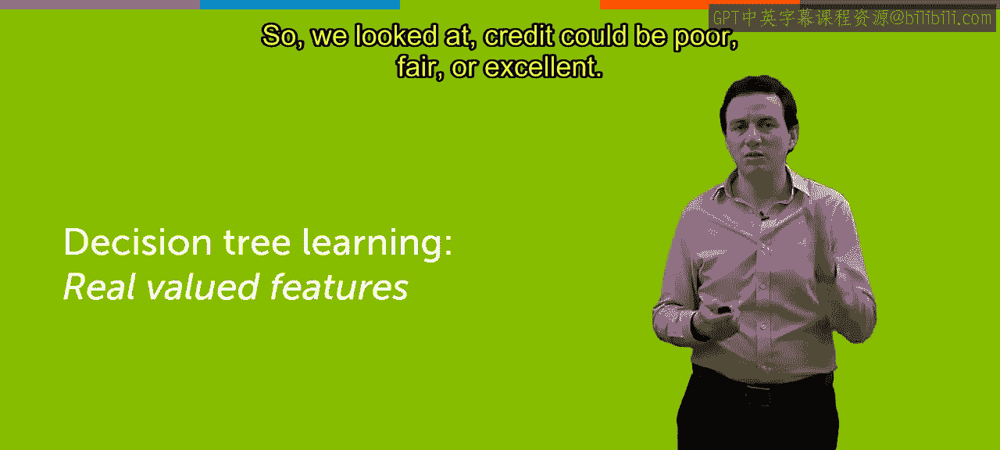
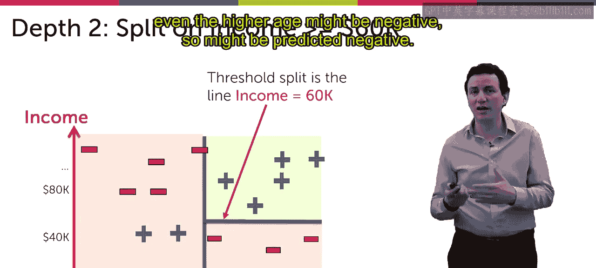
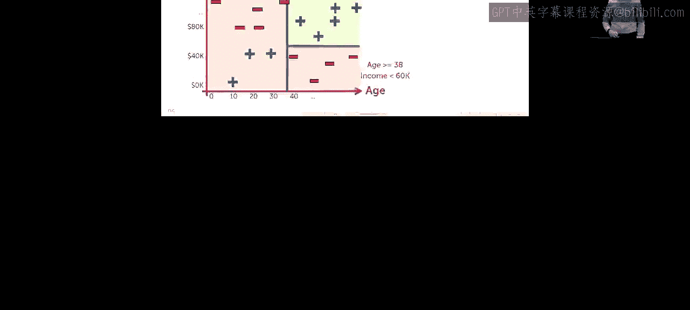
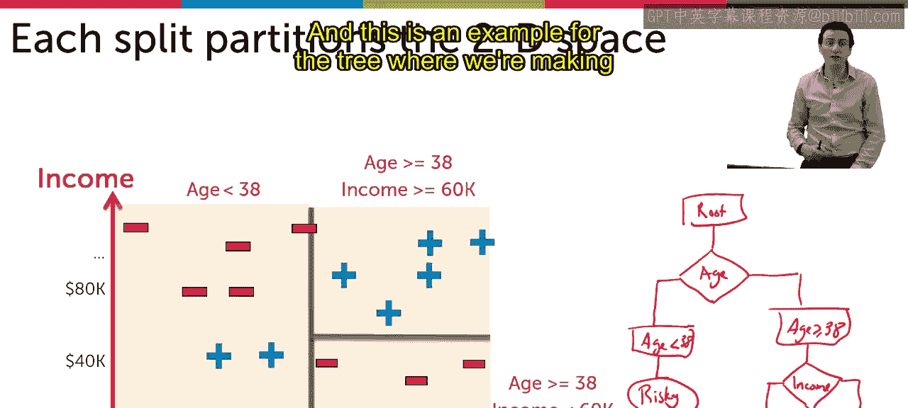

# 华盛顿大学《机器学习（分类，聚类和检索，第3-4课⧸共4课）｜Machine Learning》中英字幕 p67 66_连续输入的阈值分割.zh_en -BV1Sr421F7N7_p67-

。

So far in this module we've discussed learning decision tree。

 but we only use what's called categorical date inputs or features so we looked at you know credit could be poor fair or excellent however if you look at income that's what's called a real value feature it has a continuous possible value so you know 1050073。

00，69000 and so on So the question is how do you build a decision tree with this kind of input。

One natural approach is to just treat income or the continuous value feature like we did with the categorical data。

 so let's take that root node with 40 data points and just split on income and see what happens Well there is one data point with income of 30。

000 there's one data point income of 31，400 there is one data point with income 39500 and so on and it turns out that the nodes that we get out of them。

😊，Basically， only have one data point in them。And this can be really。

 really bad When you have very few data points in an intermediate node in decision tree。

 you're very prone to overfitting， very prone to make predictions you cannot trust。 So， for example。

😊，If you look here， you'd predict in this case that if your income is 30，000。

 this is definitely a risky loan， but if your income is 31，400， it's definitely a safe loan， however。

 if your income is now 39，500， you're back to risky so it's risky。

 safe risky which doesn't make any sense。I mean， do you trust it， I wouldn't。

 And so the question is how do we deal with these real valued features？

It's a very natural alternative， we can work called threshold splits and these are simply picking a threshold on the value of that continuous value feature so let's say 60000 and for the left side of that split we put all the data points have income lower than 60000 and on the right we put all the data points have income higher than or equal to 60000 and as we can see we have a subset of the data here that has income higher than 60。

000 and for those we have many data points there so it's a lot less risk of overfitting and we see that 14 of them have a safe loans so we probably predict a safe there while 13 were risky with income 60。

000 so maybe we predict those as risky。😊，So this is a very natural kind of split that we might want to do with continuous value data。

Let's now take a moment to visualize what happens when we do this kind of threshold split so for example。

 I've laid out my date of income into this line here that ranges from 10。

000 to 120 and if we pick a threshold split of 60，000 and we say everything on the left of that split has come less than 60。

000 and going to predict them to be risky loans， everything to the right has income higher than 60。

000 when to predict those as being safe loans。Now let's suppose that we have two continuous value features。

 We have income in the Y axis and we have age in the x axis。 And let's see what happens here。

 And you see thats some positive and negative examples laid out in 2D and then I thing that's interesting is that you see that other people higher incomes tend to be safe loans。

 but also younger people might have low incomes but those might also be safe loans because those people might make money over time。

 let's say so we might look at this data and decide to split on age first and if we split on age let's say say age equal to 38。

 we'll see that for the folks younger than 38 on average。

 more of them have risky loans so we might predict risky but for the folks that have age greater than 38。

 we have more safe loans than risky so we might predict safe。Now。

 if the next split in our decision tree， we might choose to split for the folks that have age greater to 38。

 we might split on the income and ask where this income greater is 60，000 or not， and if it is。

 we put a split there and we'll see that the point below income below 60，000。

 even at the higher age might be negative， so might be predicted negative。

So let's take a moment to visualize the decision tree of learns so far。

 so we start from the root node over here。😊，And we made our first split。 And for our first split。

 we decided to split on age。And。The two possibilities we looked at were。Is the age？诶。Smaller than。38。

Or is the age。Greatreter than or equal to 38。So that was a first threshold split and for those with age small and 38。

 let's see that we stopped right here， wed see that there is five risky and three save so we predict risky。

So there might be our leaf here。And for age greater and 38， we took another split。

 which was on income。And we just ask ourselves， is the income？Is it less than 60000。Or is it。

Greater than or equal to 60，000。And for the ones that have income greater equal to 60。

000 and age greater than 38， we predicted those were safe loans。

While the ones that had ageged grade and 38 an income less than 60，000。

 we predicted those to be risky loans。And this is an example of a decisionry where we're making this binary split on the data for the continuous variables。

