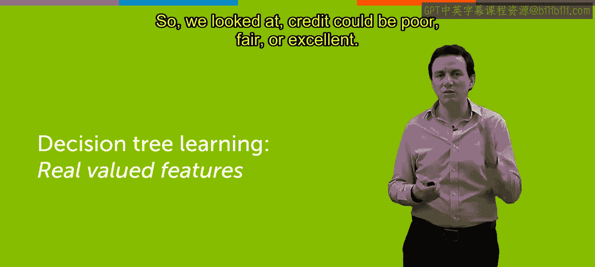
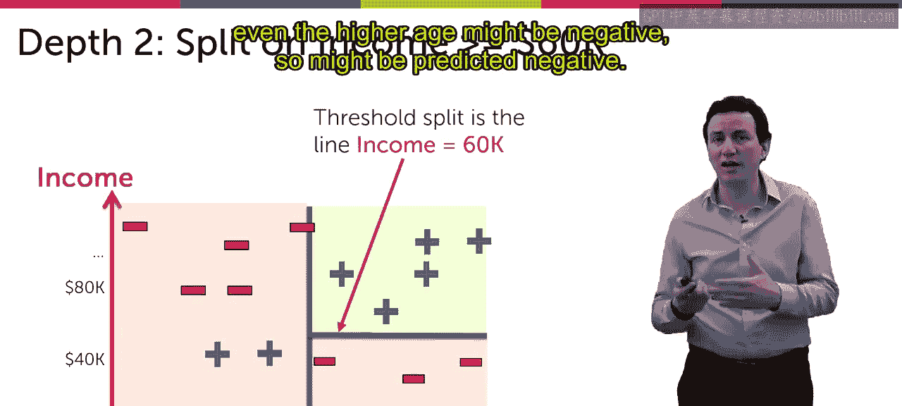
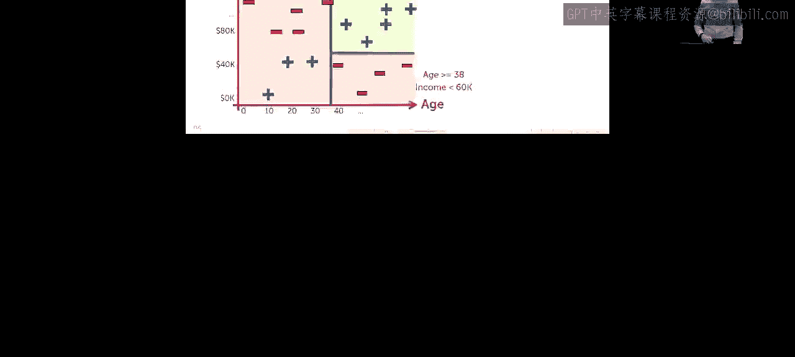
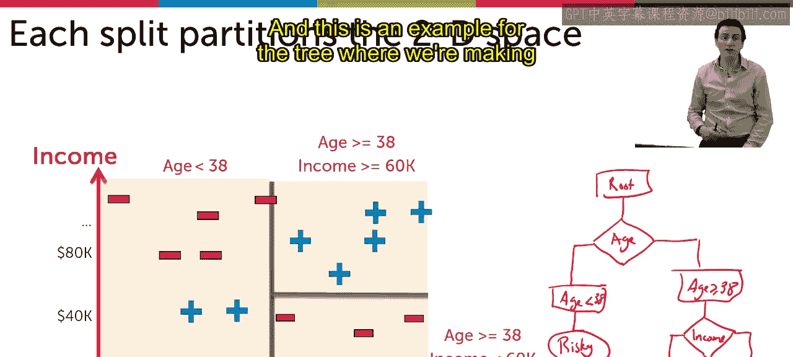

# 机器学习（分类，聚类和检索）：第3-4课：连续输入的阈值分割 📊


在本节课中，我们将要学习如何处理决策树中的连续值特征。之前我们讨论了使用分类数据（如信用等级）构建决策树，但现实数据中常包含像“收入”这样的连续值特征。本节将介绍一种称为“阈值分割”的方法，它能有效地将连续值转换为可用于决策树分割的二元判断。



---

## 从分类到连续值

上一节我们介绍了如何使用分类特征（如“信用等级”）来构建决策树。然而，许多重要特征（如收入、年龄）是连续取值的。如果像处理分类数据一样，为收入的每一个可能值（例如30,000、31,400）都创建一个分支，会导致每个分支节点只包含极少的数据点。

例如，如果为每个收入值单独分割，得到的节点可能只包含一个数据点。这会导致严重的**过拟合**问题，模型会记住训练数据中的噪声，而无法做出可靠的预测。例如，模型可能预测收入30,000为高风险，31,400为低风险，39,500又为高风险，这种预测模式显然不合理且不可信。

因此，我们需要一种更好的方法来处理连续值特征。

---

## 引入阈值分割

处理连续值特征的一个自然而有效的方法是使用**阈值分割**。这种方法不是为每个值创建分支，而是选择一个阈值，将数据划分为“低于阈值”和“高于或等于阈值”两组。

以下是阈值分割的核心步骤：
1.  选择一个连续特征（如 `income`）。
2.  为该特征选择一个阈值（如 `60000`）。
3.  根据阈值创建二元分割：
    *   **左分支**：`income < 60000`
    *   **右分支**：`income >= 60000`

通过这种方式，我们可以将数据点聚合到两个更大的子集中，从而减少过拟合的风险，并得到更稳定、更可信的预测结果。

---

## 可视化阈值分割

为了更好地理解阈值分割，我们可以将其可视化。

**单特征分割**
假设我们只有收入一个特征，其值分布在一条从10,000到120,000的直线上。如果我们选择60,000作为阈值，那么：
*   直线左侧（收入 < 60,000）的数据点被预测为“高风险”贷款。
*   直线右侧（收入 >= 60,000）的数据点被预测为“安全”贷款。

**多特征分割**
现在，考虑两个连续特征：收入（Y轴）和年龄（X轴）。数据点分布在二维平面上。
1.  我们可能首先根据年龄进行分割，例如选择阈值 `age = 38`。
    *   对于 `age < 38` 的群体，高风险贷款比例较高，因此预测为“高风险”。
    *   对于 `age >= 38` 的群体，安全贷款比例较高，因此预测为“安全”。
2.  接着，对于 `age >= 38` 的这个子群体，我们可以进行第二次分割，这次根据收入，选择阈值 `income = 60000`。
    *   对于 `income >= 60000` 的，预测为“安全”。
    *   对于 `income < 60000` 的，即使年龄较大，也可能被预测为“高风险”。

---

## 构建决策树示例

让我们将上述可视化过程转化为一个具体的决策树结构。





以下是基于年龄和收入两个连续特征构建的决策树示例：

1.  **根节点**：包含所有数据点。
2.  **第一次分割（基于年龄）**：
    *   条件：`age < 38`？
    *   **是（左分支）**：该节点包含5个高风险和3个安全贷款。由于高风险居多，该**叶节点**预测为“**高风险**”。
    *   **否（右分支）**：进入下一步分割。
3.  **第二次分割（基于收入）**：
    *   条件：`income >= 60000`？
    *   **是（右分支）**：该节点数据点被预测为“**安全**”贷款。
    *   **否（左分支）**：该节点数据点被预测为“**高风险**”贷款。

这棵决策树可以用以下伪代码表示：
```python
if age < 38:
    prediction = “高风险”
else:
    if income >= 60000:
        prediction = “安全”
    else:
        prediction = “高风险”
```

通过这种二元阈值分割，我们成功地将连续值特征整合到了决策树模型中，并得到了一个清晰、可解释的决策路径。

---

## 总结




本节课中我们一起学习了如何处理决策树中的连续值输入。关键点在于，不能直接为每个连续值创建分支，否则会导致过拟合。我们引入了**阈值分割**这一核心方法，通过为连续特征（如 `income`、`age`）选择一个合适的阈值（如 `60000`、`38`），将数据划分为两个子集（例如 `feature < threshold` 和 `feature >= threshold`）。这种方法允许我们在决策树中有效地使用连续特征，生成更稳健、更可靠的模型，并通过可视化示例和树结构展示了其实际应用过程。