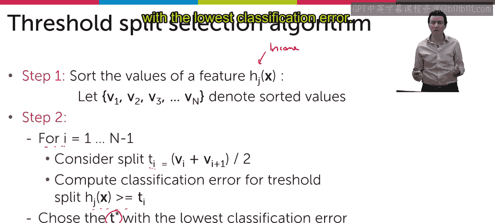
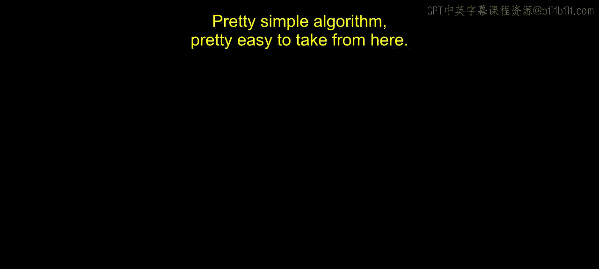

# 华盛顿大学《机器学习（分类，聚类和检索，第3-4课⧸共4课）｜Machine Learning》中英字幕 p68 67_可选：选择最佳阈值进行分割.zh_en -BV1Sr421F7N7_p68-

。

This next section will talk about how to pick that threshold split H equals 38 or income equal 60000 for continuous value continuous valued features we're going to make this an optional section it's not super complicated but is's that a little bit laborious so if you're interested definitely take a deep dive but for those who want to skip it it's totally okay。

So the goal here is to ask， if I decide to split on， say income。

 how do I choose the splitting point T star that we want to separate okay so 60000。

 but we want to split the left and right side of the tree。Now。

 this infinite many values that T star could take， you know， could be 6059999 of 99 cents。

 And if this is truly continuous， it could go to infinitely many the dec places。 The question is。

 do we need to consider all of those。😊，And do all those deciminal places really affect the quality of our decision tree？

Now， if you think about it and if you look at the values that income can take on the data so actual observe values of income。

 you see that if you take two points to say VA and VB。 let's say 60000 and 65000。

 if there are no points in between whether the split is at 610006206300，64000。

 you're still going to have the same classificational error。

 the points on the left of that split are always going to be the same。

 The points on the right of the split can gonna be the same。

 So all I have to do is consider the middle point between any of the data points that we have and just consider those who be the possible splits for my data and that's exactly what we're going do。

Let's now close this section by walking through the algorithm for picking the best splitting point for a particular feature。

 so let's say that I'm considering splitting on the feature here， HJ， which might be in our case。

 income。And what I can do is go through all my data so that column of values of that income might take and sort them such that。

 V1 is， the lowest income V2 is the next lowest Vn is the highest income。

 And all I need to consider is the splitting points right in between V1 and V2 V2 and V3 and so on。

 So I walk from I equals1 through M-1， And I consider splitting point ti。

 which is the midpoint between V V plus1。 And I ask where is the classification error。

 if I were to build a decision3 a decision stamp in this case。

 that splits Xj on T greater than T and less than T So 60 60000 and lower than 60000。

 And then we pick T star to be the split that leads to decision stamp with the lowest classification error。

 And that's it Pre simple algorithm pretty easys to take from here。

。

