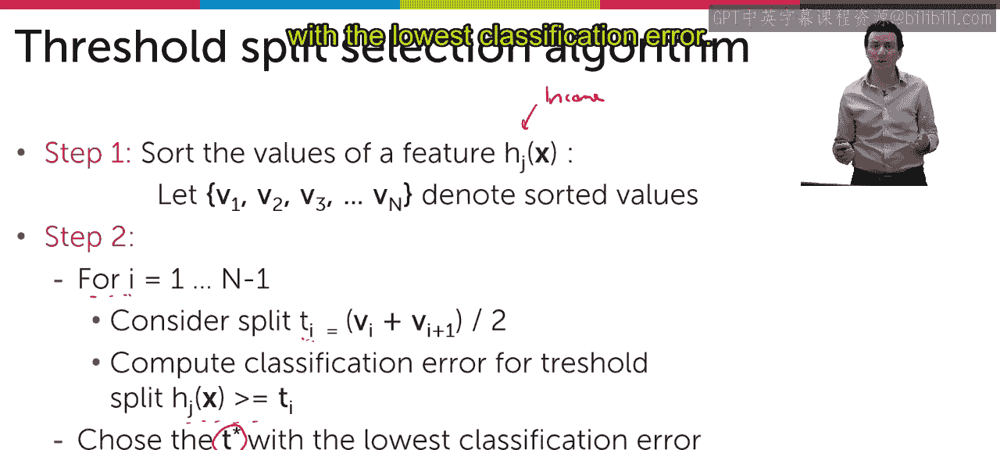

# 机器学习（分类，聚类和检索）：第3-4课：可选：选择最佳阈值进行分割 📊


在本节中，我们将学习如何为连续值特征（例如收入）选择最佳的分割阈值。例如，是选择 `H=38` 还是 `收入=60000` 作为决策树的分支点？我们将介绍一个简单但有效的算法来找到这个最佳点。

上一节我们讨论了决策树的基本概念，本节中我们来看看如何为连续特征自动选择最优的分割阈值。

## 为什么需要考虑所有可能的分割点？ 🤔

我们的目标是：如果决定在某个特征（例如收入）上进行分割，如何选择最佳的分割点 `T*`（例如60000）来划分树的左右分支。

`T*` 理论上可以取无限多个值（例如60000.01, 60000.001...）。但问题是，我们需要考虑所有这些值吗？这些小数点后的细微差别真的会影响决策树的质量吗？

实际上，并不需要。我们只需要考虑数据点之间的中点。原因在于：观察数据中收入的实际取值，例如 `VA=60000` 和 `VB=65000`。如果这两个数据点之间没有其他数据点，那么无论分割点选在61000、62000还是64000，分类结果都是一样的。分割点左边的数据点集合和右边的数据点集合不会改变。因此，我们只需考虑现有数据点之间的中点作为候选分割点。

## 寻找最佳分割点的算法 🧮

以下是为一特定特征（例如收入 `Xj`）选择最佳分割点的具体步骤。

首先，获取该特征在所有数据样本上的取值，并将其排序，得到有序序列：
`V1`（最低收入）, `V2`, ..., `Vn`（最高收入）。

接下来，我们只需要考虑每两个相邻数据点之间的中点作为候选分割点。

以下是算法的核心步骤：

1.  **排序数据**：将特征 `Xj` 的所有取值升序排列。
2.  **生成候选点**：对于 `i` 从 `1` 到 `n-1`，计算候选分割点 `ti`。`ti` 是 `Vi` 和 `V(i+1)` 的中点，公式为：
    `ti = (Vi + V(i+1)) / 2`
3.  **评估每个候选点**：对于每个候选分割点 `ti`，构建一个决策树桩（单层决策树）。该树桩的规则是：如果 `Xj > ti` 则分到右分支，否则分到左分支。然后计算该树桩在训练数据上的**分类错误率**。
4.  **选择最佳点**：遍历所有候选点后，选择那个能产生**最低分类错误率**的决策树桩所对应的分割点 `ti`，将其作为最终的最佳分割点 `T*`。

用伪代码描述如下：
```
# 假设 features 是特征列，labels 是对应标签
sorted_values = sort(unique(features))
best_error = infinity
best_split = None

for i in range(len(sorted_values)-1):
    candidate_split = (sorted_values[i] + sorted_values[i+1]) / 2
    # 根据 candidate_split 规则预测标签
    predictions = (features > candidate_split)
    # 计算分类错误率
    error = calculate_classification_error(predictions, labels)
    if error < best_error:
        best_error = error
        best_split = candidate_split

# best_split 即为最佳分割点 T*
```

这个算法简单直接，易于实现，它确保了我们在有限的候选点中找到对当前数据最优的分割阈值。




本节课中我们一起学习了如何为连续值特征选择决策树的分割阈值。核心在于理解无需遍历无限的可能值，只需评估数据点之间的中点。我们介绍了一个清晰的算法：排序特征值、生成中点候选、评估每个候选点的分类错误，并选择错误率最低的点作为最佳分割点 `T*`。这为构建更精确的决策树模型奠定了基础。