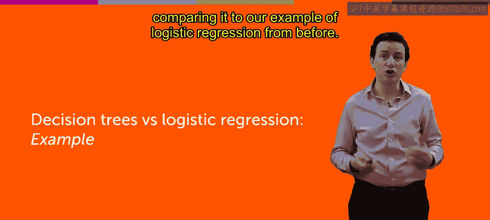
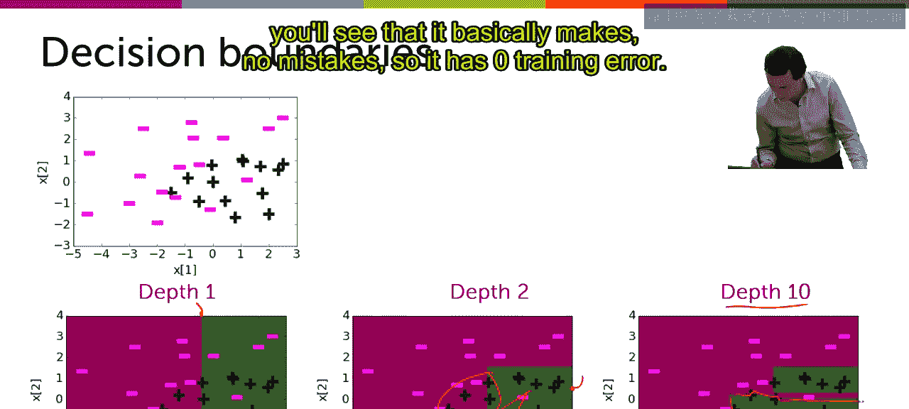
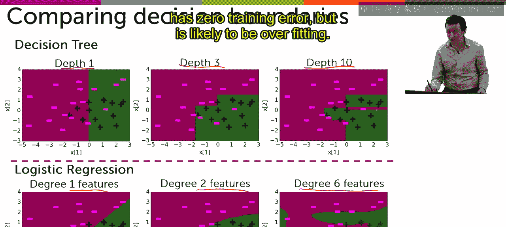

# 华盛顿大学《机器学习（分类，聚类和检索，第3-4课⧸共4课）｜Machine Learning》中英字幕 p69 68_可视化决策边界.zh_en -BV1Sr421F7N7_p69-

。

We'll close off this module by exploring a little bit more detail a tri example of decision trees and comparing it to our example of logistic regression from before。

😊。

Here's the example that wet consider is one that we considered in the logistic regression module。

 we're taking this data set here and。😊，Fitting a logistic regression decision boundary is on the right here。

 And we can see the parameters that we learned from data。

 So this is if we just did a simple degree1 polynom features just gonna straight up linear features。

 Let's see what happens when we build a decision stamp on the same data。 So。

If you you do a single level decision tree and you apply to this data set。

 what we'll do is we'll split on x1。 And if you try out the threshold values。

 you'll see that on the left side， well have x1 less than-0。70。

07 and on the right side it would be x1 greater than-0。07。 You see for the4 ones on the right。

 We have more positive examples。 So we're gonna predict。Positive。

 while the ones on the left we have more negative examples。

 so we're going to predict negative and you'll see that they correspond。 So here's our split minus0。

07 this first。Left all the tree will correspond to points on the the left there。

 and the second one will correspond to points on the right。 extremely intuitive。

 So unlike logistic regression， we were able to get a diagonal decision boundary here。

 we're only going to get straight up or straight across the decision boundary。

 at least in the first split。😊，Now， if we keep going with the gridy algorithm and we take another split for each one of these intermediate nodes。

 we'll see that。😊，For the data where x1 is less than-0。07。

 we might split on x1 again and make predictions which in this case will be splititting on x1 less than minus。

1。66 and on both cases， we're predicting to be minus。1 so negative data points so -1 minus-1。

 but for x1 greater than minus0。07， we now split on x2， whether it's bigger than or greater than 1。

55， which in our。Split on our data is over here，1。55。 That's what x2 would be。

 And we see that now we have for the data， which is smaller than 1。55 in x2。

 we have 11 positive examples。 So we predict plus1， but for the data which is greater than 1。55。

 we have three negative examples， so we predict -1 And so now we have a much more interesting region。

 so。The splits， so there two nodes here on the right。

 one corresponds to this big green area and the other one corresponds to this little box on the top。

And we can imagine continuing this process pretty again and again and again， as we'll see next。

 But one important thing to know is that。When we have continuous variables。

 and this is a really important point， unlike for discrete ones or for categorical ones。

 we can split on the same variable multiple times。 so you can split the next one and split on next one again。

 or we can split on next one and the next student then on next one again。 And we'll see that。😊。

So in this example that we talked about we can keep the decision tree learning process going。

 so in depth 1 we just get a decision stamp which corresponds to the vertical line that we drew in the beginning minus 0。

07 if we go to depth2， we get this little box that contains most of the positive examples but it is still some misclassifications over here。

And then if you kept going splitting， split， split， spliting， spliting。

 splitting all the way to depth 10， we get this really crazy decision boundary。

 And if you look at it carefully， where you'll see is that。😊。

And I'm going to draw over the decision boundary here。

 where if you look at it a little bit carefully， you'll see that it basically makes no mistakes。

 so it has zero training error。

And we can compare what we solve logistic regression with what we're seeing with decision trees and understand again and preview for what well see in the next module kind the notion of overfitting。

 So logistic regression we started with degree 1 polynomial features。

 and then we saw the degree 2 had a really nice fit of the data It's a nice par。

 It didn't get everything right， but it did pretty well。 and then a degree 6 polynomial was you know。

 had a really crazy decision boundary。 It got zero training error。

 but I didn't really trust those predictions。 We didn't really trust those predictions。

 The Dec 3 where you control is the depth of the decision tree。

 And so depth 1 was just a decision stamp。 It didn't do so well。 If you go to depth3。

 It looks like a little bit of a jogged line， but it looks like a pretty nice decision boundary。

 It makes a few mistakes， but it looks pretty good。 If you look at depth 10。

 you get this crazy decision boundary has zero training error， but is likely to be overfitting。😊。

