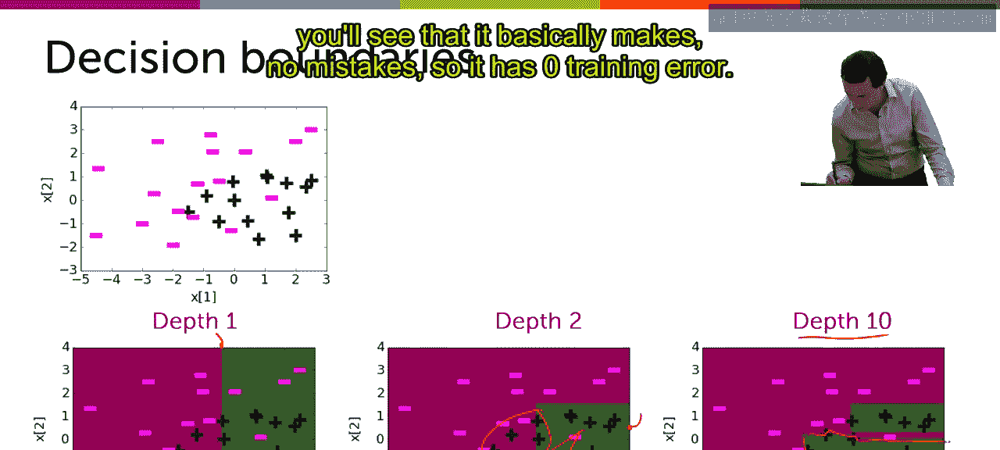
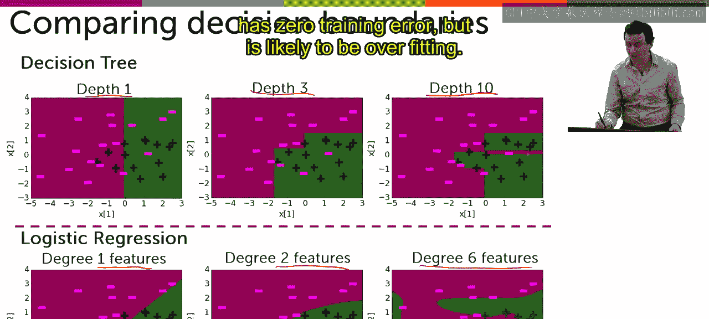

# 机器学习（分类，聚类和检索）：3-4：可视化决策边界

在本节课中，我们将通过一个具体例子，深入探索决策树的工作原理，并将其与我们之前学过的逻辑回归模型进行比较。我们将重点关注决策边界如何随着模型复杂度的变化而变化，并初步了解过拟合的概念。

---

## 决策树与逻辑回归的对比

上一节我们介绍了决策树的基本构建过程。本节中，我们来看看一个具体的例子，并将其与逻辑回归的决策边界进行可视化对比。

我们使用的数据集与逻辑回归模块中考虑的例子相同。下图展示了使用简单的一阶多项式特征（即线性特征）进行逻辑回归后得到的决策边界，以及从数据中学到的参数。

现在，让我们看看在相同数据集上构建一个决策树桩（单层决策树）会发生什么。

以下是构建过程：
*   如果我们尝试不同的阈值，会发现最佳分割点是 **x1 < -0.07**。
*   在分割点的左侧（x1 < -0.07），负例样本更多，因此预测为**负类**。
*   在分割点的右侧（x1 >= -0.07），正例样本更多，因此预测为**正类**。

这个结果非常直观。与逻辑回归可以得到斜向决策边界不同，在第一次分割时，决策树只能产生**垂直或水平**的决策边界。

## 构建更深的决策树

现在，如果我们继续使用贪心算法，为这些中间节点进行下一次分割，决策边界会变得更加复杂。

以下是深度为2的决策树的分割过程：
*   对于 **x1 < -0.07** 的数据，我们可能再次在 **x1** 上分割（例如 **x1 < -1.66**），两边都预测为负类。
*   对于 **x1 >= -0.07** 的数据，我们在 **x2** 上分割，条件是 **x2 > 1.55**。
    *   对于 **x2 <= 1.55** 的数据，有11个正例，预测为**正类**。
    *   对于 **x2 > 1.55** 的数据，有3个负例，预测为**负类**。

现在，我们得到了更有趣的决策区域。右侧的两个节点，一个对应一大片绿色区域，另一个对应顶部的一个小方框。

一个重要的知识点是：对于**连续变量**，我们可以对同一个变量进行**多次分割**。这与离散或分类变量不同。

## 决策树的深度与过拟合

我们可以让决策树学习过程继续进行下去。随着深度增加，决策边界会变得越来越复杂。

以下是不同深度决策树的对比：
*   **深度 1**：只是一个决策树桩，对应开始时画的垂直线（x1 = -0.07）。效果一般。
*   **深度 2**：得到一个包含大多数正例的小方框，但这里仍有一些分类错误。
*   **深度 10**：得到一个非常复杂的决策边界。仔细观察会发现，它基本上没有错误，即**训练误差为零**。

## 与逻辑回归的对比及过拟合预览

现在，我们可以将逻辑回归的结果与决策树进行对比，并初步理解下一个模块将详细讨论的**过拟合**概念。

以下是不同模型的比较：
*   **逻辑回归（1阶多项式）**：从简单的线性决策边界开始。
*   **逻辑回归（2阶多项式）**：对数据拟合得很好，是一个漂亮的抛物线。虽然没有完全分类正确，但表现相当不错。
*   **逻辑回归（6阶多项式）**：决策边界非常复杂，达到了零训练误差，但我们并不完全信任这些预测。
*   **决策树**：通过**深度**来控制复杂度。
    *   **深度 1**：决策树桩，效果不太好。
    *   **深度 3**：决策边界略有锯齿，但看起来相当不错，只犯了少量错误。
    *   **深度 10**：决策边界极其复杂，训练误差为零，但很可能**过拟合**了。

---

本节课中，我们一起学习了如何可视化决策树的决策边界，并通过与逻辑回归的对比，观察了模型复杂度（决策树深度、多项式阶数）对决策边界形状和模型性能的影响。我们看到了简单的模型可能欠拟合，而过于复杂的模型虽然训练误差低，但可能学习到了噪声，导致过拟合。这为我们接下来深入探讨模型评估与选择奠定了基础。