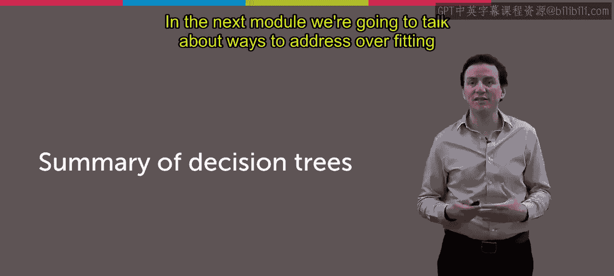

# 华盛顿大学《机器学习（分类，聚类和检索，第3-4课⧸共4课）｜Machine Learning》中英字幕 p70 69_决策树回顾.zh_en -BV1Sr421F7N7_p70-

。

And we've now seen how to build a decision tree from data spray call a simple。

 greedy recursive algorithm， main choice to be made is what feature to split on and when to stop splitting in the next module。

 we're going to talk about ways to address overfitting in decision trees。

 but you should be ready now to understand how to build a decision tree from data。

 really implement that algorithm and be able to make predictions from the decision trees that you learn as well as to explore the decision boundaries of decision trees and how they relate to decision boundaries of say logistic regression。

😊。

And let me close by thanking my colleague Krishnna。

 who was instrumental at making the slides that you saw in this module。

I really appreciate all the effort that Krishna put into this。

