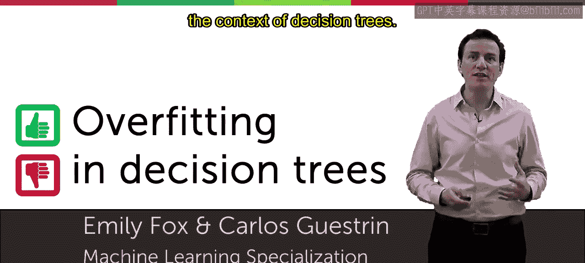
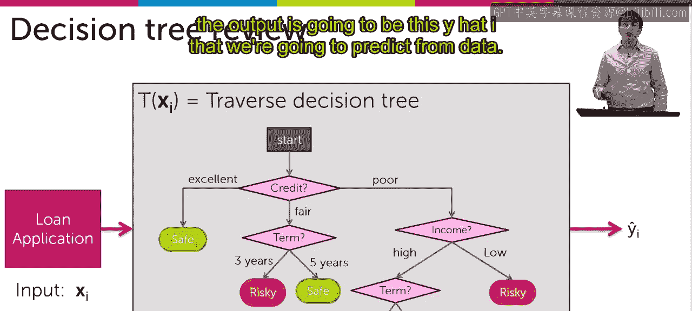
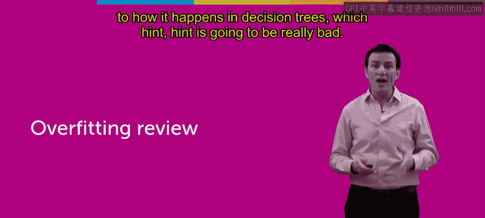
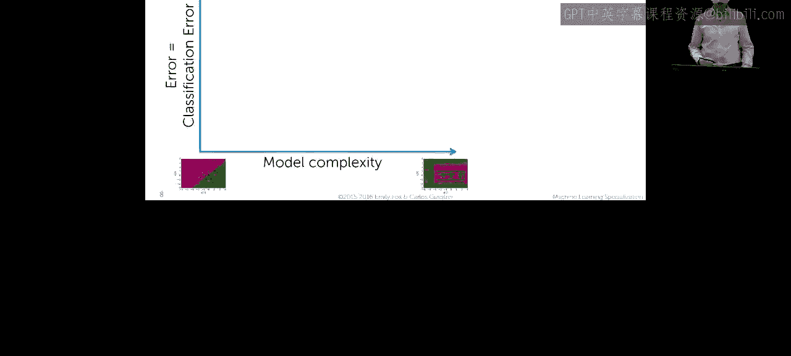
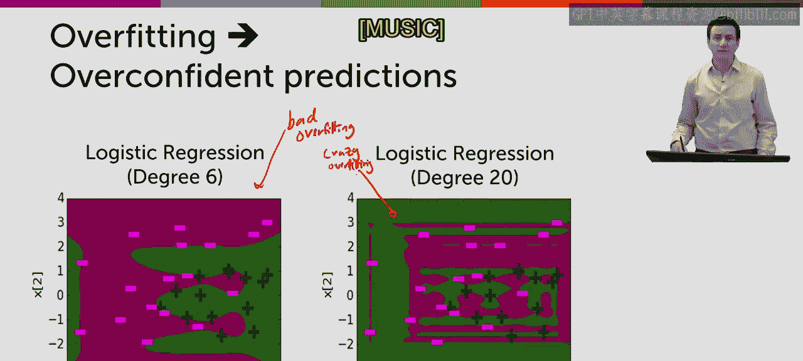

# 华盛顿大学《机器学习（分类，聚类和检索，第3-4课⧸共4课）｜Machine Learning》中英字幕 p71 70_过拟合回顾.zh_en -BV1Sr421F7N7_p71-

。

We've now seen the basics of decision trees， which are an amazing type of classifier that can be used on a range of different types of data。

 however， decision trees are highly prone to overfitting。😊。

And so let's dig in a little bit in this module on how we can avoid overfitting in the context of decision trees。

And as a reminder， we're going to continue to use our loan application evaluation system as our running example。

 where loan data will come in and we're going to be able to predict whether that's a safe loan or a risky loan application。

😊，And so that's the decision making we're trying to make。And from that loan application。

 we're going to learn a decision tree that allows us to traverse down the tree and make a prediction as to whether a particular loan is risky or safe and so the input is going to be XI and the output is going to be this Y hat I that we're going to predict from data。

Let's first spend a quick minute reviewing overfitting and then dig in and so how it happens in decision trees。

 which hit hand is going to be really bad。😊。

As well recall， overfitting is the fact that separates the training error。

 we tends to go down to zero as we make our models more and more complex and the true error which goes down with the complexity of the model。

 but then spikes back up and so more specifically overfitting happens when we end up outputting a model W hat。

Which has low training error， but high true error， while there was some other model。

or model parameters， W stars which had maybe higher training error but definitely lower true error And so that's the overfitting problem and when somehow pick a model that's less complex to avoid that kind of overfitting so we saw this effect in logistic aggression quite pronouncedly where as we increase the degree of the polynomial we got this crazy and crazyaz decision boundaries where we saw overfitting which was you know bad overfitting over here。

But overfitting for polynoms of degree6， and then polynomials of degree 20 here for features。

 this is a technical term that I use， I think I'll use crazy decision boundary。

 but let's call it crazy overfitting。So really bad stuff and so we're trying to avoid overly complex models and as we'll see with decision trees。

 models can get overly complex very quickly。😊。

