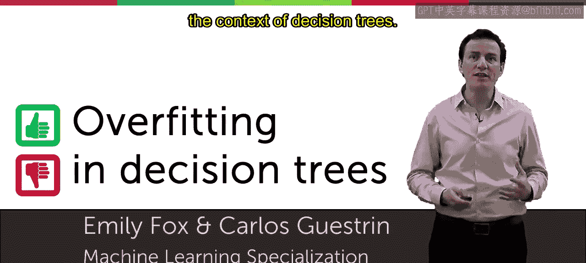
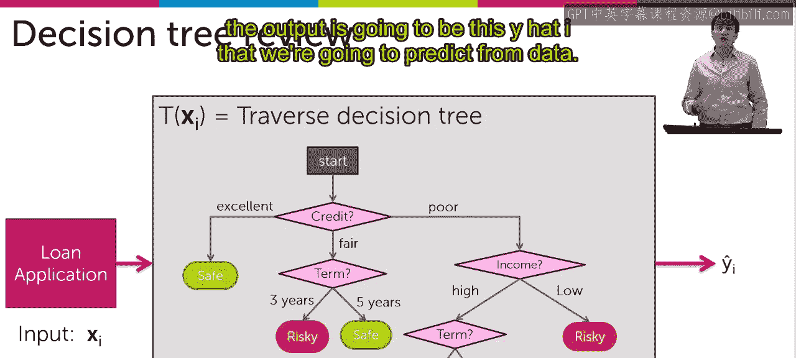
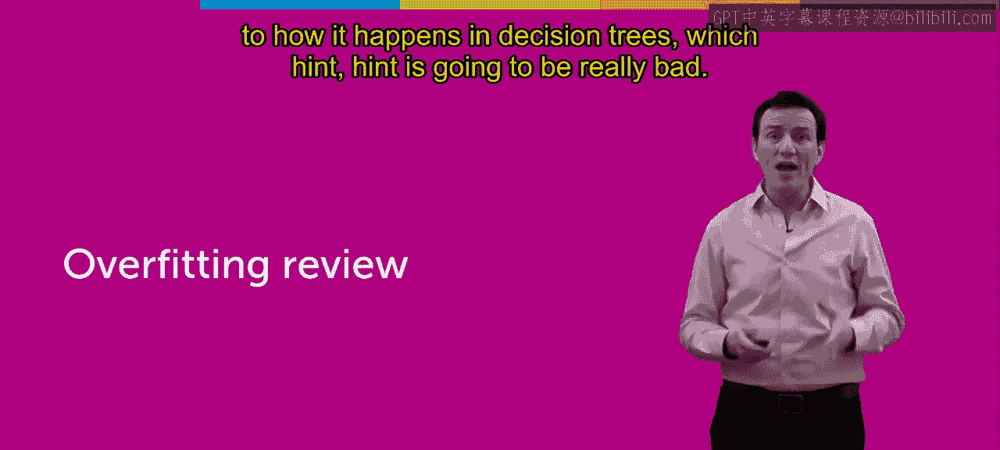
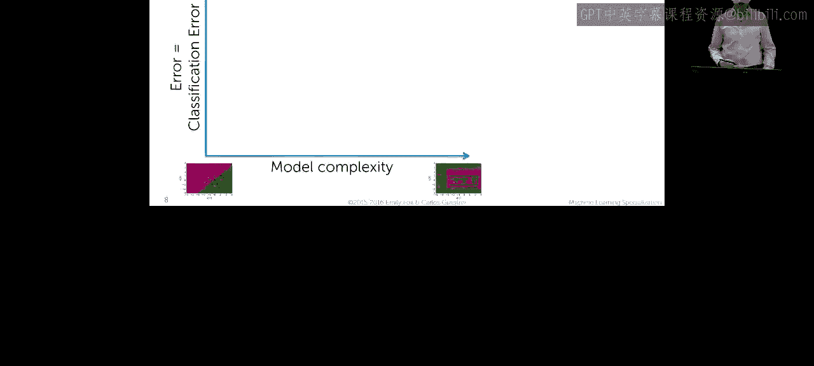
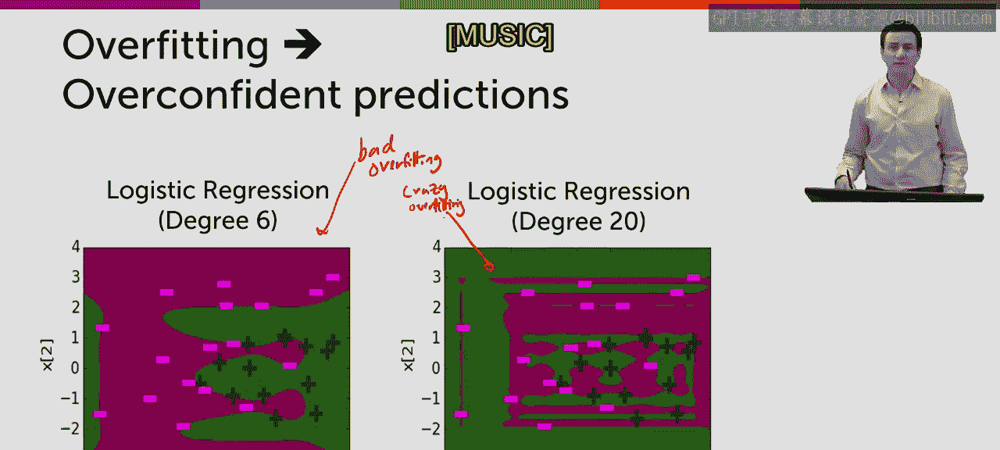

# 机器学习（分类，聚类和检索）：3-4：决策树过拟合回顾 🧠

在本节课中，我们将回顾决策树的基础知识，并深入探讨一个关键问题：过拟合。我们将了解什么是过拟合，它为何在决策树中尤为突出，以及它对模型性能的影响。

## 决策树基础回顾 🌳

上一节我们介绍了决策树，这是一种非常强大的分类器，能够处理多种不同类型的数据。决策树通过一系列规则对数据进行划分，最终做出预测。

在我们的贷款申请评估系统示例中，输入数据 `XI` 代表贷款申请信息，输出 `Y_hat_I` 是我们预测的贷款风险类别（安全或高风险）。决策树的目标就是学习从 `XI` 到 `Y_hat_I` 的映射规则。

## 过拟合问题 🔍

然而，决策树有一个显著的缺点：它非常容易过拟合。在深入探讨如何避免之前，我们先花一点时间回顾一下什么是过拟合。

过拟合是指模型在训练数据上表现很好（训练误差很低），但在新的、未见过的数据上表现很差（真实误差很高）的现象。随着模型复杂度增加，训练误差会持续下降并趋近于零，但真实误差会先下降后上升。

更具体地说，过拟合发生在我们最终选择了一个模型参数 `W_hat` 时，该模型具有**低训练误差**但**高真实误差**。而实际上，可能存在另一个模型参数 `W_star`，它虽然训练误差稍高，但真实误差却低得多。这就是过拟合的核心问题。

我们在逻辑回归中已经见过这个效应。随着多项式次数的增加，决策边界变得异常复杂和“疯狂”，导致严重的过拟合。我们称这种现象为“疯狂过拟合”。

## 决策树中的过拟合 🌲➡️🍂

决策树模型可以非常快速地变得过度复杂。一个深度很大、分支很多的决策树会记住训练数据中的每一个细节，包括噪声和异常值，从而导致过拟合。

为了避免这种情况，我们需要找到方法在模型复杂度和泛化能力之间取得平衡。这通常意味着我们需要选择一棵不那么复杂（例如，深度较浅）的树。

## 总结 📝

本节课我们一起回顾了决策树的基础和过拟合的概念。我们了解到：
*   决策树是一种灵活的分类器。
*   **过拟合**是模型在训练集上表现优异但在新数据上表现不佳的问题，其核心公式可概括为：选择模型时，`训练误差(W_hat) ≈ 0` 但 `真实误差(W_hat) >> 真实误差(W_star)`。
*   决策树由于其结构特点，特别容易产生过拟合。

在接下来的课程中，我们将学习如何通过“剪枝”等具体技术来避免决策树中的过拟合，从而构建出更稳健的模型。