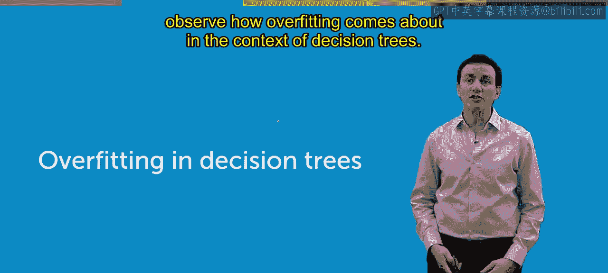
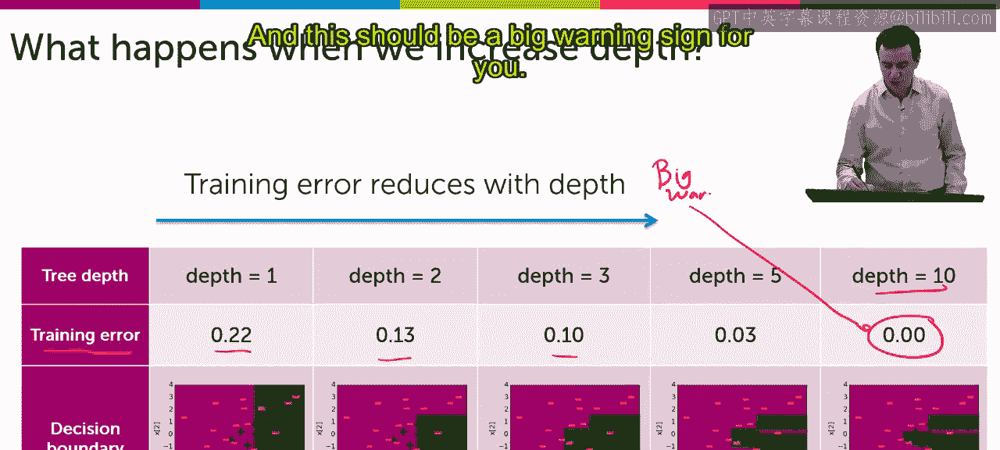
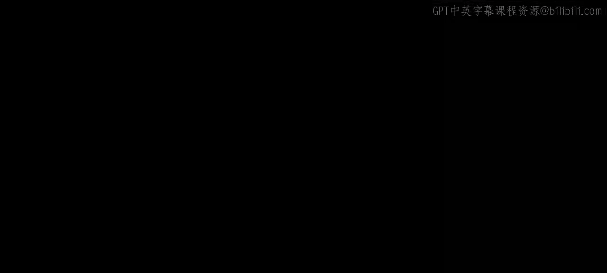
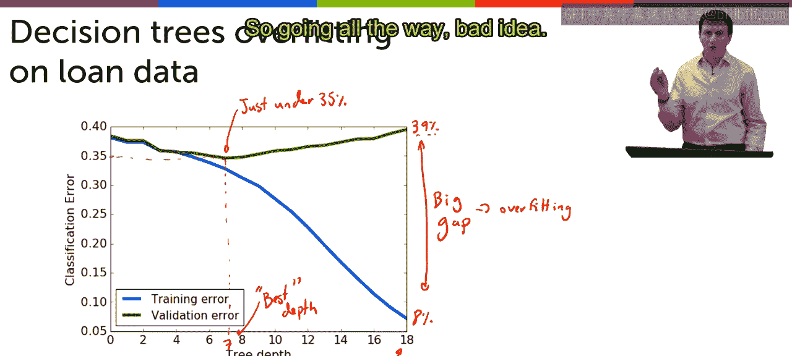

# 华盛顿大学《机器学习（分类，聚类和检索，第3-4课⧸共4课）｜Machine Learning》中英字幕 p72 71_决策树中的过拟合.zh_en -BV1Sr421F7N7_p72-

。

With all that in mind， let's just dig in and observe how overfitting comes about in the context of decisionion trees。

When we start learning a decision tree， we learn a decision st。

 which is a very simple boundary between the data， let's say a simple example we be usings a vertical line or a horizontal line。

 and so in this case when the decision with respect to x1 as to whether it's less than minus-0。

07 or greater than than a 0。07 so if it's less than we're going to predict minus-1 and that will correspond to this side of the decision boundary。

 but if it's greater than 0。 the minus0。07 we're going to predict plus1 and we're going to be falling to the right side of that decision boundary and so that's a very simple decision boundary with just a depth1 decision tree or a decision st but as we increase the depth that situation becomes more and more complex the decision boundary become more and more complex so you can see。

As you increase a depth， you increase the complexity of the decision boundaries。

Until we end up with a super crazy one here where the depth is 10。

And so that step 10 decision boundary。Has zero。Traee error so the training error at this point goes down from 0。

22， which is relatively high for the decision stamp through 0。13 and 0。10。

 which are depth and three decision trees which looked okay to this crazy decision tree of depth 10 which had zero training error and this should be a big warning sign for you。

And I should side face。

We've seen that with decision trees， as we increase the depth。

 the training error goes down until we get to a point where the training error could even reach zero and very often actually does in this case with decision tree of depth 10。

 so it could say oh decision tree or depth trend that's great， it has zero train error。

 so that's a perfect decision tree。But in reality， it's not a perfect decision tree。And as we know。

 even though the training error is zero， the true error can shoot up。

 and so this can be a really highly overfitting decision tree。So。

It's good to take a step back and really understand a little bit better why the training error of the Syrian trees tend to go down so quickly with depth。

So let's take this simple example where were just learning decision St。

 we had 40 data points just like we've been using， 22 of them were safe loans， 18 were risky。

And we chose first to split on credit。Now the question is。Why did we choose to split on credit first？

Why was that the first feature we chose and the reason we chose to split on credit first is because it improved the training error the most。

Imve the training error from 0。45 to 0。20。 So that was a good first split to make。 Now。

 if we go back and review the algorithm for choosing what the best decision split is。

The best feature to split on is。We try every single possible feature。

And pick the one that decreases the training error the most。

And so every step of the way we're adding features that decrease the training error and we're adding features that decrease the training error and we're adding features decrease the training error。

 and eventually we're going to drive the training error to zero。

 unless of course we get to some point where we can't drive the training error down because we run our features split on and we have positive points on top of negative points。

 but that's kind of a side note Most importantly， just remember the train error tends to go down。

 down， down， down。😊，And so that going down as you increase the depth is what leads to this low traininging error。

 which often leads to these very complex trees which are very prone to overfitting。

And here's a real world data set from loan data where we actually observed that big bad overfitting problem。

So if we take the depth of the tree and we push it all the way to depth 18。

 we'll see that the training error has gone down a lot。And it's the blue line。

 which gets you down to about 8% training error which is extremely low， however。

 if you look at the validations that error， man， that was not so good， maybe that's around 39%。

And so there's a。Big up。Between the two。Which。We will characterize as a form of overfitting。

If somehow you were able to pick the best depth。For decision3， which in this case。Was depth seven。

Then。You notice that， in this case。The training the validation error is just under。35%。

In other words。If I could pick the right depth， I'll get 39% validation error。

 but if I let it go until a very low train error， I get a validation error of 39%。😊。

So going all the way by the idea， got to stop a little earlier。

