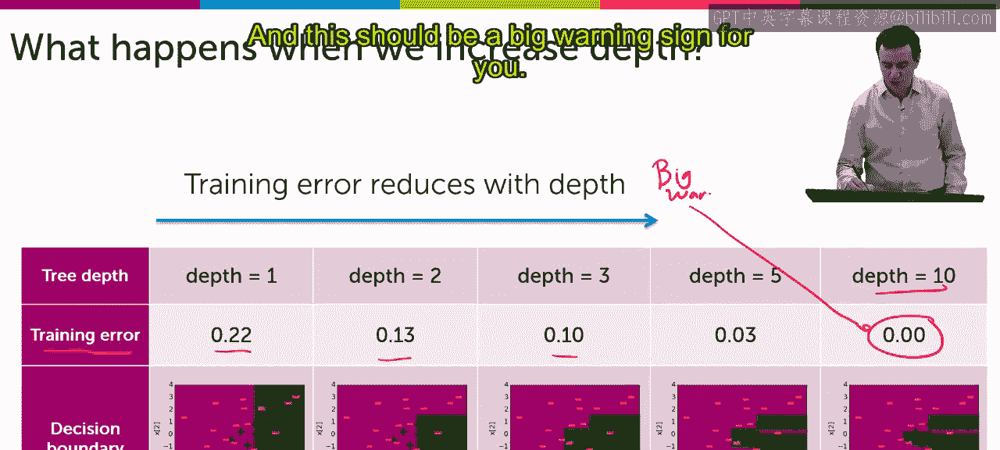
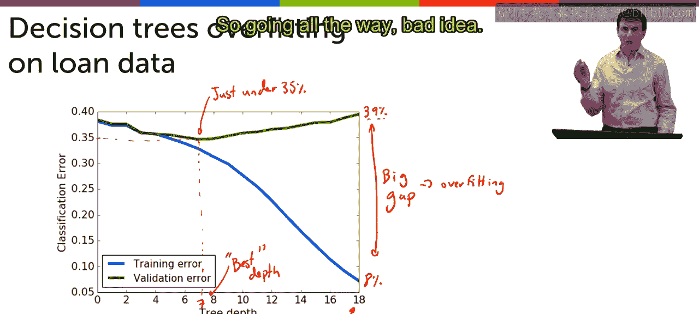

# 机器学习（分类，聚类和检索）：第3-4课：决策树中的过拟合

在本节课中，我们将要学习决策树模型中的一个核心问题：过拟合。我们将通过观察决策树深度增加时，模型在训练集和验证集上表现的变化，来理解过拟合是如何发生的，以及为什么我们需要警惕训练误差过低的情况。

---

上一节我们介绍了决策树的基本概念。本节中我们来看看，随着决策树变得复杂，模型的表现会发生什么变化。

当我们开始学习一个决策树时，我们首先学习的是一个决策桩。决策桩是数据之间一个非常简单的边界，例如一条垂直线或水平线。

在这个例子中，决策规则是关于特征 `x1` 是否小于 `-0.07`。如果 `x1 < -0.07`，模型预测为 `-1`，这对应于决策边界的左侧。如果 `x1 > -0.07`，模型预测为 `+1`，这对应于决策边界的右侧。这是一个深度为1的决策树，即决策桩，其决策边界非常简单。

随着我们增加决策树的深度，决策边界会变得越来越复杂。你可以看到，深度增加，决策边界的复杂性也随之增加。

直到我们得到一个深度为10的、极其复杂的决策边界。这个深度为10的决策树在训练集上的误差为零。训练误差从决策桩的 `0.22`（相对较高），下降到深度为2和3的决策树的 `0.13` 和 `0.10`，最后到这个深度为10的疯狂决策树的 `0`。这应该是一个巨大的警告信号。

---

我们观察到，对于决策树，随着深度增加，训练误差会持续下降，直到可能达到零。在这个深度为10的决策树案例中，训练误差确实为零。

你可能会说，深度为10的决策树太棒了，它有零训练误差，所以它是一个完美的决策树。但实际上，它并非一个完美的决策树。正如我们所知，即使训练误差为零，真实误差（泛化误差）可能会急剧上升。因此，这可能是一个高度过拟合的决策树。

---

为了更好地理解为什么决策树的训练误差会随着深度增加而迅速下降，让我们回顾一个简单的例子。

我们使用了一个包含40个数据点的简单数据集，其中22个是安全贷款，18个是风险贷款。我们首先选择在“信用”特征上进行分割。

问题是，为什么我们首先选择在“信用”特征上分割？原因是我们选择首先在“信用”上分割，是因为它最大程度地降低了训练误差，将训练误差从 `0.45` 降低到了 `0.20`。这是一个很好的首次分割。

如果我们回顾选择最佳分割特征的算法，其核心是：我们尝试每一个可能的特征，并选择那个能最大程度降低训练误差的特征。

因此，在构建树的每一步，我们都在添加能够降低训练误差的特征。我们不断地添加特征来降低训练误差，最终会将训练误差驱动到零。当然，除非我们到达某个点，无法再降低训练误差，例如用尽了所有特征或正负样本已经无法完全分开。

最重要的是，请记住训练误差倾向于持续下降。这种随着深度增加而下降的趋势，导致了很低的训练误差，但也常常导致产生非常复杂、极易过拟合的树。

---

以下是一个来自真实贷款数据集的例子，我们实际观察到了严重的过拟合问题。

*   如果我们把树的深度一直增加到18，会看到训练误差（蓝线）下降了很多，大约降至8%，这是极低的。
*   然而，如果你观察验证集误差（橙线），情况就不那么好了，它大约在39%左右。
*   因此，训练误差和验证误差之间存在一个巨大的差距，我们将此表征为一种过拟合。

如果我们能够选择决策树的最佳深度，在这个案例中是深度7，那么验证集误差会略低于35%。换句话说，如果我选择了正确的深度（7），我能得到约35%的验证误差；但如果我任由树生长到训练误差极低（深度18），我却得到了39%的验证误差。

所以，盲目追求深度并不可取，我们需要适时停止。

---

本节课中我们一起学习了决策树中的过拟合现象。我们看到，随着决策树深度增加，模型会变得过于复杂，完美拟合训练数据（训练误差降至零），但在未见过的验证数据上表现变差（验证误差升高）。这提醒我们，在机器学习中，不能只追求训练集上的完美表现，控制模型复杂度、防止过拟合至关重要。在实践中，我们需要通过验证集来选择合适的模型深度。