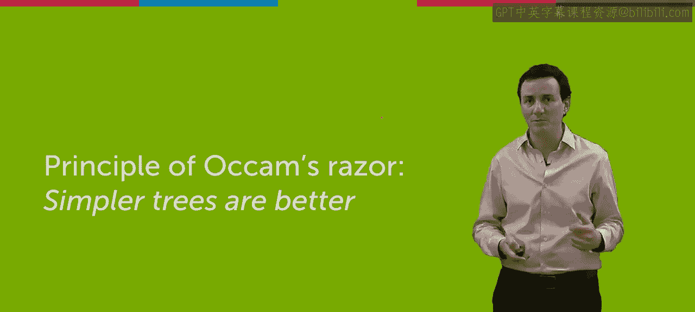
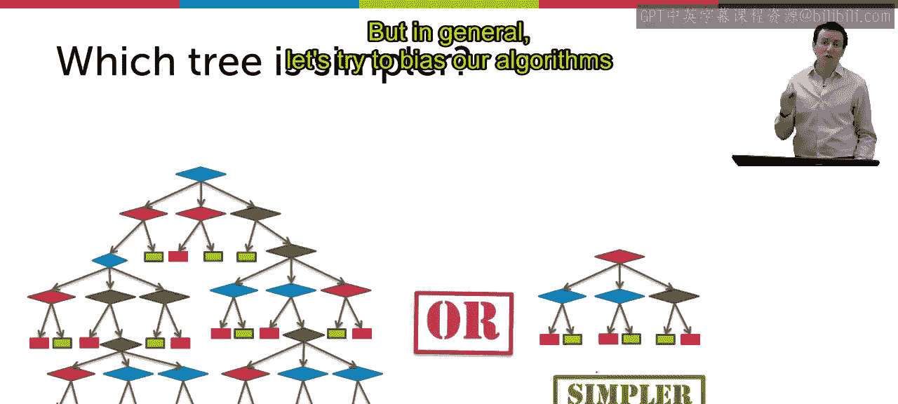
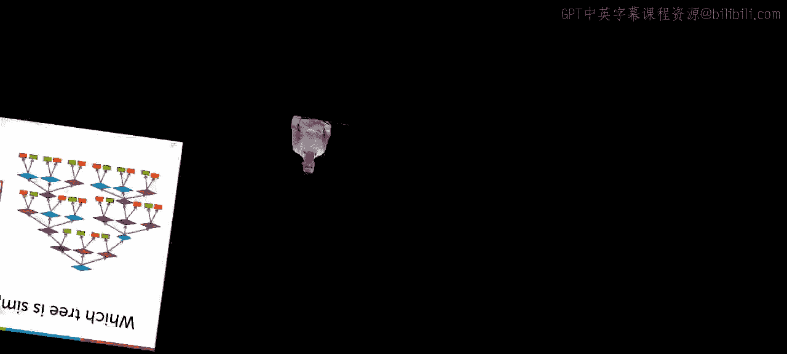
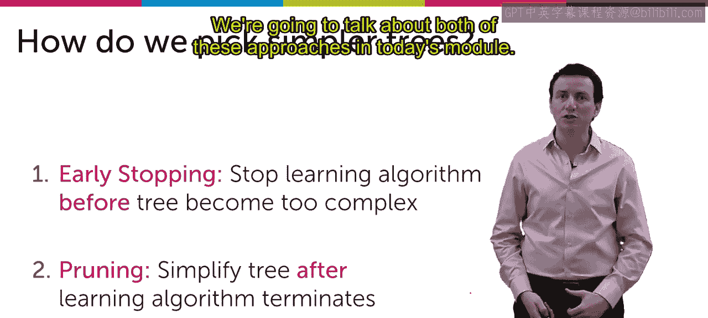

# 华盛顿大学《机器学习（分类，聚类和检索，第3-4课⧸共4课）｜Machine Learning》中英字幕 p73 72_奥卡姆剃刀原理：学习更简单的决策树.zh_en -BV1Sr421F7N7_p73-

。

So what does it mean to avoid overfitting indecision trees。

 what does it mean to stop a little earlier or what does it mean to try to simplify the types of trees that we learn so that we don't have this crazy overfitting problems and what we'll use is a type of regularization which biases us towards simpler trees and that's also kind of philosophically related to concept called outcomesham's razor and so let's talk about that principle。

It's interesting that this idea of finding simpler trees。

 simpler explanations for data is a concept that goes back to a long， long time。

 so many people call itockham's Rar because of William Oham who was talking about this concept around the 13th century。

 although this goes back to Pyagoras and Aristotle， 2000 years or so before that， but。

Basically the concept there has been of the possible hypothesises of the possible explanations。

 as we'll see of the possible trees， you should also speak the one that explains the data with as simple an explanation as possible。

 so for example let's say that you you go to a doctor and say I have these two symptoms S one and S2 let's say have terrible red headache and a terrible sore throat。

So there's two options that doctor might say。嗯。A brain tumor explains the headache。And。A。You know。

 throat infection explains the sore throat。Or it could say， okay， there's another disease。

 let's say common code that explains both the headache。And the sore throat。And in that case。

It's probably better， probably more likely that it's just one disease that explains both symptoms than in having two separate disease。

 one explains symptom one， that one that explains symptom2。Now it's kind of a general idea。

The way the Am talked about it was among competing hypotheses。

 the one of fierce's assumptions should always be selected。

 and so fierce assumptions here is like simplest in our case。In the context of decisionion trees。

 the outcomeist raised in the principle says， if you have two trees that have similar classification error pick the simpler one。

So let's go through the examples below。Let's see。😊，We have the training error。

For four different trees， and then we have the validation error for four different trees。

So we observe a couple different things。We observe that two trees have similar validation error and that one tree has a very low train error but higher validation error。

 so the lower tree is clearly overfit， the so the simple complex tree is definitely bad。

But interestingly， what you do about these two trees， the moderate one and the more complex one。

 they get same validation error， but one has higher training error， you can say well。

 you know what the simpler trees probably better is less likely to overfit so I'm probably going to pick。

The moderately complex tree。That gives me reasonable training error and low validation error。

 So that's kind of an intellectually conceptually validating kind of idea。

 try to pick simpler trees that explain the data relatively well and do well in a validation set。

But to get this right， we have to go dig in and define what a simpler tree is。

So the question here is what makes a tree simpler and so we have this really complex， high depth。

 complicated tree on left。😊，Or， you know， the shallower。

Two level decisionion3 on the right and clearly the one on the right is simpler so if they both have similar performance。

 let's pick the simpler trees， but in general let's try to bio our algorithms to find the simpler trees are than the more complex ones。

😊。

We're going to see next is a modification of the decision tree algorithm that's going to bias us ourselves to simpler trees。

 so in other words let's try to avoid complex trees and focus on simpler trees and the question is how do we do that and there's two main approaches out there for doing that one is what's called early stopping instead of keeping making a tree deeper and deeper and deeper somehow stop earlier to avoid overfitting and stop at simpler trees。

😊，The more advanced approach it tends to work much better。

 it's called pruning where you build a deeper tree and then you chop off some leaves at the bottom。

 some decisions that were not that important and come up with a simple tree that way we're going to talk about both of these approaches in today's module。

