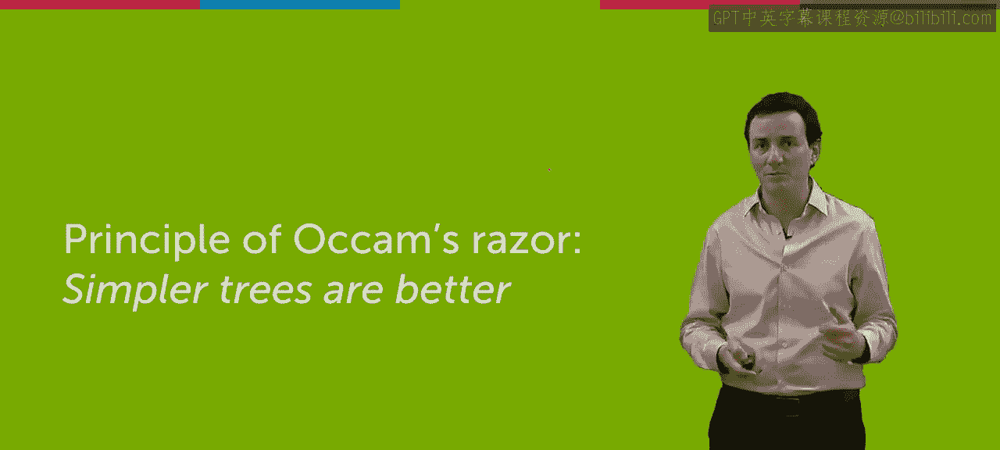
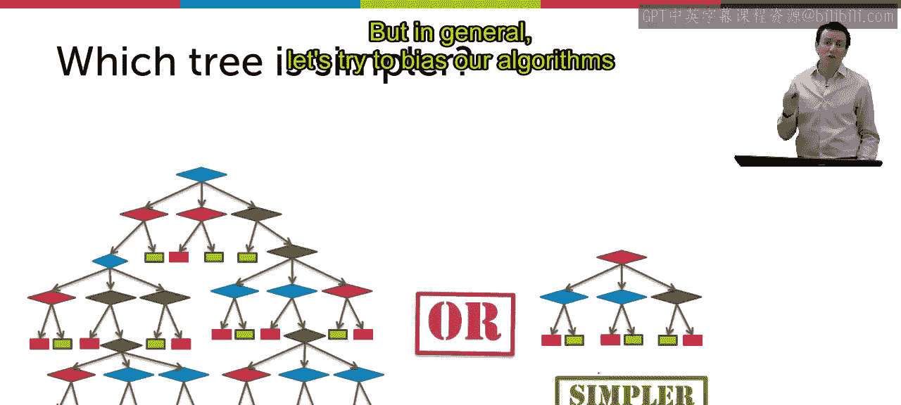
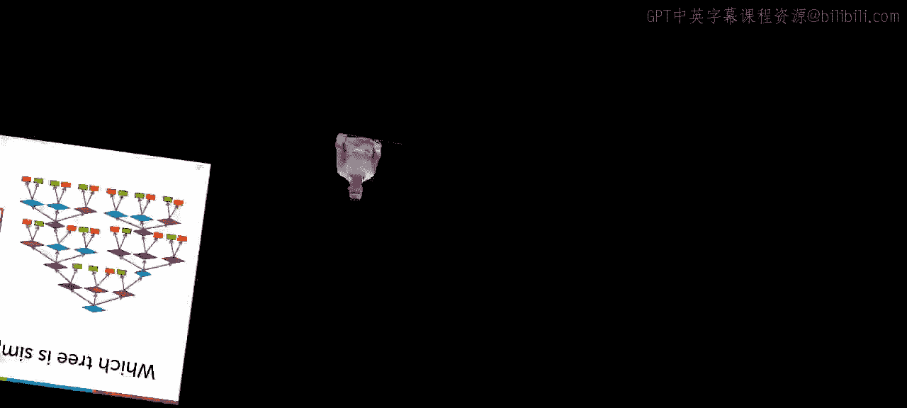
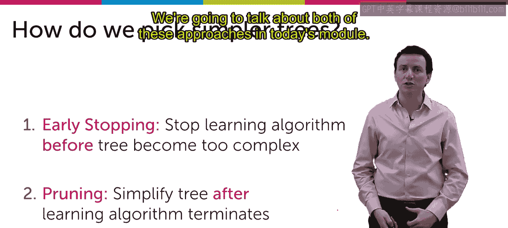

# 机器学习（分类，聚类和检索）：第3-4课：奥卡姆剃刀原理：学习更简单的决策树

在本节课中，我们将要学习如何避免决策树模型中的过拟合问题。我们将探讨奥卡姆剃刀原理，并学习两种主要技术——**早停法**和**剪枝法**，它们能引导我们构建更简单、泛化能力更强的决策树。

## 避免决策树过拟合的含义

上一节我们介绍了决策树可能出现的过拟合问题。那么，避免决策树过拟合具体意味着什么？它意味着我们需要提前停止树的生长，或者尝试简化我们学习的树的结构，从而避免严重的过拟合问题。我们将使用一种**正则化**方法，它会使我们倾向于选择更简单的树。这种方法在哲学上与一个称为“奥卡姆剃刀”的概念相关，接下来让我们讨论这个原理。

## 🪒 奥卡姆剃刀原理

寻找更简单的树、为数据提供更简单解释的这一思想，其历史可以追溯到很久以前。许多人称之为“奥卡姆剃刀”，源于13世纪左右讨论此概念的威廉·奥卡姆，尽管这一思想甚至可以追溯到更早的毕达哥拉斯和亚里士多德。

其核心概念是：在所有可能的假设或解释（在我们这里就是所有可能的树）中，你应该选择那个能够用尽可能简单的解释来说明数据的那一个。

例如，假设你去看医生，说你有两种症状S1和S2，比如剧烈的头痛和严重的喉咙痛。医生可能有两种解释：
1.  脑瘤解释了头痛，而喉咙感染解释了喉咙痛。
2.  另一种疾病，比如普通感冒，同时解释了头痛和喉咙痛。

在这种情况下，很可能是一种疾病同时解释了两种症状，而不是两种独立的疾病各解释一种症状。这是一种普遍的理念。奥卡姆的表述是：在相互竞争的假设中，应该选择假设最少的那一个。在这里，“假设最少”就相当于我们所说的“最简单”。

在决策树的语境下，奥卡姆剃刀原理可以表述为：**如果你有两棵分类错误率相似的树，请选择更简单的那一棵。**

让我们看下面的例子。我们观察到了几件事：
*   我们观察到有两棵树具有相似的验证集错误率。
*   其中一棵树训练错误率很低，但验证错误率更高，这棵树显然是过拟合的，因此复杂度过高的树肯定不好。
*   但有趣的是，对于那两棵验证错误率相同的树（中等复杂度树和更复杂的树），其中一棵训练错误率更高。根据奥卡姆剃刀，更简单的树可能更好，因为它更不容易过拟合。因此，我们很可能会选择那棵**中等复杂度的树**，它给出了合理的训练错误率和较低的验证错误率。

这是一个在概念上得到验证的想法：尝试选择那些能相对较好地解释数据，并且在验证集上表现良好的更简单的树。

## 如何定义“更简单”的树？

但要正确应用这一原理，我们必须深入定义什么是一棵“更简单”的树。

问题是：什么让一棵树更简单？我们左边有一棵深度很高、非常复杂的树，右边则是一棵较浅的两层决策树。显然右边那棵更简单。如果它们性能相似，我们就选择更简单的树。总的来说，我们应该尝试**引导我们的算法去寻找更简单的树，而不是更复杂的树**。

## 🛠️ 实现更简单决策树的方法

接下来我们将看到的是对决策树算法的修改，它将引导我们走向更简单的树。换句话说，我们要尝试避免复杂的树，专注于更简单的树。问题是如何做到这一点？主要有两种方法：

以下是两种主要方法：
1.  **早停法**：与其让树长得越来越深，不如在某个时刻提前停止，以避免过拟合，从而停在更简单的树上。
2.  **剪枝法**：这是一种更高级的方法，通常效果更好。你先构建一棵较深的树，然后“修剪”掉底部一些不重要的叶子节点（决策），从而得到一棵更简单的树。

在今天的课程中，我们将讨论这两种方法。

## 总结

本节课中，我们一起学习了如何应用奥卡姆剃刀原理来避免决策树过拟合。我们理解了选择更简单模型的重要性，并介绍了两种实现这一目标的技术：**早停法**和**剪枝法**。这些方法通过引导算法构建复杂度适中的树，帮助我们在保持良好解释能力的同时，提升模型在未知数据上的泛化性能。