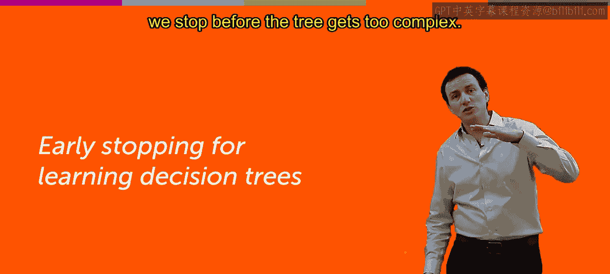
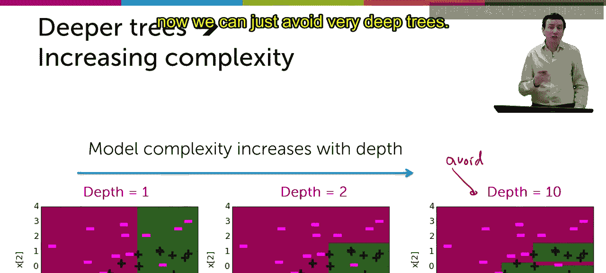
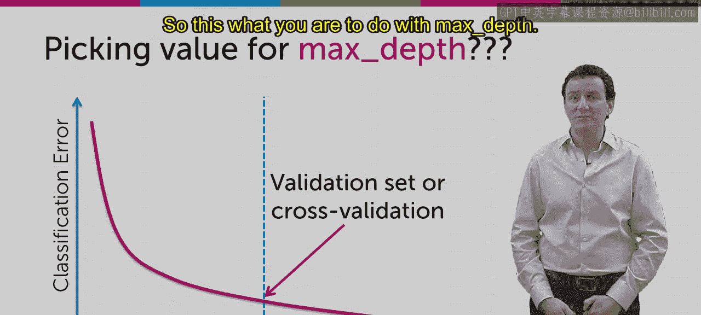
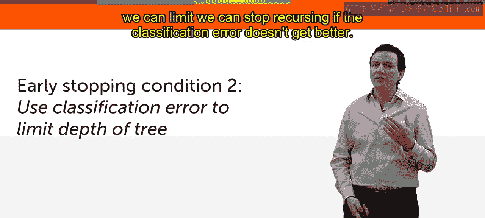
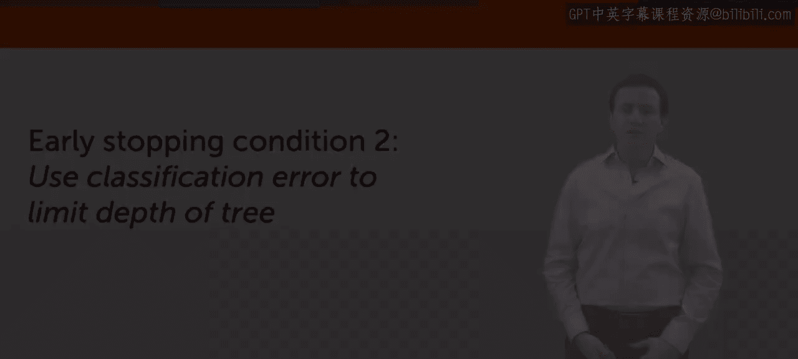
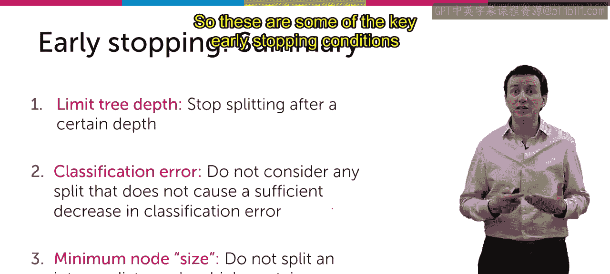
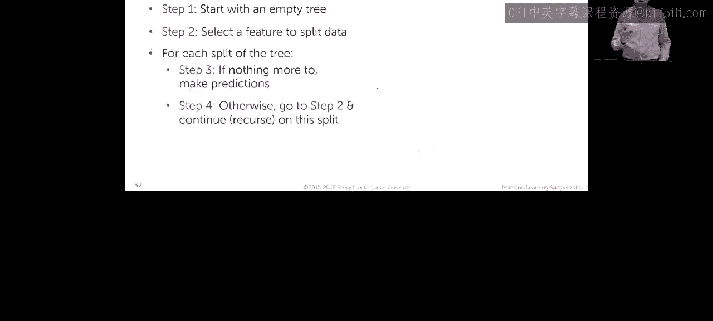
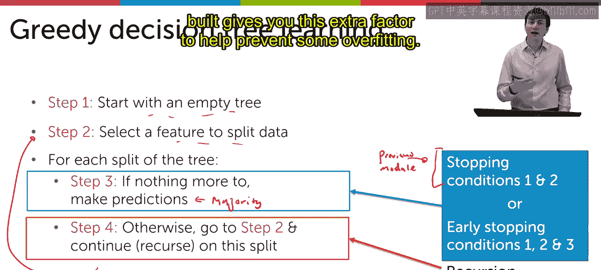

# 华盛顿大学《机器学习（分类，聚类和检索，第3-4课⧸共4课）｜Machine Learning》中英字幕 p74 73_学习决策树时的早停.zh_en -BV1Sr421F7N7_p74-

。

Well， let's start with the idea of early stopping where we keep going down。

 but we stop before the tree gets too complex， so how does that work？

Simply recall that as we add more depth to the tree， we're increasing the complexity of the model。

 and so if we are avoiding these super complex models， then we can just avoid very deep trees。

So the first early stopping condition is absolutely simple， just limited up of the tree。

Now we know that the training error goes down as increased the depth of the tree。

 but the true error goes down and goes up， so maybe there's some magical max depth where before that the trees are simple。

 they get too good true error， but after that the trees get too complex and the true error keeps going up。

And so somehow this max depth is going to be a magic parameter we're going to provide where we stop going down the recursion once we hit that max step。

And just like any other magic parameter in machine learning， you have to figure out how to pick it。😊。

And the answer is。Validation set or cross validation never use a validation set sorry never use your test set to pick your magic parameters。

 so this is what you have to do with Mac step。😊。

Limiting the depth is just one approach for limiting the complexity of the decision tree however。

 if you limit the depth you're cutting every branch in the same way。

 but some branches might want to go further than others so let's take a look at an approach where some branches might go down further than others so for example we can limit we can stop recursing if the classification error doesn't get better。

😊。

So we split on credit and now we're looking at what happens if we recur some poor。

 so of the five safe loans that we have in poor with credit code poor and the 16 risky loans of credit were poor if we just stopped there and made no splits we be making five mistakes。

The error would be 5 out of 21， which is 0。24。Now if I were to try to split on the other features term and income。

 suppose that neither of them helped， suppose neither of them decreased the training error。

 so training error were still 0。24 for both of them。

 What should I do Now I could try to split on one then keep going but that would make the tree more and more complex so another stopping a second stopping condition might use is to say stop there。

If the train error is not decreasing， don't make the tree more complex。

 Use outcomescom's razor and stop the process right there and just say。

Everything after credit Co sp is just a risky loan。

And then just focus on what to do with the node where credit is fair。

So the second type of early stopping criteria we're exploring is。Keep recursing。

 but stop if the train error does not decrease。 Don't make the tree more complex。

Now there's a few practical caveats about this first typically you don't just stop if that error doesn't decrease at all。

 you put a magic parameter， you say stop if error doesn't decrease by more than epsilon。

 let's say if it doesn't increase by more than 1%。We just stop then there's a few pitfalls in practice for this rule and we talk about those a little bit in the context of pruning。

 so this is a rule you should be super careful about。

 but it's very useful in practice so something to definitely keep in mind。

The third type of early stopping rule is extremely important and you should always include it and he just says if there is only few data points left in a node。

 don't split any further because then youre really risky overfitting so in example we've been looking at we had that case or credit is equal to fair well there was only one safe loan there and two risky loans so total of only three data points fall inside of that node in that case if I were trying to split further we're going to find multiple patterns in the data they don't make much sense because there's very little data to support those patterns。

😊，With three data points， I don't know if I really trust a decision tree algorithm to make tons of decisions。

 so I'll just stop recursing right there。In general， we should always set kind of a parameter。

 say n min， which says if a node has fewer data points than N min then or n min or less。

 then just stop recursing right there and call that early stopping conditionition3。

 this one you should always implement， no matter what。For example。

 here I'm suggesting setting Nmin to 10， 10 is quite a nice number for Nmin if you have a relatively small data set size。

 if you have a huge data set size you might set it to 100。

 but somewhere between 10 and 100 is a good value for Nmin。😊。

So let's summarize the early stopping conditions that we described and this approach to try to find decisionion trees that are not too complex。

There are3。 The first one is limiting the depth of the tree。

 That's a relatively good condition to set。 and you should set that one to be something pretty carefully using cross validation。

 The second one is stop recursing if the classification error doesn't decrease by enough by0 decrease by0 by doesn't decrease by more than absolute。

 It's a little risky， but it can be very useful。 The third one extremely useful。

 you should always do it。 stop recursing。 If there's not that many data points left inside of a node。

😊，So these are some of the key early stopping conditions a decision three algorithm should be thinking about。

If we go back to the decision tree greedy learning for the tree algorithm that we discussed in the previous module。

 we start off the empty tree， we selected a feature to split on。

Then we said， stop if there was nothing left to do and just make the prediction。

 this is the majority class。And otherwise， we're going to recurse and go back to step two。

Now we considered。Two stopping conditions in the previous module。And to those。

We are adding the three early Italy shopping conditions that we just described。

And so small modification to the code you've already built gives you this extra factors to help prevent some overfitting。

