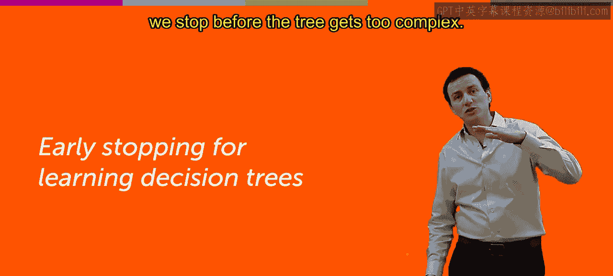
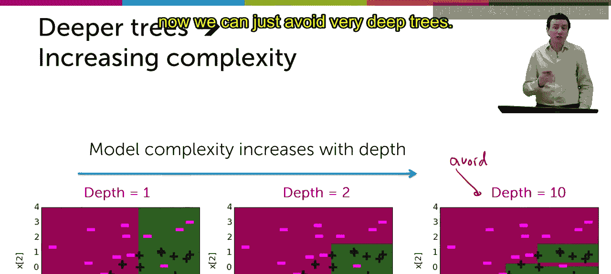
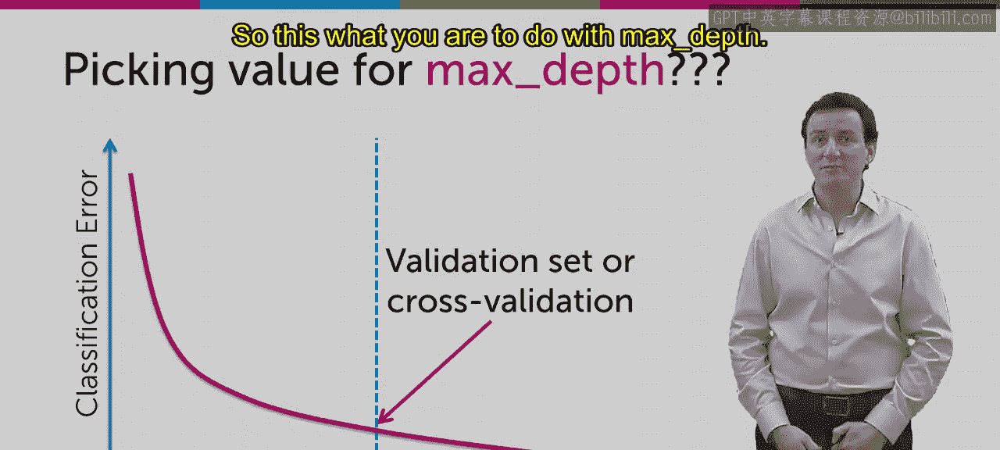
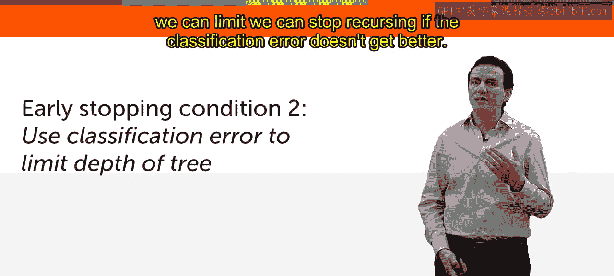
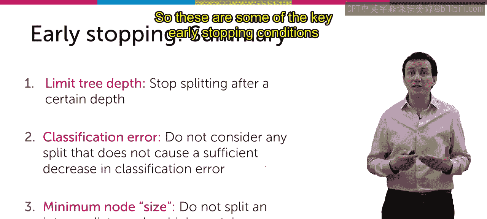
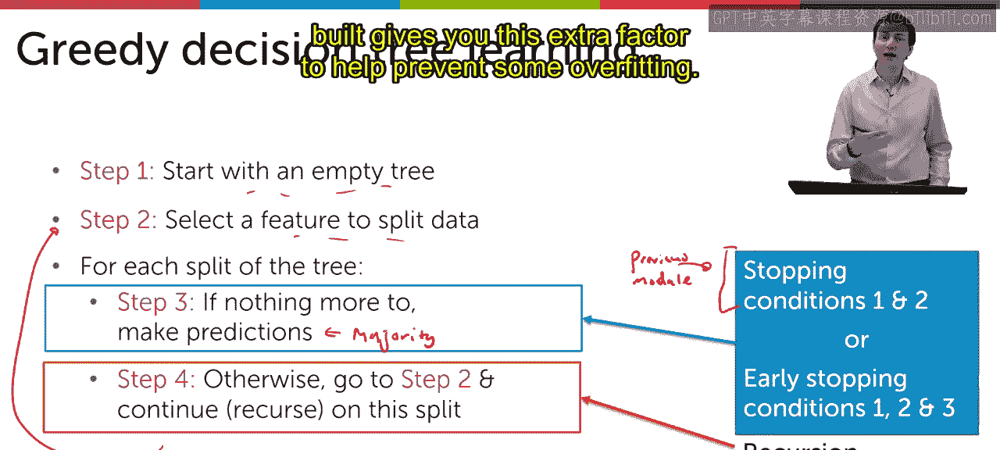

# 机器学习（分类，聚类和检索）：3-4：学习决策树时的早停 🛑

在本节课中，我们将要学习决策树学习过程中的一个重要技术——**早停**。早停是一种防止决策树模型过于复杂、从而避免过拟合的策略。我们将探讨三种具体的早停条件，并理解它们如何被整合到决策树的学习算法中。

上一节我们介绍了决策树的基本构建过程，本节中我们来看看如何通过早停来控制树的生长，防止过拟合。

## 早停的基本概念

早停的核心思想是：在决策树向下生长的过程中，**在树变得过于复杂之前就停止分裂**。这样做的目的是为了控制模型的复杂度。

随着树深度的增加，模型的复杂度也随之增加。如果我们希望避免那些过于复杂的模型，一个直接的方法就是避免生成非常深的树。

## 三种早停条件

以下是三种常用的早停条件，它们可以单独或组合使用，以控制决策树的生长。

### 1. 限制树的最大深度 🌳

第一种早停条件非常简单：**为树设置一个最大深度限制**。

我们知道，随着树深度的增加，训练误差会持续下降，但真实误差（泛化误差）会先下降后上升。因此，可能存在一个“最佳”的最大深度，在此之前，树足够简单且真实误差较低；在此之后，树变得过于复杂，真实误差开始上升。

这个最大深度 `max_depth` 是一个需要通过验证集或交叉验证来确定的超参数。**切勿使用测试集来选择此类超参数**。

### 2. 当分类误差不再降低时停止 📉

第二种早停条件是：**如果继续分裂不能显著降低训练误差，则停止递归**。

限制深度是对所有分支进行“一刀切”的限制。但有些分支可能需要更深的分裂才能获得好的效果。因此，我们可以检查在当前节点进行分裂后，分类误差是否得到改善。

例如，假设在一个节点上，不分裂时的训练误差是 `0.24`。如果尝试所有可能的特征进行分裂后，最佳分裂带来的训练误差仍然是 `0.24`（或改善幅度小于一个阈值 `epsilon`，例如 `1%`），那么就不应该继续分裂，以避免增加不必要的复杂度。

在实践中，通常会设置一个阈值参数 `epsilon`，只有当误差降低超过这个阈值时才继续分裂。这个规则需要谨慎使用，但在实践中非常有用。

### 3. 当节点数据量过少时停止 📊

第三种早停条件极其重要，**应该始终被包含在算法中**：**如果节点中剩余的数据点太少，则停止分裂**。

当数据量很少时继续分裂，会极大地增加过拟合的风险，因为算法会试图从噪声中寻找模式。

通常，我们会设置一个参数 `n_min`（例如 `10` 或 `100`）。如果一个节点包含的数据点数量 **小于或等于** `n_min`，则立即停止在该节点的递归。对于较小的数据集，`n_min=10` 是一个不错的起点；对于大型数据集，可以设置为 `100`。

## 整合到决策树算法中

回顾之前模块讨论的决策树贪心学习算法，其基本步骤是：
1.  从空树开始。
2.  选择一个特征进行分裂。
3.  如果满足停止条件，则将该节点标记为叶节点，并预测多数类。
4.  否则，递归地对子节点回到步骤2。

我们之前已经讨论过两种停止条件（如所有样本属于同一类）。现在，我们将上述三种**早停条件**加入到这个框架中。

对现有代码进行微小的修改，加入这些早停条件，就能有效帮助防止决策树的过拟合。

## 总结

本节课中我们一起学习了决策树学习中的**早停**技术。我们介绍了三种关键的早停条件：
1.  **限制最大深度**：通过 `max_depth` 参数直接控制树的结构。
2.  **分类误差不再改善时停止**：通过阈值 `epsilon` 判断分裂是否带来足够收益。
3.  **节点数据量过少时停止**：通过 `n_min` 参数避免在数据不足的节点上进行不可靠的分裂。

将这些条件整合到决策树构建过程中，可以帮助我们找到复杂度适中、泛化能力更强的模型。记住，超参数如 `max_depth`、`epsilon` 和 `n_min` 需要通过**验证集**或**交叉验证**来谨慎选择。