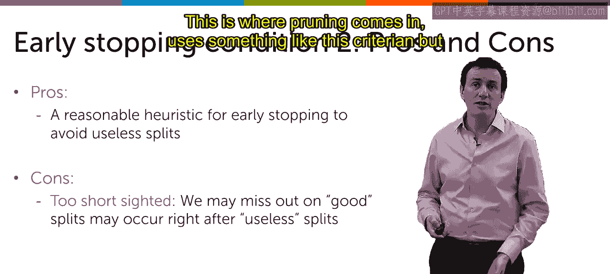

# 华盛顿大学《机器学习（分类，聚类和检索，第3-4课⧸共4课）｜Machine Learning》中英字幕 p75 74_可选：修剪的动机.zh_en -BV1Sr421F7N7_p75-

。

Often the best way to prevent overfi the ciion trees， however， is to use pruning。

 where you grow the tree to be much bigger than you need。

 and then you chop off parts that turn out to be less important。Now。

 pruning is very important if you're implementing a real world decision tree algorithm。 However。

 the details can get a little tedious， not too mathematical。

 but just a lot of little things you have a lot of tea across and I so dot。

 And so we've made this section optional。 you're welcome to watch it， not a lot of math here。

 just a lot of detail。 And so I would recommend you especially pay attention if you're implementing your own decision tree learning from scratch。

 but if not just know that what pruning is we just talked about it and know that most implementations。

 most great implementations out there would use some kind of pruning。😊。

We've discussed lots of recursions where we're building the decision tree from the top down。

 and we discussed two types early stopping of stopping conditions， the ones that we should always do。

 the stopping conditions from the previous module and the three earliest topic conditions from this module。

😊，Now let's explore some of the challenges that come about with these early stopping conditions。

Early shopping condition once was， let's pick a max step and stop recursing once you reach that max step。

The question is， how do you really pick that max up？😊。

We said you should use cross validation or validation set。

 but you know there can be challenges with setting data aside for that。

 you have to rerun your algorithms many times and you might not always reach the desired answer that you like and plus you want some parts of the tree to grow more than others it becomes really kind of complicated to set the parameter。

Now， early stopping condition two is the most dangerous one。

Elyop condition2 says stop if the training error stops decreasing。

 So if that classification error for the training data stops going down， so it flattens out。 However。

 it turns out that in practice， the curve might not be as beautiful as what I drew。

 might not be smoothly going down， it might jump and if I do some weird stuff。

 So let's see why that can come about。As we discussed， stopping condition2 early stopping condition2。

 stop when error doesn't decrease can be a dangerous and to show how it's dangerous。

 we need a counter example and we'll use the counter example for everything。

Which if you saw the coarse one， you know that it is Xr。So here's our data。😊。

And this data corresponds to the Xor of the first input and the second input。

 so when they're both false， the output is false， when is false， the other is true。

 the output is true， which happens in the two middle rows here， and then when they're both true。

 the output is false。If you ever need to find an counter example for anything， just say Xor。In fact。

 if somebody calls you in the middle of the night and asks。

 what is the counter example for this crazy problem I'm having， you say。X R。

So what happens with this X or when we just look at the root of decision tree。 Well， we have two。

Rows with output true and two rows of output false And so what is the error of this decision tree we've just kind the top level well you just choose one of these because they're both the same let's say we choose。

True， because we're optimists。 we like to think positively。

 And so we're going to say that the output here is plus one。

And so that means that we're making two mistakes。Two mistakes。

 so two out of four data points so errors 0。5。Which is bad， that means that you're as good as random。

Just error 0。5。Okay， let's see what happens if we split on x1。Well， if we split on x1。And。

You're actually splitting the table like this and you see that because XO is so beautiful。

 we again for each one of these subsequent nodes we're in the same situation so for example。

 for an x one that goes through you have one。😊，Y true and1 y false。

 so let's suppose that you predict plus1 for this side and also plus one for the side where x1 is false because it's all even Stevens。

 so what's the error well we made mistakes。No， mistakes were made。Stakes are made here and here。

 so we made one plus one mistakes， which is two out of four， so it's 0。5。

So it turns out that splitting on X1 does not help。Okay。

 let's see what happens when you try to split on。😊，X 2。So if I try to split on X two。

I end up with the same situation， except I change this label here from x1 to x 2。 but again。

 willll be。In exactly the same situation where we're going to output one on each one of these outcomes and make the same number of mistakes。

 so one mistake for each， which gives me total error of 0。5。And so。If I look all in all。

 neither is splitting on x1 nor x2。And helps me reduce the error。

So both splits give you the same error。So the question is， should I stop now？

Neither feature improves and you're using early stopping condition too。Then you just say now。

 don't do it take any of those splits， you just stop splitting the decision tree at the very。

 very root output to be true， make two mistakes。And say that the error that you get in the end is 0。

5。So。This is why XR is a counter example to everything。😊。

What would have happened if you didn't take teletopping condition too and you just kept going？

If you just get going， you get this tree that looks here and if you see for each one of these leaves。

There is zero mistake。 So the leaf on the left outputs false and。or minus1 and make zero mistakes。

 next one makes zero mistakes third will makes zero mistakes and the last one makes zero mistakes so if you kept going if you didn't use early stopping condition too。

You would get train error。Of0。And so in this case， there is a huge gap。Huge go。Between。Tiner of 0。5。

Which is as good as random in tri year of 0， which is。Perfect train error。So in this case。

 early stopping condition2。createdreated this arbitrary large gap between the best thing you could have done and what you ended up outputpoting。

So we saw early stopping condition two， don't stop recursing if the trainer does not decrease enough。

Seemed like a reasonable heuristic。😊，But it has some dangeroussome pitfalls because it's too shortight that it doesn't explore branches far enough。

 So it's kind of a generally a good principle， but if you apply it top down。

 you might get yourself into trouble。 So what can you do about this， This is where pruning comes in。

 uses something like this criterion but it uses a bottom up。

