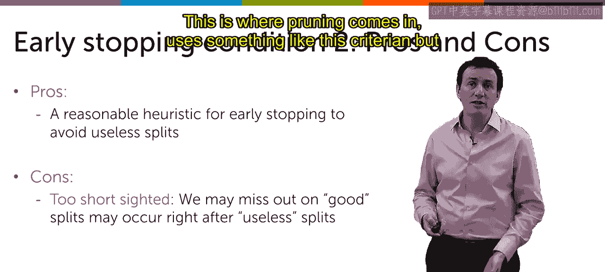

# 机器学习（分类，聚类和检索）：第3-4课：可选：修剪的动机 🌳

在本节中，我们将探讨决策树学习中的一个重要概念——**修剪**。我们将了解为什么简单的“提前停止”策略可能导致次优的决策树，以及修剪如何作为一种更稳健的替代方案来解决这些问题。

---

上一节我们介绍了决策树构建中的递归和提前停止条件。本节中，我们来看看这些停止条件可能带来的挑战。

## 提前停止条件的挑战

以下是两种主要的提前停止条件及其潜在问题：

1.  **最大深度停止条件**：当递归达到预设的最大深度时停止。
    *   **挑战**：如何选择合适的最⼤深度？通常需要使用交叉验证或验证集，但这需要预留数据、多次运行算法，并且为树的不同部分设置统一的深度参数可能过于僵化。

2.  **训练误差停止条件**：当训练误差停止下降时停止。
    *   **挑战**：这个条件可能很危险，因为它可能过早地停止探索，错过后续能显著降低误差的分支。我们用一个反例来说明。

## 一个关键的反例：异或问题

为了说明第二个停止条件的危险性，我们使用一个经典的反例：**异或**问题。

假设我们有以下数据集，其中输出 `Y` 是输入 `X1` 和 `X2` 的异或结果：

| X1 | X2 | Y |
| :-- | :-- | :-- |
| 0 | 0 | 0 |
| 0 | 1 | 1 |
| 1 | 0 | 1 |
| 1 | 1 | 0 |

**在根节点**：我们有两个 `Y=1` 和两个 `Y=0`。如果我们预测多数类（例如 `Y=1`），我们会犯两个错误。训练误差为 `2/4 = 0.5`。

**尝试在 X1 上分裂**：分裂后，每个子节点仍然包含一个 `Y=1` 和一个 `Y=0`。如果我们继续在每个子节点预测 `Y=1`，总错误数仍然是2个，训练误差保持 `0.5`。分裂没有带来改进。

**尝试在 X2 上分裂**：情况完全相同，训练误差仍为 `0.5`。

如果应用“训练误差停止条件”，算法会认为任何分裂都无法降低误差，从而**在根节点就停止**，最终得到一个训练误差为 `0.5` 的单一节点树。

然而，如果我们**不停止并继续分裂**，最终可以得到一棵完美的决策树（例如，先按X1分裂，再在每个分支上按X2分裂），其训练误差为 `0`。

这个例子展示了“训练误差停止条件”可能导致巨大的性能差距：在最佳可能结果（误差0）和实际得到的结果（误差0.5）之间。

---

## 引入修剪

正是由于上述“提前停止”策略的局限性，**修剪**成为了决策树算法中防止过拟合的更佳方法。

修剪的核心思想是：
1.  首先，让树**充分生长**（甚至过度生长），而不施加严格的提前停止限制。
2.  然后，**自底向上**地检查并“剪掉”那些对提升模型泛化能力贡献不大（甚至可能有害）的子树，将其替换为叶节点。

这种方法比简单的自上而下提前停止更稳健，因为它基于更全面的信息（整个子树的表现）来做决策。

---

本节课中我们一起学习了决策树构建中“提前停止”策略的缺陷，特别是通过异或问题看到了它如何导致次优模型。我们由此引入了**修剪**的概念，它通过先过度生长再自底向上剪枝的策略，为构建泛化能力更强的决策树提供了一条更可靠的路径。大多数优秀的决策树实现都会采用某种形式的修剪。