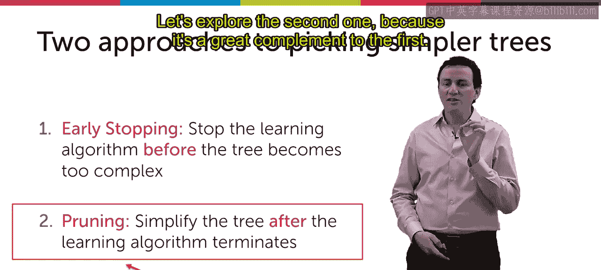
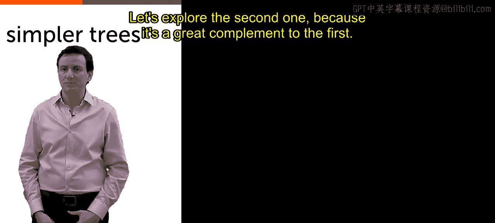
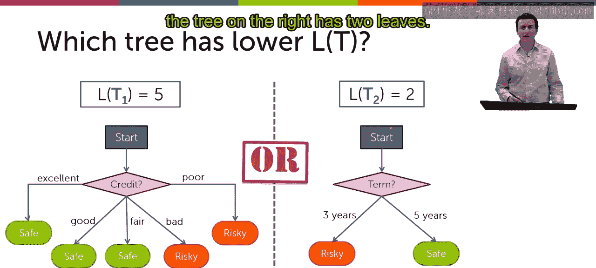
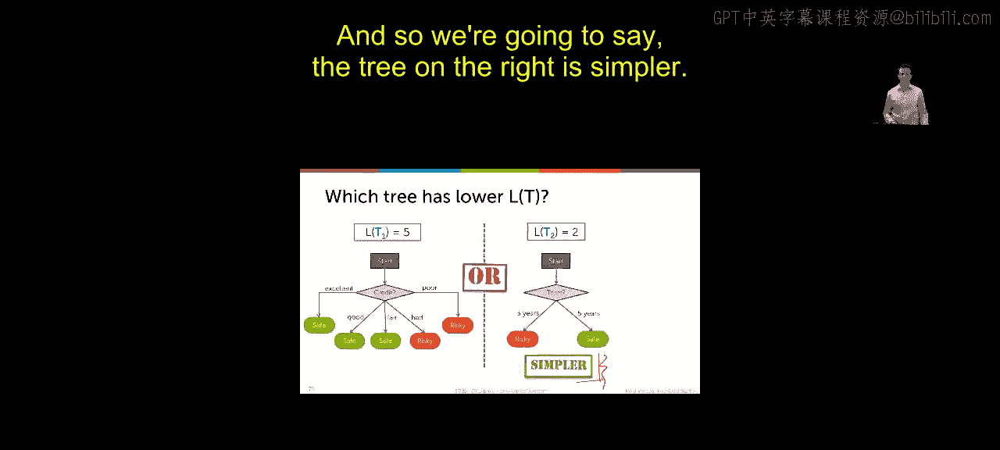
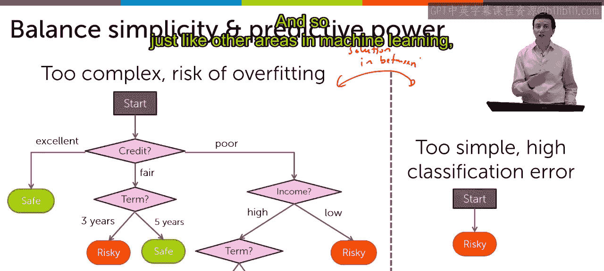
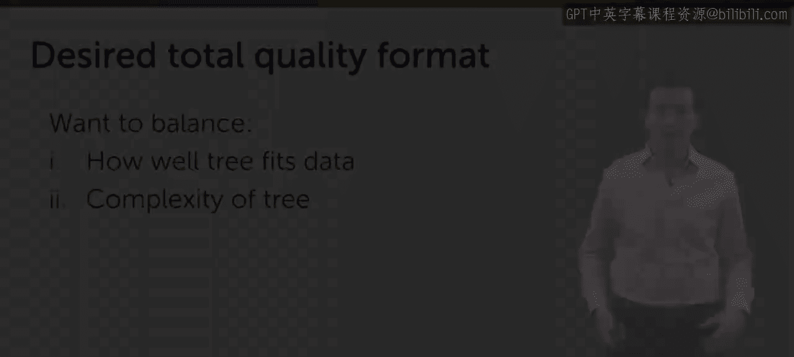
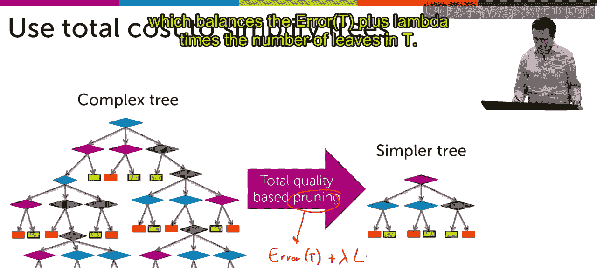
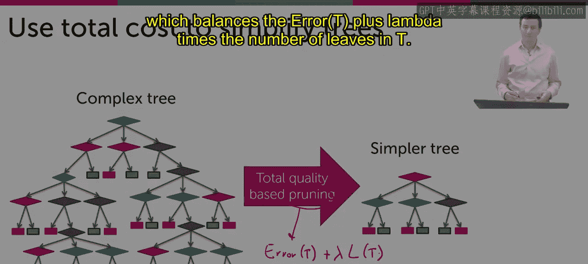

# 华盛顿大学《机器学习（分类，聚类和检索，第3-4课⧸共4课）｜Machine Learning》中英字幕 p76 75_可选：修剪决策树以避免过拟合.zh_en -BV1Sr421F7N7_p76-

。

Next we're going to explore a different approach for finding simple decision trees。

 we're going to grow them all the way and then we kind of start pruning and the way we're going to prune it is kind of like stopping criteria。

 at least stopping criteria too， we're going to prune things that don't improve our classification error enough。

😊，So we have two ways to try to find simple trees， one way was to stop recursing when stopped recursing earlier。

 and the second one was to expand and then prune and let's explore the second one because it's a great complement to the first。

Our goal is going to be to take the complex street that we learn by going too far， man。

 you aren' too far。And somehow。Crop up some stuff， remove it。

 and then simplify it in order to come up with what would be a better tree in terms of true error。

So here's a kind of a motivational picture。You might end up with a complex tree if you don't stop too earlier。

And you can imagine try to come up with some fancy way to stop earlier， but doing this。

 you just go a little too far。And then we're going to backtrack。

So we're going to start from this complex tree and we're going to simplify it until I get a reasonable tree that has maybe higher train error。

 but it has better true error。😊，The fundamental question though， is what makes a tree simpler？

Clearly， if you'd have a super deep tree on the left。😊，here's is a shallow tree on the right。

 So in other words， if you're looking at depth， then it is a， you know。

 here's a technical term that like to use no brainer。

It is a no brainer that the tree on the right is simpler than the tree on the left。

 so is depth the measure that we going to use to qualify what complexity of decision trees is and it turns out the depth is not a very good metric。

And the reason is the core problem is that some features might have more values than others。

 and so some features might lead to more splits than others。So here， both trees have the same depth。

And so the question is。Which one is simpler？And we will see this problem all the time。

And intuitively， the more leaves you have， the more complex a tree is。

 so we're going to introduce this function L of T， which just measures the number of leaves that tree has。

And so the tree on the left here has five leaves。 The tree on the right has two leaves。

 And so we're going to say the tree on the right is simpler。

And now we're getting somewhere interesting。😊，Now we can start talking about the complexity of different decision trees so for example。

 the super complex one on the left had the number of leaves here was one，2，3，45。

6 while the one is too simple on the right， the number of leaves they had was one and somehow I want to find a solution in between。

😊，And the solution in between will allow also adapt that allows you to go deeper in some branches。

 shallow in others， but try to keep the number of leaves as good as possible and so just like other areas in machine learning。

 we're going to introduce some kind of tradeoff between these two concepts。

The two concepts we went trade off the two quantities are how well my tree fits the data and what the complexity of the tree is。

😊，So the total cost is going to be a measure of fit and a measure of complexity。

 we saw this in regression， we saw this in logistic regression we' evening this again decision three here the measure of fit is just classification error in the training data so training error and the measure of complexity is going to be the number of leaves and we're going to balance the two。

😊，So more specifically， we're going to use error of T to denote the error classification error and training data and L of T to denote the number leaves。

😊，And as we will see， well have a magic parameter to trade off between these two quantities。😊。

In particular， we're going to use Lambda to denote that magic parameter that we can fit then with a validation set or with cross validation when lambda equals zero back to the standard decision tree learning process。

When Lada is infinite， we have infinite penalty。So we're going to have infinite。Penalty。

Which means we're going to just learn a tree that has no decisions in it。 So just the root。

 So we're going to learn something like this。Root。And then a class， and in this case。

 we're just going to say the Y hat for all data points is the majority class。In other words。

 lambda is inconfin you're just going to output put the majority class when lambda is equal to0。

 it's crazy deep decision tree， when lambda is in between that's where we're game here。

 so this is going to balance the fit。😊，And。And the complexity of the tree。More specifically。

 we're going to go from that complex tree to a simpler tree by using a pruning approach where the pruning is based on this function。

 which balances the error of T。Plus， lambda。

Times the number leaves in T。

