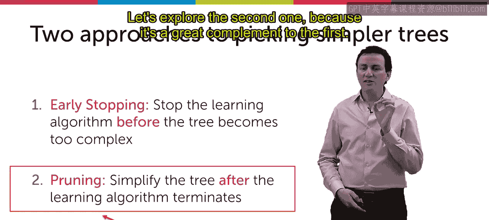
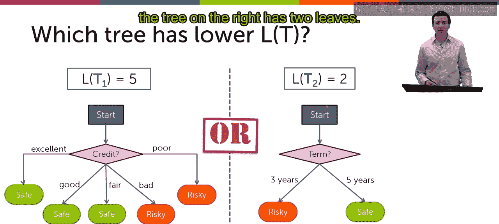
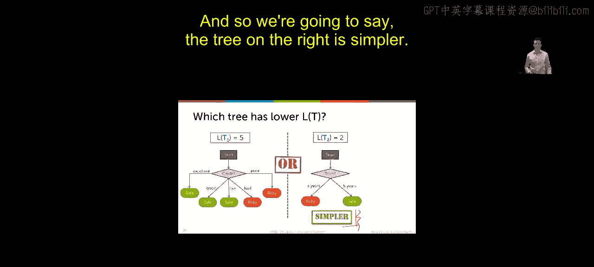
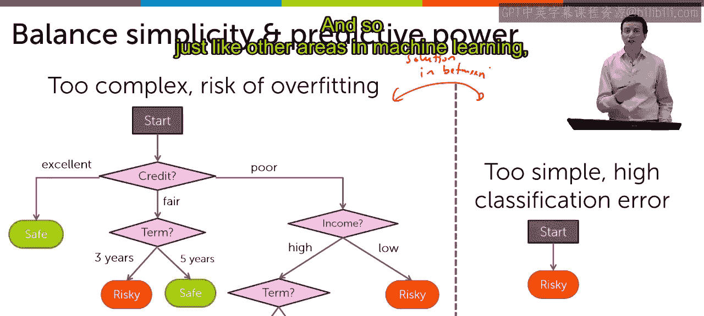
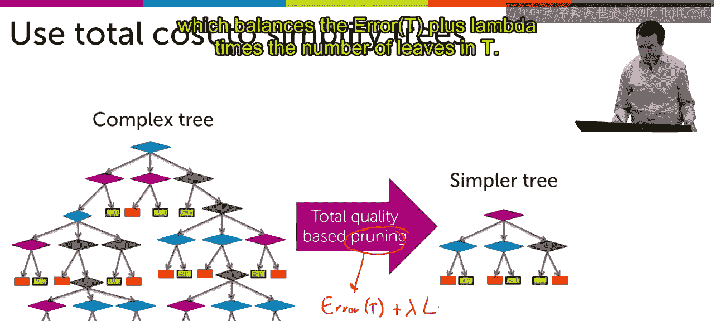
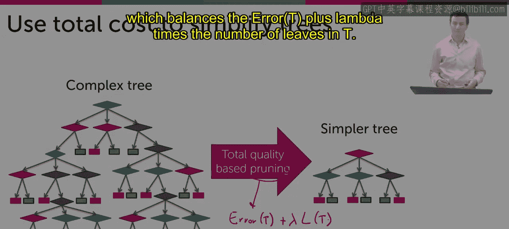

# 机器学习（分类，聚类和检索）：第3-4课：可选：修剪决策树以避免过拟合 🌳

在本节课中，我们将要学习一种避免决策树过拟合的新方法：先让树完全生长，然后再进行“修剪”。我们将探讨如何通过平衡模型在训练数据上的表现与模型本身的复杂度，来获得泛化能力更强的决策树。

上一节我们介绍了通过提前停止递归来寻找简单决策树的方法。本节中我们来看看另一种互补的方法：先扩展，后修剪。

## 从复杂树到简单树

我们的目标是处理那些因递归过深而变得过于复杂的决策树。我们将学习如何通过“修剪”来移除部分结构，从而简化树，以期获得在真实误差上表现更好的模型。

下图是一个动机示例。如果不提前停止，你可能会得到一棵非常复杂的树。我们可以想象一些巧妙的方法来提前停止，但有时我们还是会走得太远。这时，我们就需要回溯。

我们将从这棵复杂的树开始，逐步简化它，直到得到一棵虽然训练误差可能更高，但真实误差更优的合理决策树。

## 如何衡量树的复杂度？

一个根本的问题是：什么使一棵树更简单？显然，左边非常深的树比右边浅的树更复杂。深度似乎是一个直观的指标。

然而，深度并不是一个很好的度量标准。核心问题在于，有些特征可能比其他特征拥有更多的取值，从而导致更多的分支。在下图中，两棵树深度相同。

那么，哪一棵更简单呢？直观上，叶子节点越多，树就越复杂。因此，我们引入函数 **L(T)** 来度量一棵树的叶子节点数量。

左边这棵树有5个叶子节点，右边这棵树有2个叶子节点。因此，我们说右边的树更简单。

## 在拟合与复杂度之间权衡

现在我们可以开始讨论不同决策树的复杂度了。例如，左边超级复杂的树有6个叶子节点，而右边过于简单的树只有1个叶子节点。我们的目标是找到一个介于两者之间的解决方案。

这个折中的方案允许在某些分支上更深，在另一些分支上更浅，但同时尽可能控制叶子节点的数量。就像机器学习中的其他领域一样，我们将在这两个概念之间引入一种权衡。

我们需要权衡的两个量是：**模型对数据的拟合程度** 和 **模型本身的复杂度**。

总成本将是拟合度量与复杂度度量的组合。我们在回归、逻辑回归中都见过这种思想，现在在决策树中再次应用。这里的拟合度量就是训练数据上的分类错误率（训练误差），而复杂度度量则是叶子节点的数量。我们将平衡这两者。

更具体地说：
*   我们用 **error(T)** 表示树 **T** 在训练数据上的分类错误。
*   用 **L(T)** 表示树 **T** 的叶子节点数量。

我们将使用一个神奇的参数 **λ** 来在这两个量之间进行权衡。这个参数可以通过验证集或交叉验证来调整。
*   当 **λ = 0** 时，我们回到标准的决策树学习过程，不惩罚复杂度。
*   当 **λ → ∞** 时，复杂度惩罚无限大，我们将只学习一棵没有任何决策的树，即只有一个根节点，直接输出数据中的多数类。

当 **λ** 取中间值时，才是我们发挥的舞台。它将平衡拟合优度与树的复杂度。

具体来说，我们将通过一种基于以下函数的修剪方法，从复杂树过渡到简单树：

**总成本 = error(T) + λ × L(T)**

---

本节课中我们一起学习了决策树的后剪枝方法。我们认识到，叶子节点数量是衡量树复杂度的有效指标。通过引入一个权衡参数 **λ**，并构建总成本函数 **error(T) + λ × L(T)**，我们可以在模型对训练数据的拟合程度与模型复杂度之间取得平衡，从而有效避免过拟合，提升模型的泛化能力。