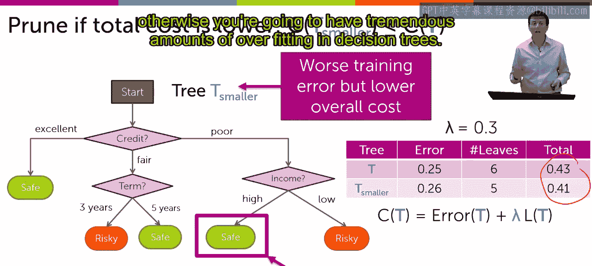
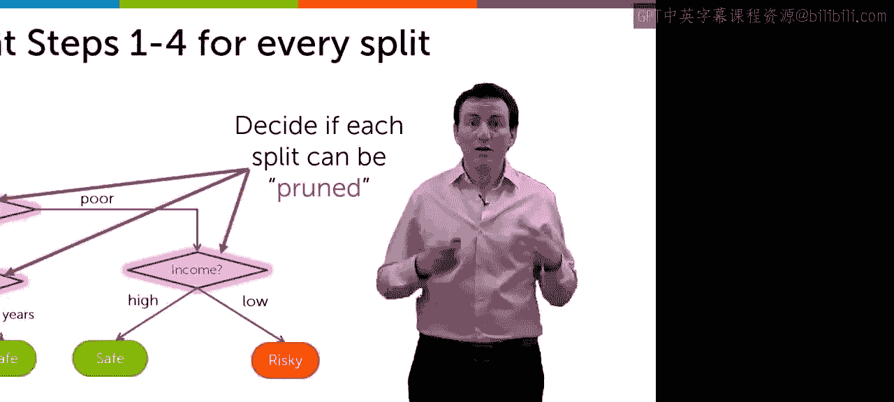
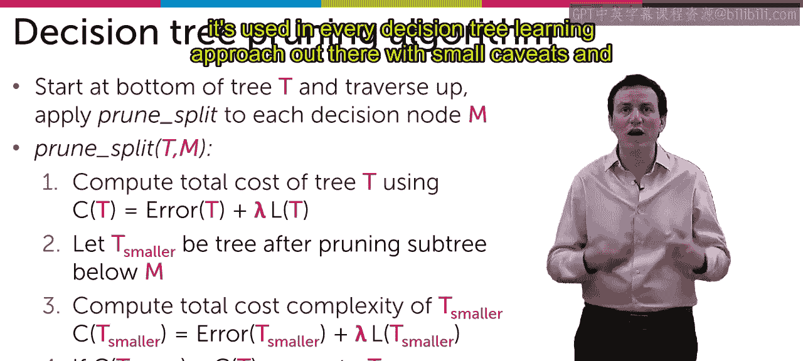
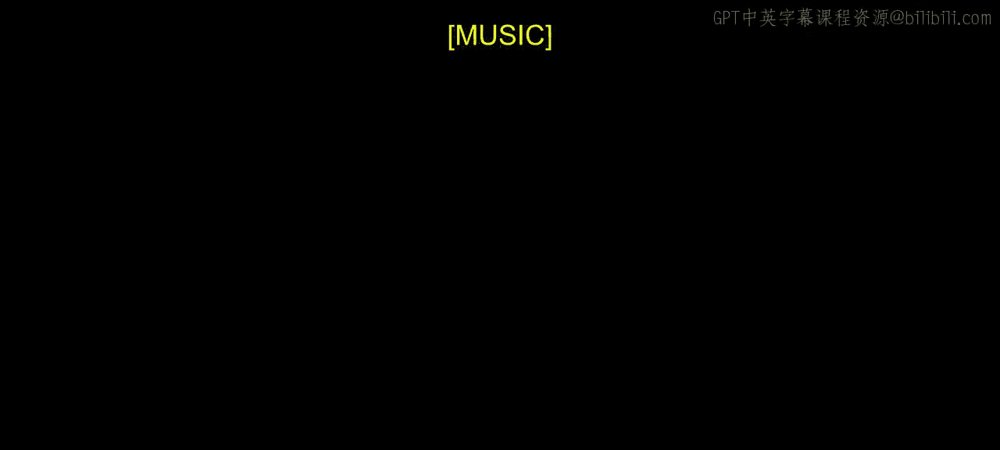

# 华盛顿大学《机器学习（分类，聚类和检索，第3-4课⧸共4课）｜Machine Learning》中英字幕 p77 76_可选：树修剪算法.zh_en -BV1Sr421F7N7_p77-

。

Next， we'll describe the pruning procedure， which takes this cost function that we describe and uses it to throw away decisions in the tree that were not that important。

The idea is pretty simple。 consider a split in the decision three and usually we start from the bottom。

 so we'll start here with this candidate split approvedrune should we split on term after we split first on credit and then non income should we do that split or not。

😊，Well， we can use our cost function to figure out what to do。 So let's say that the tree。

With the tree that showed everything here has an error of 0。

2500 training data but we're trying to decide whether to the split or not。

 well let's see what how many leaves we have we have 123456 leaves and if we use a lambda of 0。

3 then the total here， the error plus lambda times the number of leaves would be 0。25 plus 0。

18 which is 0。43。So that's the totem。TheG auto here。Now， let's see what happens after。

We do the pruning if we were to do the pruning。So if we were to do pruning。

 let's say that the smaller tree where this last decision is being prune has slightly higher training error。

So the training error goes up to 0。26 you like should I really do it well let's look at the number of leaves its one2。

 three，45 leaves and so we're here five leaves。And say okay， we have five leaves instead of six。

 so one last leaf， the training error went up a little bit， but if you do five times 0。3。

 which is lambda， you get 0。15， you add that to 0。26 you get a grand total of 0。41。And。Magically say。

 ah， this new tree。The smaller is looking promising。 You know。

 it has worse straining error by a little bit， but lower overall cost。

And so since it has a lower vertical cost， we are going to do that pruning。佢啲 idea啊。

So that's a kind of simplification that it looks okay in a simple example when you have a massive tree of tons of data。

 it's hard to imagine how these things come through， but it must happen。

 otherwise you're going to have tremendous amounts of overfitting in decisionion trees。😊。

We're not just going to do it。

The pruning procedure for the very bottom of the tree。

 we're going to keep going up the tree and revisit every decision that we've made that we've introduced the tree and say is it worth pruning this。

 is it worth pruning so is it worth pruning income after credit is it worth pruning term after credit I it worth pruning credit itself and just have the root no？

So we're going to check all those up and then find the best tree after this pruning procedure。

And output'll put that as our solution。For completeness。

 I've included here the full algorithm for building up a decision tree using pruning it's a little bit know more contrived I'll leave it as reference for those who actually want to implement themselves。

 but it's relatively simple to implement and not that different than what you might have done in the regular case this kind of idea is fundamental though and it's used in every decision tree learning approach out there with small caveats and changes in the parameters but overall same idea。

😊。

