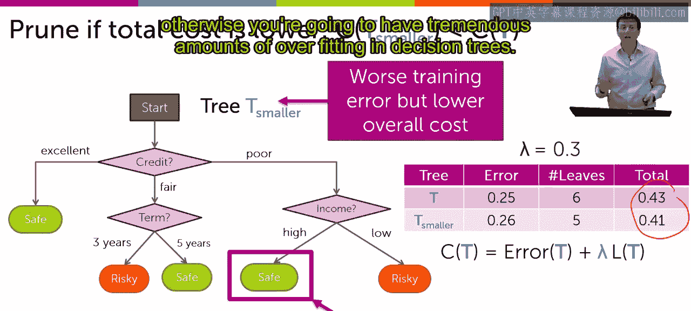
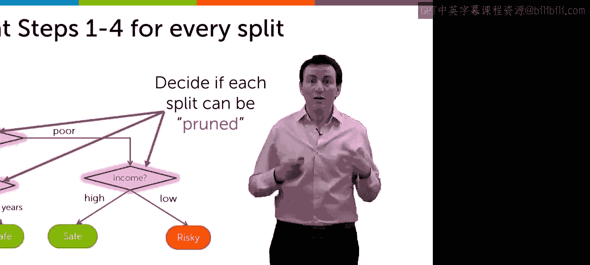
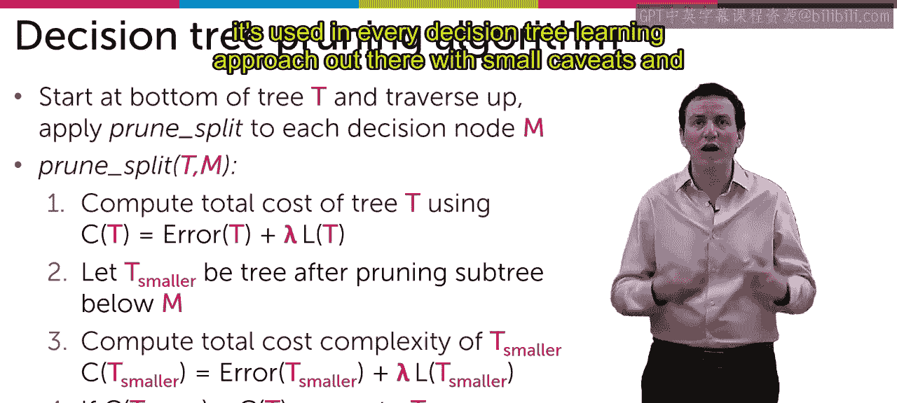

# 机器学习（分类，聚类和检索）：3-4：可选：树修剪算法 🌳

在本节课中，我们将要学习决策树模型中的一个重要技术——树修剪算法。该算法旨在通过移除决策树中不重要的分支来防止模型过拟合，从而提升其泛化能力。

上一节我们介绍了决策树的构建与成本函数，本节中我们来看看如何利用成本函数对已生成的决策树进行修剪。

## 修剪的基本思想 ✂️

修剪过程的核心思想相当简单。它利用我们之前描述的成本函数，来评估并“剪掉”决策树中那些不重要的决策。通常，我们从树的底部开始进行修剪。

考虑决策树中的一个分裂点。例如，在根据“信用”和“收入”进行分裂后，我们是否还应该根据“期限”进行分裂？我们可以使用成本函数来决定。

假设包含所有分裂的完整树在训练数据上的错误率为 **0.25**。这棵树有 **6** 个叶子节点。如果我们设置正则化参数 **λ = 0.3**，那么总成本为：
**总成本 = 错误率 + λ × 叶子节点数 = 0.25 + 0.3 × 6 = 0.43**

现在，让我们看看如果对这个底部分支进行修剪会发生什么。修剪后，树变小了，训练错误率可能会略微上升，例如升至 **0.26**。但此时叶子节点数减少为 **5** 个。新的总成本为：
**总成本 = 0.26 + 0.3 × 5 = 0.41**

虽然训练错误率略有增加，但由于模型复杂度（叶子节点数）降低，总成本反而从 **0.43** 下降到了 **0.41**。因此，根据成本函数，这个更小的树是更优的选择，我们将执行这次修剪。

这个简单的例子展示了修剪如何权衡模型复杂度和拟合精度。在实际应用中，面对拥有海量数据和复杂分支的大树，修剪是防止严重过拟合的关键步骤。

## 系统的修剪过程 🔄

我们不会只对树底部的某一个分裂点进行评估。修剪过程是系统性的。

以下是针对树底部的修剪步骤：

1.  从决策树的最底层开始。
2.  对每一个候选分裂点，计算修剪前与修剪后的总成本。
3.  如果修剪后的总成本更低，则执行修剪。

但这还不够。我们不会就此停止。

我们将沿着树向上回溯，重新审视树中引入的每一个决策分裂点，并评估是否值得将其修剪掉。

例如，我们会依次检查：
*   在“信用”分裂之后，修剪“收入”分裂是否值得？
*   在“信用”分裂之后，修剪“期限”分裂是否值得？
*   甚至，修剪“信用”分裂本身，只保留根节点是否值得？

我们会检查所有这些可能性，并在整个修剪过程结束后，找到成本最低的那棵树，并将其作为我们的最终模型输出。

## 完整的剪枝决策树算法 📝

为了内容的完整性，这里提供了使用剪枝构建决策树的完整算法参考。它比基础版本稍显复杂，我将其留作参考资料，供那些希望自己实现的人使用。

该算法的实现相对简单，与常规决策树构建方法没有本质不同。然而，这种通过成本函数进行剪枝的核心思想是基础性的，几乎被所有决策树学习方法所采用，尽管在参数和细节上可能有细微的变化和调整，但总体思路是一致的。

---

本节课中我们一起学习了决策树的修剪算法。我们了解到，修剪通过一个结合了训练误差和模型复杂度（叶子节点数）的成本函数，系统地移除不重要的分支，从而在不过度拟合训练数据的前提下找到更简洁、泛化能力更强的树模型。这是一个防止决策树过拟合的核心技术。