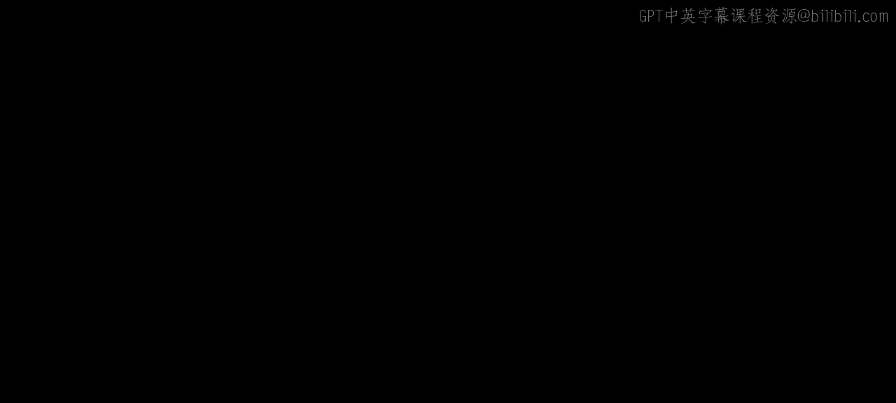
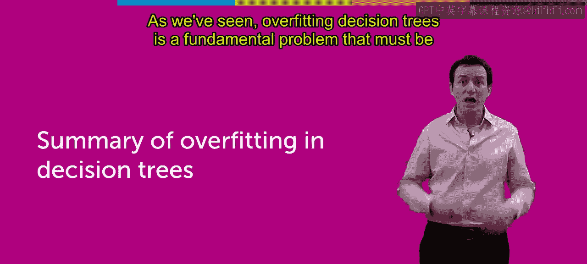
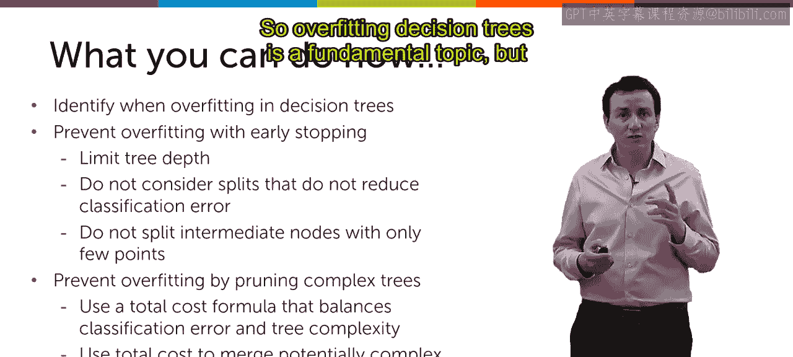
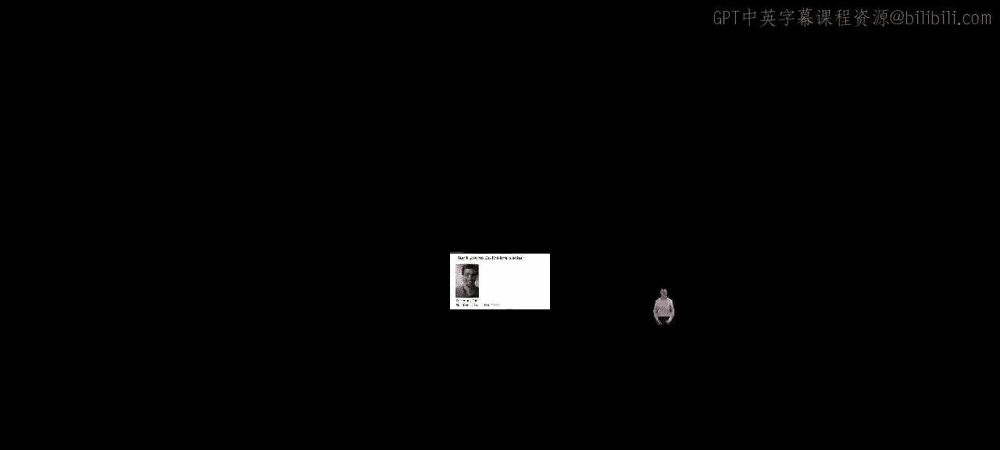
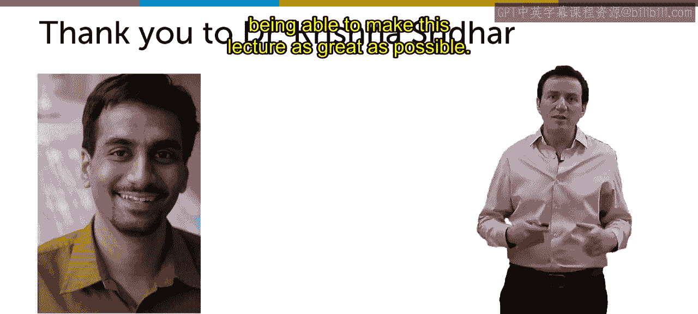

# 华盛顿大学《机器学习（分类，聚类和检索，第3-4课⧸共4课）｜Machine Learning》中英字幕 p78 77_决策树中过拟合和正则化的回顾.zh_en -BV1Sr421F7N7_p78-

。

As we see overfitting decision trees is a fundamental problem that must be addressed and we've looked at a couple different ways to address this problem。

 we looked at early stopping so as we go down the tree we're going to stop early to avoid getting to a very complex tree and overfitting and then we talked about pruning where we take a massive tree and then we chop chop。

 chop chop and simplify it。

Pruning is very important in practical settings and so we spent quite a bit of time going through detail of that but it was an optional section in the lecture but I just want to make sure we're all aware that if you see an algorithm out there for the stringries that does pruning。

 that's a kind of idea of what's being executed。😊，So over 15 decision trees， it a fundamental topic。

 but one that now we have a handle on how to address。

And let me close by thanking my colleague， Krishna Shriar， who has been really fundamental。

Creating these slides and be able to make this lecture as great as possible。

