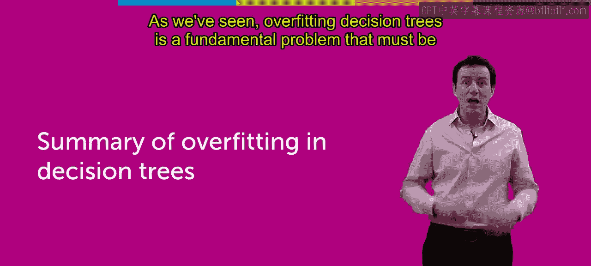
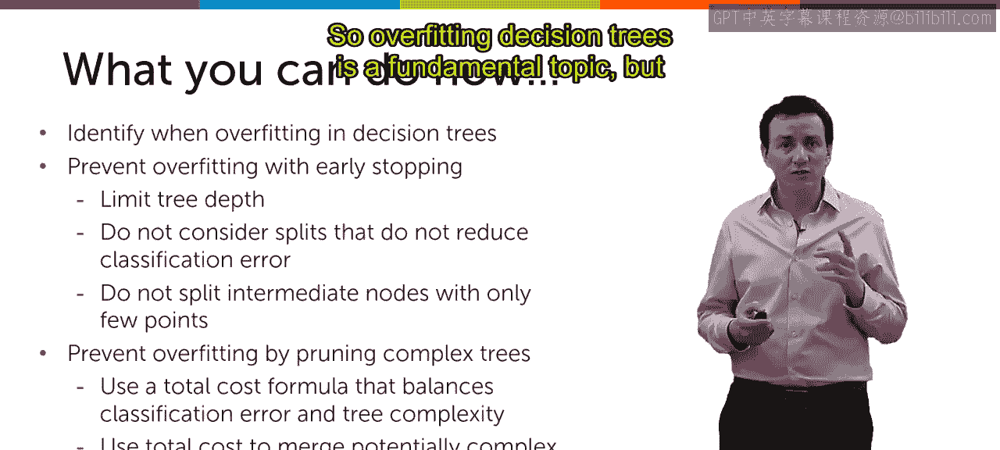

# 机器学习（分类，聚类和检索）：第3-4课：决策树中过拟合和正则化的回顾 🌳

在本节课中，我们将要学习决策树模型中的一个核心挑战——过拟合，并回顾两种用于解决此问题的正则化技术：**提前停止**和**剪枝**。我们将详细探讨这两种方法的基本思想及其重要性。

---

正如我们所见，决策树过拟合是一个必须解决的根本问题。我们已经探讨了两种不同的方法来解决这个问题。

上一节我们介绍了决策树的基本概念，本节中我们来看看如何控制其复杂度以避免过拟合。

## 应对过拟合的方法

以下是两种主要的正则化策略：

1.  **提前停止**
    在向下构建树的过程中，我们会提前停止生长，以避免生成非常复杂的树从而导致过拟合。

2.  **剪枝**
    我们先构建一个庞大的树，然后通过“剪、剪、剪”来简化它。

---

剪枝在实际应用中非常重要，因此我们花了相当多的时间来详细讨论它。虽然在讲座中这是一个可选部分，但我想确保大家都明白，如果你在决策树算法中看到剪枝操作，那执行的就是这种思想。

所以，关于决策树的过拟合，这是一个基础主题，但现在我们已经掌握了如何应对它。

---

最后，我要感谢我的同事 Krishna Shriar，他在创建这些幻灯片和使本次讲座尽可能出色方面起到了根本性的作用。

---

本节课中我们一起学习了决策树中的过拟合问题，并回顾了通过**提前停止**和**剪枝**进行正则化的两种核心方法。掌握这些技术对于构建泛化能力更强的决策树模型至关重要。