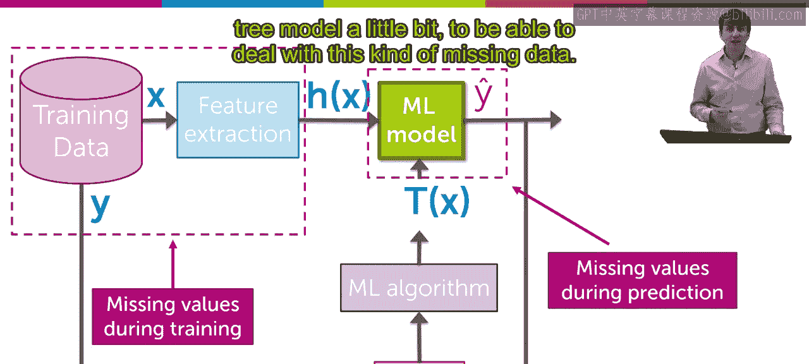

# 华盛顿大学《机器学习（分类，聚类和检索，第3-4课⧸共4课）｜Machine Learning》中英字幕 p79 78_缺失数据的挑战.zh_en -BV1Sr421F7N7_p79-

。

So far in this specialization data has always looked pretty beautiful。

 we sometimes did a little bit of feature engineering like taking rotex and turning into Bago4s。

 count of words， the TFIDF， sometimes it created more advanced features like polynomials。

 science and cosines and so on。😊，We did feature transformations， feature engineering。

 but we always observe all of our data， so for every feature we always observe every possible value for every data point。

Now， that is rarely true in the real world。Real world data tends to be pretty messy and often is fraught with missing data and unobserved values。

 And theres this is a significant issue we should always be on the lookout for。 In today's module。

 we're gonna talk about some of the basic concepts and ideas of what you can do to try to address missing data in a learning problem。

😊，Approaches to dealing with missing data I bet youre interested understood in the context of a particular learning algorithm So for this module you're going to pick decision trees as a way to kind of better see the impact of missing data and some of the key approach to dealing with it again we're going to be dealing with loan data so as input XI is kind not the term of the loan。

 your credit history and so on'm going to push it through this crazy decision tree trying to make a decision whether your loan is safe or your loan is risky which is going to be the output Y hat I we're trying to decide here。

As we discussed thus far， we've assumed that all of the data was fully observed。

 so nothing was missing。 so for every row of the data， for every feature we observed， for example。

 the credit was excellent， fair or poor， if the term of the alone was three years or five years。

 if the income was high or low。😊，And we'll observe the output， of course， safe or risky。

Now in reality， we have missing data， so missing data for example。

 in this highlighted row might say I know that for this particular loan application the credit was poor。

 the income was high。😊，Turned out to be a risky loan。

 but nobody entered in there whether the loan was a three year loan or five year loan。

And that might be true for multiple data points and the question is。What can we do about this。

 what impact it has on our learning algorithm， what happens？Well。

 missing data can impact our learning algorithms both in the training phase because I don't know how to train a model when you have this question marks。

 I don't know what value of those have， and it can have an impact one prediction time。

 let's say I build a great decision tree， I put it out in the wild I when the bank。

 somebody feeds an application in there， but we don't know a particular entry。

 what predictions do we make。So let's be more specific。

 Let's say that we have a this tree that I learned from data。

 and I have a particular input where the credit was poor。 The term was five years。

 but the income was a question mark。 I don't know the income of this person。

 So I tried to go down the decision tree。 I hit credit first。 Cred was poor。 I hit income。

That was a question mark。 I don't know。 It was unknown。 What do we do next。

So we're a learning problem where you have some training data we studies some features we filter to your machine learning model which then use a quality metric to learn a decision treat T of x。

 but we're in a setting where some of the data might be missing a training time。

And some of the data might be missing a prediction time and what we do and we're going to do is modify the machine learning model a little bit and decisionary model a little bit to be able to deal with this kind of missing data。

😊。

Let's see how。