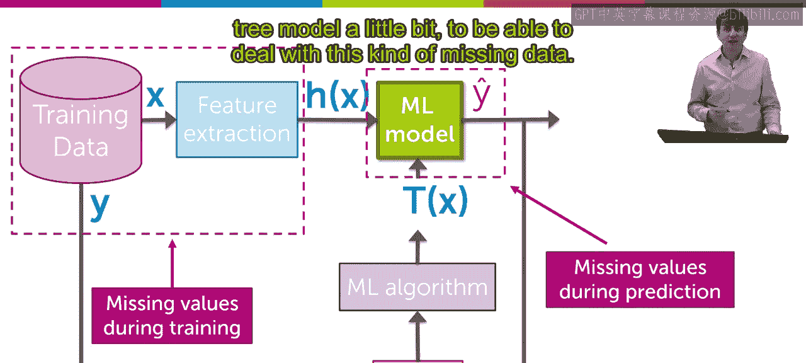

# 机器学习：第3-4课：缺失数据的挑战

在本节课中，我们将要学习如何处理机器学习中一个非常常见且棘手的问题：缺失数据。我们将探讨缺失数据对模型训练和预测的影响，并介绍一些基本的应对策略。为了更具体地理解这些概念，我们将以决策树算法为例进行说明。

---

## 缺失数据的影响

到目前为止，我们讨论的数据看起来都非常“完美”。我们有时会进行一些特征工程，例如将文本转换为词袋模型、计算词频-逆文档频率，或者创建更高级的特征，如多项式、正弦和余弦等。我们进行了特征转换和特征工程，但我们总是假设能够观察到所有数据。也就是说，对于每个数据点的每个特征，我们都能获得其值。

然而，这在现实世界中很少成立。现实世界的数据往往非常混乱，经常充满缺失值和未观测到的值。这是一个我们必须时刻警惕的重要问题。

## 以决策树为例

处理缺失数据的方法最好在特定学习算法的背景下理解。因此，在本模块中，我们将选择决策树作为例子，以便更清楚地看到缺失数据的影响以及处理它的关键方法。

我们将继续使用贷款数据。输入 `X_i` 包括贷款期限、信用历史等特征。我们将数据输入到一个复杂的决策树中，试图做出决定：你的贷款是安全的还是高风险的，这将是输出 `Y_hat_i`。

正如我们之前讨论的，到目前为止我们假设所有数据都被完整观测到，没有任何缺失。因此，对于数据的每一行，我们都能观测到每个特征的值，例如信用是优秀、一般还是差，贷款期限是三年还是五年，收入是高还是低。当然，我们也能观测到输出：安全或高风险。

但在现实中，数据可能存在缺失。例如，在下图高亮的行中，我们可能知道对于这个特定的贷款申请，信用是差的，收入是高，并且最终被证明是高风险的贷款。但是，没有人输入这笔贷款是三年期还是五年期。这种情况可能发生在多个数据点上。问题在于：我们能为此做些什么？它会对我们的学习算法产生什么影响？

## 训练与预测阶段的影响

缺失数据既会影响我们模型的训练阶段，也会影响预测阶段。

*   **训练阶段**：当训练数据中存在问号（缺失值）时，我不知道该如何训练模型，因为我不知道那些缺失的值应该是什么。
*   **预测阶段**：假设我构建了一个很棒的决策树模型并投入使用。当银行输入一个新的申请时，如果某个条目缺失，我们该如何进行预测？

让我们更具体一些。假设我们有一个从数据中学到的决策树，现在有一个特定的输入：信用是差的，贷款期限是五年，但收入是一个问号（未知）。我试图沿着决策树向下走。首先遇到“信用”节点，信用是差的，我通过了。接着遇到“收入”节点，但收入是未知的。我该怎么办？

## 核心问题定义

我们面临的学习问题是：我们有一些训练数据，研究了一些特征，并将其输入到机器学习模型中。模型使用一个质量度量（如信息增益）来学习一个决策树 `T(x)`。但现在我们处于一个数据可能在训练时缺失，也可能在预测时缺失的环境中。

我们需要做的是，稍微修改我们的机器学习模型（在这里是决策树模型），使其能够处理这种缺失数据。

---

## 处理缺失数据的方法

以下是几种处理缺失数据的基本方法。

### 1. 丢弃缺失值

最直接的方法是直接丢弃包含任何缺失值的数据行。

**优点**：
*   实现简单。
*   如果缺失数据是随机且少量的，这可能是一个合理的起点。

**缺点**：
*   会损失大量信息，尤其是当许多行都有缺失值时。
*   如果数据缺失不是随机的（例如，高收入人群更不愿意报告收入），丢弃数据会导致样本偏差。

### 2. 填补缺失值

另一种常见的方法是使用一个合理的估计值来填补（或“填充”）缺失值。

**常用填补策略**：
*   **对于数值特征**：使用均值、中位数或众数进行填补。
    *   公式示例：`缺失值 = 特征列的均值`
*   **对于分类特征**：使用众数（最常见的类别）进行填补。
*   **更高级的方法**：使用其他特征来预测缺失值（例如，用回归或K近邻模型）。

**优点**：
*   保留了所有数据行，利用了所有可用信息。

**缺点**：
*   填补的值可能不准确，从而在数据中引入噪声或偏差。
*   如果填补方法不当，可能会扭曲特征之间的关系。

### 3. 修改算法以处理缺失值

对于像决策树这样的算法，我们可以修改其分裂规则，使其能够处理缺失值。

**具体策略**：
*   **在训练时**：计算信息增益时，可以忽略缺失值，或者将缺失值视为一个单独的类别/分支。
*   **在预测时**：当遇到缺失特征时，可以让数据同时流向所有子节点，并根据每个子节点接收到的训练样本权重来加权最终的预测结果。

**优点**：
*   算法本身具备了处理缺失数据的能力，无需在预处理阶段进行填补或丢弃。

**缺点**：
*   实现起来更复杂。
*   可能不适用于所有类型的机器学习算法。

---

## 总结

在本节课中，我们一起学习了机器学习中缺失数据带来的挑战。我们了解到，现实世界的数据很少是完整的，缺失值会影响模型的训练和预测。我们介绍了三种主要的应对策略：
1.  **丢弃缺失值**：简单但可能造成信息损失和偏差。
2.  **填补缺失值**：保留数据但可能引入噪声，常用均值、众数或更复杂的模型进行填补。
3.  **修改算法**：使学习算法（如决策树）能够原生处理缺失值，这通常是最优雅但实现较复杂的方法。

选择哪种方法取决于具体的数据情况、缺失机制以及所使用的机器学习算法。理解这些基本概念是构建健壮机器学习模型的重要一步。