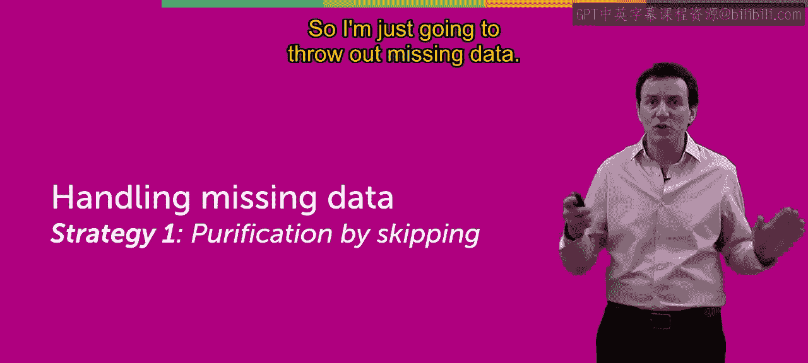
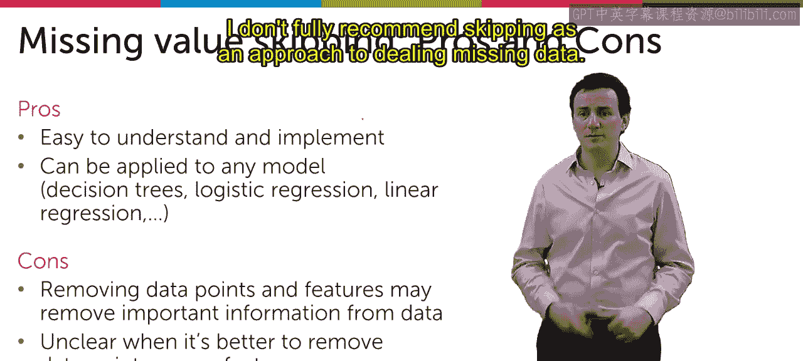
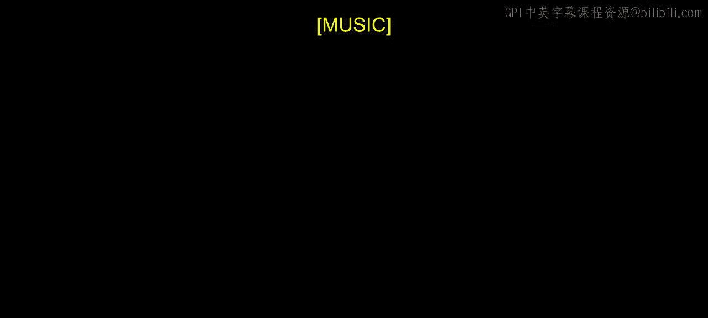

# 华盛顿大学《机器学习（分类，聚类和检索，第3-4课⧸共4课）｜Machine Learning》中英字幕 p80 79_策略1：通过跳过缺失数据进行纯化.zh_en -BV1Sr421F7N7_p80-

。

And this module will cover a couple basic strategies for dealing with missing data and then we'll cover a modification of the decision three algorithm where we're actually going to be able to deal missing data in a much smarter way。

😊，Now， the basic most common way of dealing with missing data is what's called purification。

 so I'm just going to throw out missing data。

So I'll start with a data set where for some data points。

 some of the feature values are missing and somehow'm going to skip some of these features from these data points and end up with a data set and outputs here。

 H of x where nothing is missing， everything' is observed。😊。

So skipping data and purifications risk skipping data is the most obvious thing that you might want to do。

 so if I have nine data points over here。And three of them have missing data。

So this are the three rows here。 Then I could just say， okay， there's not only three missing。

 not too bad。 I'm just going to skip them。 And so I'm going to take my 9。

And decrease it to just six and call that my data set。And you know。

 if you only have a few missing values， maybe this is an okay thing to do。

Skipping data points of myths and values， however， can be a。😊，Problematic idea。 So， for example。

 in this case， you have the feature term missing in a lot of different data points。 In fact。

6 out of 9 data points， the term feature is missing。 So if I were just to skip those。

 I'll go from a data with 9 features。 So if9 data points So a data set with only three data points。

 So become much， much smaller。 And that's really bad because term here is missing on more than 50% of the data。

 So if you look we're going go down。😊，From 9。To a much， much smaller value。

And that can happen and makes your training much worse because of much less data at the end。😊。

And so in these cases， if you just have one feature which has lots of missing values。

 one another simple product is to say instead of skipping data points。

 you could skip features and now instead of having fewer data points， you just have fewer features。

So that's a reasonable alternative in this case。So there are two basic kinds of skipping that you might want to do when you have missing data。

 you can either skip data points that have missing data。Or skip features that have missing data。

And you know somehow you have to make the decision of whether to skip a data point。

 skip features or skip some data points in some features。

 and that's a kind of complicated decision to make。😊，In general。

 this idea of skipping is good because it's easy， it kind of just takes your data set and simplifies it bunch。

 can be applied to any algorithm because you just simplify the data and you just feed it to any algorithm。

😊，But it has some challenges。 Now， removing data， removing features is always a kind of a painful thing。

 You know data is important。 you don't want to do that。😊。

And it's often unclear whether you should remove features。

 should remove data points or impact willll have on your answer what you do。😊，Most fundamentally。

Even if you didn't skip too much at training time at prediction time， if you had a question mark。

 what do you do， this approach does not address missing data at prediction time。

And so people do this approach all the time and I'm okay with it if you just have kind of1 K zero case there。

 but it's a pre dangerous approach to take， I don't fully recommend skipping as their approach to the missing data。

