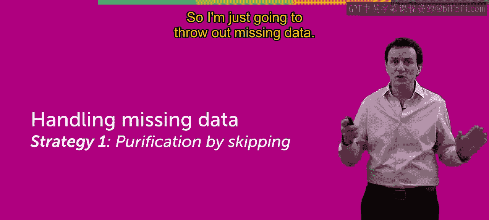
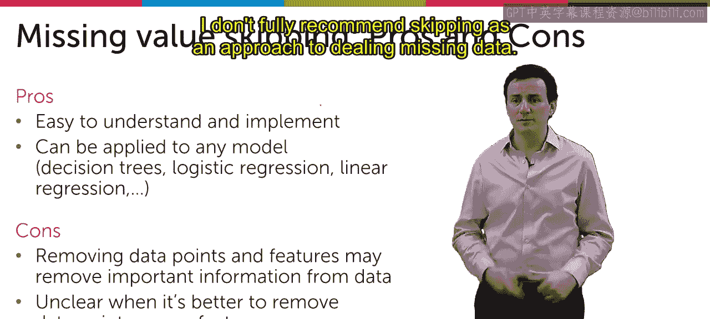

# 机器学习：分类、聚类与检索：3-4：策略1：通过跳过缺失数据进行纯化

在本节课中，我们将要学习处理数据集中缺失值的一种基本策略：**纯化**，即通过跳过包含缺失值的数据点或特征来清理数据。

上一节我们介绍了缺失数据带来的挑战，本节中我们来看看最直接的处理方法。

## 概述：什么是纯化？

纯化是指从数据集中移除包含缺失值的部分，最终得到一个所有特征值都被观测到的“纯净”数据集。其核心思想是：从包含某些缺失特征值的数据点出发，通过跳过这些缺失值，得到一个输出为 **H(x)** 的完整数据集。

## 两种基本的跳过策略

以下是两种处理缺失数据的基本跳过方法。

### 1. 跳过包含缺失值的数据点

这是最直观的做法。如果数据集中只有少数数据点存在缺失值，直接移除这些数据点可能是可以接受的。

例如，假设有9个数据点，其中3个存在缺失值。我们可以直接跳过这3个数据点，将数据集从9个减少到6个。

**潜在问题**：如果某个特征在大量数据点中缺失，这种方法会导致数据集严重缩水。例如，若“期限”特征在9个数据点中的6个里缺失，跳过这些点将使数据集从9个骤减至3个，这会导致用于训练的数据量大幅减少，严重影响模型性能。

### 2. 跳过包含缺失值的特征

当某个特定特征存在大量缺失值时，另一种简单的策略是跳过整个特征。这样，数据点的数量保持不变，但特征数量减少了。

在上述例子中，与其因“期限”特征缺失而丢弃6个数据点，不如直接移除“期限”这个特征，保留全部9个数据点。

## 策略选择与挑战

在实际操作中，需要决定是跳过数据点、跳过特征，还是对不同的情况采取不同的跳过组合。这是一个复杂的决策过程。

总的来说，跳过策略（纯化）的优点在于：
*   **简单易行**：直接简化数据集。
*   **通用性强**：可应用于任何机器学习算法，因为输入的是一个已处理好的完整数据集。

然而，这种方法也存在一些挑战：
*   **数据损失**：移除数据点或特征总是痛苦的，因为数据本身具有价值。
*   **决策困难**：通常不清楚应该移除特征还是数据点，以及不同选择对最终结果的影响。
*   **无法处理预测时的缺失**：最根本的问题是，这种方法无法处理**预测时**新数据出现缺失值的情况。训练时我们可以跳过，但当一个新样本带有问号“？”时，此策略无法提供解决方案。

## 总结

本节课中我们一起学习了处理缺失数据的**纯化策略**。我们了解到，可以通过**跳过包含缺失值的数据点**或**跳过包含缺失值的特征**来清理数据集。虽然这种方法简单通用，但它会导致数据损失，且无法解决预测阶段遇到缺失值的问题。因此，尽管在实践中常见，但需谨慎使用，尤其是在缺失情况严重时。下一节，我们将探讨一种能够更智能地处理缺失数据的决策树改进算法。