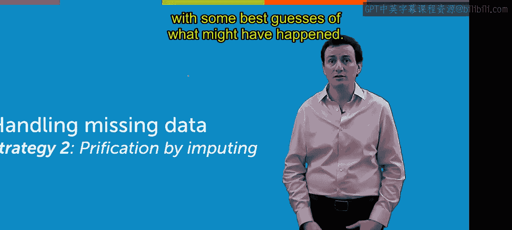
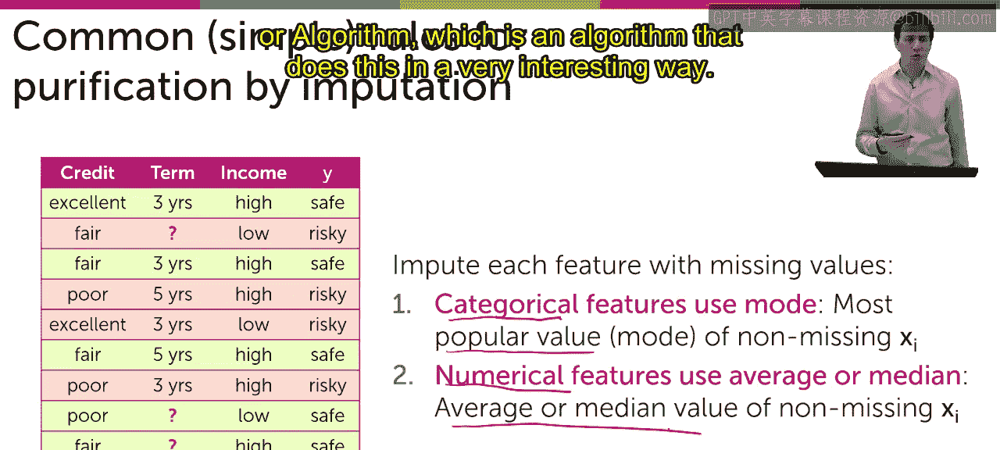
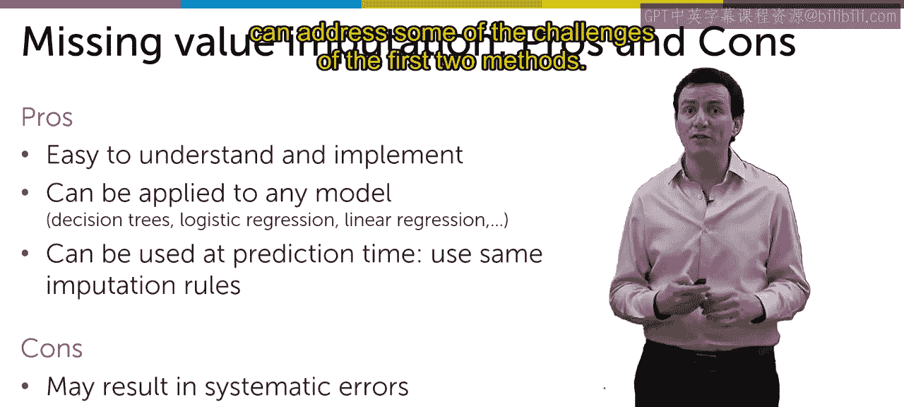

# 华盛顿大学《机器学习（分类，聚类和检索，第3-4课⧸共4课）｜Machine Learning》中英字幕 p81 80_策略2：通过填补缺失数据进行纯化.zh_en -BV1Sr421F7N7_p81-

。

The second approach to dealing with missing data is purification by what's called imputation is filling in the missing values the question marks with some best guess of what might have happened。

😊。

I'm personally not a hoarder， I don't collect a lot of things。

 I don't really care about stuff that much。But when it comes to data。You know。

 I really feel bad about throwing it away。I don't want to throw away data。

 and so going down from nine data points to six data points just pains me。

I don't think is's a really good idea。Imutation is an alternative to this is to say， okay。

 so only away those question marks， let's try to get a best guess of what the question mark value might be and just fill in those values and this is the kind of approach you might take。

 you take your input data which might have some missing values in it。

 you take your best guess of filling in those missing values and now you have a data set where everything has been filled in。

😊，For example， in a nine row data set here， we have this three question marks。And we could say， oh。

 the term is unknown for the three question marks， I'm going to fill in those values of my best guess。

 which might be three year long for the three values over here。

Why did I choose three year loan to fill it in Well if you look at the original data set。

 there were four， three year loans versus two， five year loans， so for here was my best guess。

And you can think about it as my best simple guess。So I just took a simple approach。

 just whatever was most popular， filled those in。So the way that imputation might work in the simple approach。

 the rule I say for categorical data like excellent， fair poor， three year or five year。

 it just put in the most popular value， this is called the mode of the distribution。😊，For 메ic코데。

I would suggest you put in either the average or the median value。

Now these are just simple heuristics， there are many more advanced and interesting ways to impute missing values。

 there's something called the expectation maximization or EM algorithm。

 which is an algorithm that does this in a very interesting way。😊。

Now we just describe a very simple thing in the scar。

Addressing missing data by imputation has advantages and disadvantages。

It's easy to understand and implement。It can be applied to any model because after you fill in your data。

 you just fit into a rather learning algorithm you have， you don't have to modify anything。

 so that's great。😊，it can be used at prediction time because whenever you hit a question mark。

 you fill it in in the same way that you did with your training data。

 so if you have a question mark for term， you just fill it in three years。

 three alone just like you did in the training data， so that's great。😊，However， imputation like this。

 especially simple imputation that they described can be extremely problematic because it introduces a bias。

 every question mark in term we put it in three years。😊。

We they use any other information we plug in the same value and this could result into really bad systematic errors so step back and take an examples I live in the state of Washington in the US and let's say in the state of Washington it's illegal to put the age into the loan application that means that if the loan applications come from the state of Washington age is always a question mark in other states maybe not a question mark but age is always a question mark here。

If you train a model across the United States， everybody from the state of Washington will have age question mark。

 You're gonna fill in the average age into the application。 Let's say 40。

 Then you're gonna believe that everybody in the state of Washington who is applying for loan is age 40。

And I'm going to introduce a systematic bias into the loan applications in the state of Washington。

And that's going to lead to all sorts of weird behavior， unhappy people， bad predictions， bad idea。

So imputation like this has its pluses， but it's also a complicated idea because it can introduce terrible biases。

So in the third part of this module， we're going to talk about an alternative。

 they can address some of the challenges of the first two methods。

