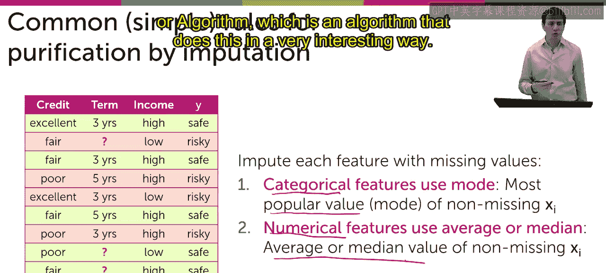
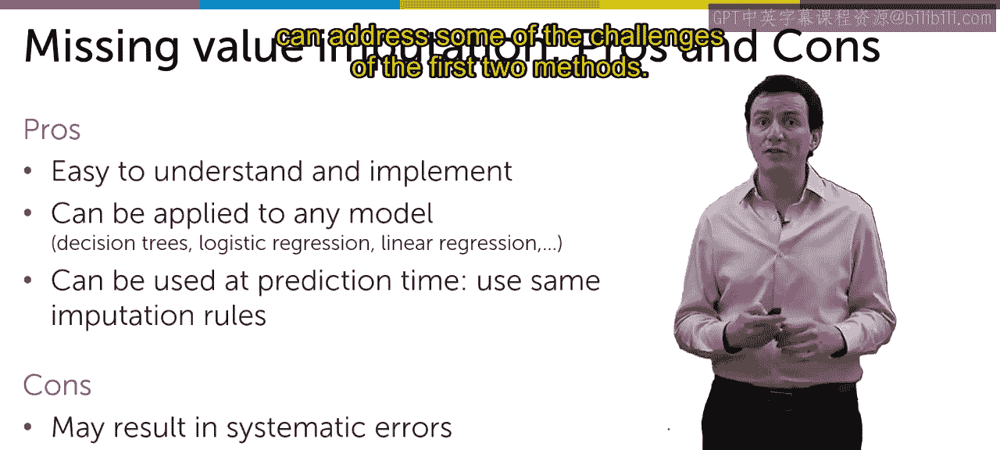

# 机器学习（分类，聚类和检索）：3-4：策略2：通过填补缺失数据进行纯化 🧩

在本节课中，我们将要学习处理缺失数据的第二种核心策略：**填补**。我们将探讨其基本思想、简单实现方法、优缺点，并理解为何在使用时需要格外谨慎。

---

上一节我们介绍了直接删除含有缺失值的数据行的方法。本节中我们来看看另一种思路：**填补**。

处理缺失数据的第二种方法是通过所谓的“填补”进行数据纯化。填补是指用某种最佳猜测来填充缺失值（即问号），以推测可能发生的情况。

我个人不喜欢丢弃数据。当数据从九行减少到六行时，会让我感到不适。我认为这不是一个好主意。填补是另一种选择，它意味着我们不去掉那些问号，而是尝试猜测问号可能的值并填充进去。

以下是填补方法的工作流程：你获取可能含有缺失值的输入数据，用最佳猜测填充这些缺失值，从而得到一个所有值都已填充完整的数据集。

例如，在这个九行的数据集中，有三个问号。我们可以说，这三个问号对应的“贷款期限”未知，我将用我的最佳猜测来填充这些值，这里我选择填充为“3年期贷款”。

我为什么选择“3年期贷款”来填充？如果你查看原始数据集，有四个“3年期贷款”和两个“5年期贷款”，所以“3年期”是我的最佳猜测。你可以将其视为最简单的猜测。我采用了一个简单的方法：无论哪个值最常出现，就填充它。

以下是填补在简单方法中的实现规则：

*   对于**分类数据**（如“优秀”、“一般”、“差”，或“3年期”、“5年期”），只需填入最常出现的值，这称为分布的**众数**。
*   对于**数值数据**，我建议你填入**平均值**或**中位数**。

这些只是简单的启发式方法。实际上，存在许多更高级、更有趣的填补缺失值的方法，例如**期望最大化算法**，它是一种以非常有趣的方式完成此任务的算法。

---

现在我们已经描述了填补的基本概念。接下来，让我们总结一下通过填补处理缺失数据的优缺点。

**优点如下：**

*   **易于理解和实现**。
*   **可应用于任何模型**，因为在你填充数据后，只需将其输入到你已有的机器学习算法中即可，无需修改算法本身。
*   **可在预测时使用**，因为每当遇到问号，你都可以用与训练数据相同的方式填充它。例如，如果“贷款期限”是问号，就像在训练数据中那样填充为“3年期贷款”。

**然而，像这样的填补，尤其是我们描述的简单填补，也可能带来极大的问题，因为它会引入偏差。**

我们为每一个“贷款期限”的问号都填入了“3年期”。我们没有使用任何其他信息，而是插入了相同的值，这可能导致严重的系统性错误。

让我们退一步举个例子。我住在美国华盛顿州。假设在华盛顿州，将年龄写入贷款申请是非法的。这意味着，如果贷款申请来自华盛顿州，年龄将始终是一个问号；而在其他州，年龄可能不是问号。但在这里，年龄始终是问号。

如果你在美国全国范围内训练一个模型，所有来自华盛顿州的人的年龄都是问号。你将会把平均年龄（假设是40岁）填入申请中。然后，你就会认为华盛顿州所有申请贷款的人都是40岁。这将在华盛顿州的贷款申请中引入系统性偏差，并导致各种奇怪的行为、不满的用户、糟糕的预测，这是一个坏主意。

因此，像这样的填补有其优点，但它也是一个复杂的概念，因为它可能引入可怕的偏差。

---

在本模块的第三部分，我们将讨论一种替代方法，它可以解决前两种方法所面临的一些挑战。

本节课中我们一起学习了处理缺失数据的第二种策略——**填补**。我们了解到，填补通过用最佳猜测（如众数、均值）填充缺失值来保留所有数据，具有易于实现、通用性强等优点。但我们也必须警惕，简单的填补方法可能会在数据中引入系统性偏差，从而影响模型的公正性和准确性。理解这些权衡对于在实际应用中正确选择数据处理方法至关重要。